<div align="center">

<h1></h1>

<p><strong>A classroom response system on ESP32 hardware</strong><br/>
Live quizzes and polls with one-tap answers over an ESP-NOW mesh. No Wi-Fi on the student devices.</p>

<p>
<a href="https://github.com/Kush-Kelaiya22/imPress/actions/workflows/ci.yml?query=branch%3Avarun%2Fv2.2"></a>
<a href="https://github.com/Kush-Kelaiya22/imPress/releases"></a>
<a href="https://github.com/Kush-Kelaiya22/imPress/issues"></a>


</p>

<p>
<a href="#start-here">Start here</a> &nbsp;·&nbsp;
<a href="#quick-start">Quick start</a> &nbsp;·&nbsp;
<a href="#features">Features</a> &nbsp;·&nbsp;
<a href="#how-it-works">How it works</a> &nbsp;·&nbsp;
<a href="#security-and-integrity">Security</a> &nbsp;·&nbsp;
<a href="#privacy-and-compliance">Privacy</a> &nbsp;·&nbsp;
<a href="#going-to-production">Production</a> &nbsp;·&nbsp;
<a href="#documentation">Docs</a>
</p>

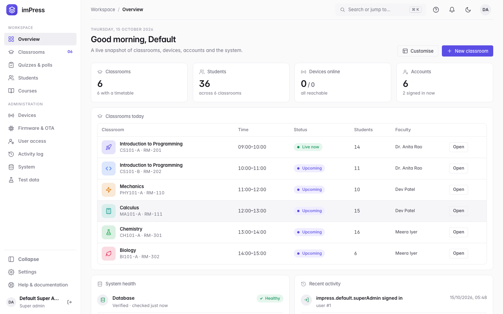

</div>

> [!NOTE]
> **v2.2** (`VERSION` 2.2.0) is built on the `varun/v2.2` line. Every feature is covered by automated tests and builds, but **none of the radio, SPI, TLS and OTA behaviour has been verified on real boards yet**, so releases stay **Beta** while the hardware test issues are open. See [status](#releases-and-status).

## What it is

Every student holds a small ESP32 module with four answer buttons. When a teacher starts a question or a poll in the browser, it appears on every module, and each press is counted live on the teacher's screen. Student modules never join Wi-Fi: they form an **ESP-NOW mesh** and relay each other's messages to a hub in the room. Only one gateway per classroom needs network access, so it works on school networks that limit clients or credentials.

---

## Start here

| I am… | I want to… | Go to |
|---|---|---|
| **Trying it** | run it on my computer in a minute | [Quick start](#quick-start) |
| **A teacher** | run a quiz or a poll | [Teacher guide](docs/user-guide/teacher.md) · [first 30 minutes](docs/user-guide/README.md) |
| **An administrator** | manage accounts, classes, devices, firmware | [Administrator guide](docs/user-guide/administrator.md) |
| **Installing a server** | set it up for a school | [Installing on Windows, macOS, Linux](docs/install/platforms.md) · [Deployment](docs/guides/deployment.md) · [Production checklist](docs/guides/production-hardening.md) |
| **Building the boards** | configure and flash the firmware | [Flashing](docs/install/flashing.md) · [Hardware](docs/reference/hardware.md) |
| **Responsible for privacy or security** | notices, retention, rights requests, incidents | [Privacy and compliance toolkit](docs/compliance/README.md) · [Security model](docs/design/security-model.md) · [Risk register](docs/compliance/risk-register.md) |
| **A developer** | change the code | [Development setup](docs/guides/development-setup.md) · [Contributing](CONTRIBUTING.md) · [Architecture](docs/architecture/overview.md) |
| **Integrating** | call the API | [REST](docs/api/rest-api.md) · [WebSocket](docs/api/websocket-api.md) · [Device API](docs/api/device-api.md) |

## Quick start

You need nothing but a terminal. The launcher installs what is missing (Python 3.12+, the virtual environment, the dependencies), writes `backend/.env` with generated secrets, and starts the server on all network interfaces at port 8000. If that port is occupied, it identifies the listener and asks before stopping it.

```bash
git clone https://github.com/Kush-Kelaiya22/imPress.git
cd imPress
./launcher.sh          # macOS and Linux
launcher.bat           # Windows: double-click it, or run it in cmd
```

The terminal then shows the **imPress logo and version**, the live log, and a prompt for root's commands (the [root screen](docs/guides/console.md)). Open **http://127.0.0.1:8000** on the server itself, or `http://<SERVER_IP>:8000` from a device on the classroom network. Sign in as **`impress.default.superAdmin`**. Its password is **new at every start** and is printed once on that screen (or fix it with `IMPRESS_DEFAULT_SUPERADMIN_PASSWORD`). Run the launcher again any time to start the server.

| To… | Do |
|---|---|
| let classroom gateways reach the server | already enabled on `0.0.0.0:8000`; allow TCP 8000 in your firewall and configure HTTPS before using an untrusted network |
| check whether a busy port can be stopped | the launcher displays the process and waits for confirmation; a forced stop requires a second confirmation |
| try it with realistic data | sign in, open **Test data**, turn on test mode, **Generate**, **Import**: [guide](docs/guides/test-mode.md) |
| start in a special way | launch flags: `--test-mode` (forced, cannot be turned off), `--no-test-mode`, `--no-ota`, `--rehash`, `--bypass-iips`, `--feature NAME=VALUE`: [launch flags](docs/guides/launch-flags.md) |
| run it in the background | no terminal means no screen: the log is plain lines (`--plain` forces it) |
| run it with Docker | [Container guide](docs/deployment/container.md) |

> [!WARNING]
> The server listens on all network interfaces at port 8000. The launcher never stops a listener without confirmation; if it does not exit gracefully, a second confirmation is required before a forced stop. Restrict TCP 8000 with the host firewall and configure HTTPS before exposing the server to an untrusted network. The launcher runs the *standard* policy profile. For real student data, follow the [production checklist](docs/guides/production-hardening.md) and run the *hardened* profile.

### Requirements

| Component | Needs |
|---|---|
| Server | Linux, macOS or Windows; Python 3.12 or newer (the launcher installs it); one process; SQLite is bundled |
| Network | the room's gateway reaches the server over HTTP(S) and WebSocket on 2.4 GHz Wi-Fi |
| Browser | a current Chrome, Edge, Firefox or Safari |
| Per room | one gateway, one hub, one student module per student |
| Firmware builds | ESP-IDF v6.1 or Docker; a C compiler (`cc`) for the host tests |

## Screenshots

<table>
<tr>
<td width="50%"><a href="docs/images/login.png">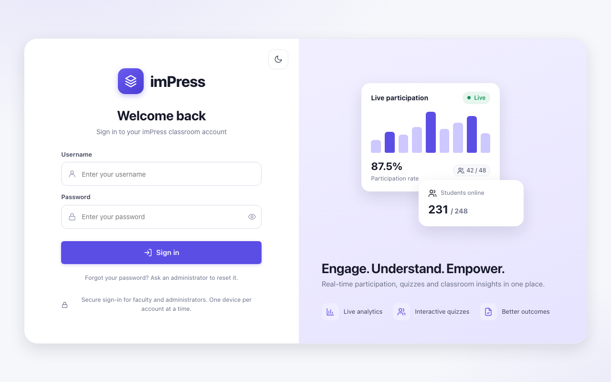</a><br/><sub><b>Sign in</b>: one centred card</sub></td>
<td width="50%"><a href="docs/images/dashboard-customise.png">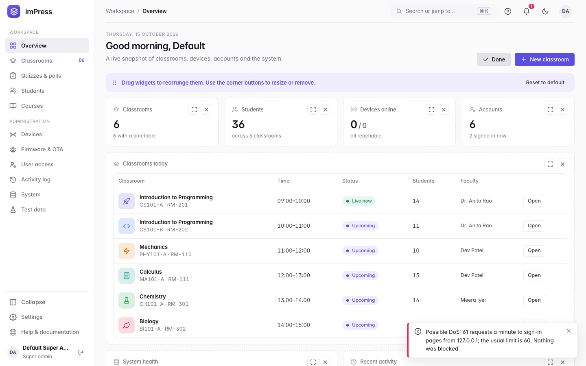</a><br/><sub><b>Dashboard</b>: widgets you add, resize and drag</sub></td>
</tr>
<tr>
<td><a href="docs/images/classrooms.png">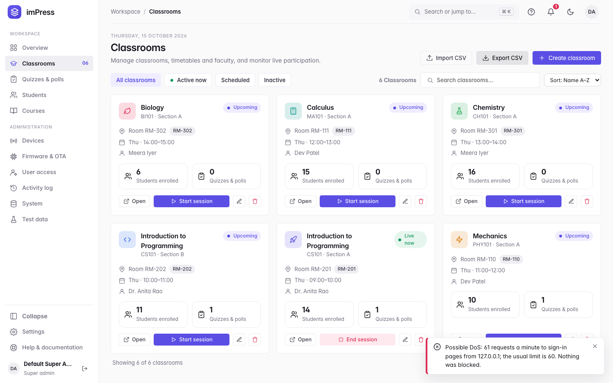</a><br/><sub><b>Classrooms</b>: each with its own icon and colour</sub></td>
<td><a href="docs/images/accounts.png">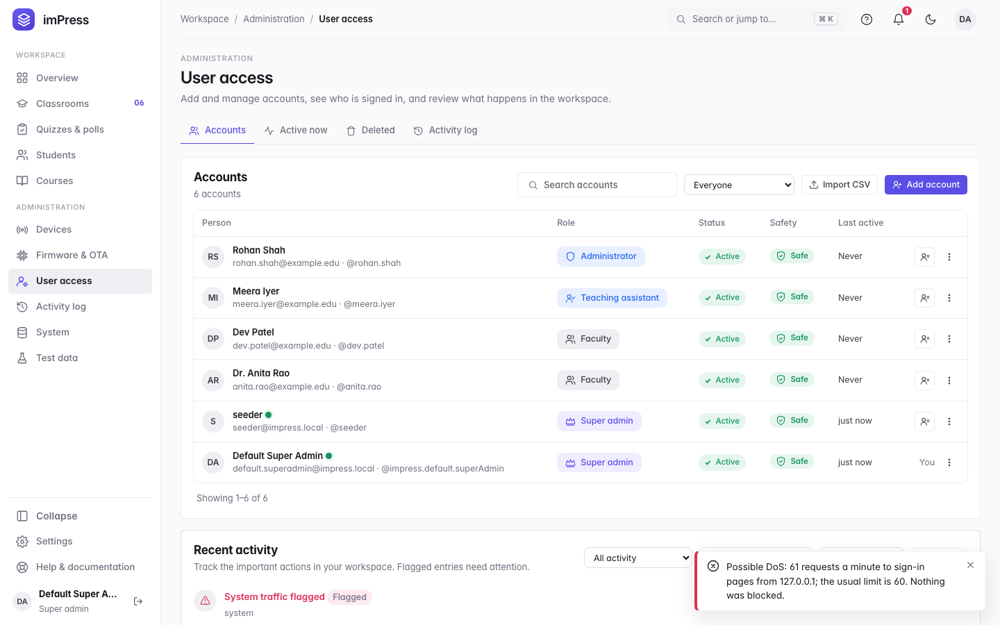</a><br/><sub><b>Accounts</b>: roles, TAs, safety badges, pending setup</sub></td>
</tr>
<tr>
<td><a href="docs/images/search.png">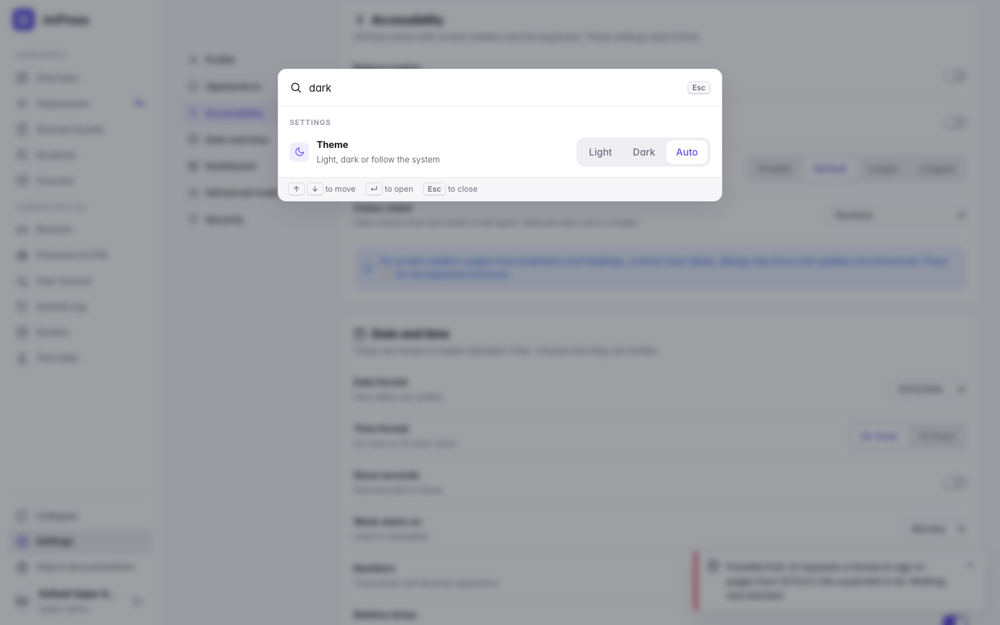</a><br/><sub><b>Search</b> everything; change settings in place</sub></td>
<td><a href="docs/images/settings.png">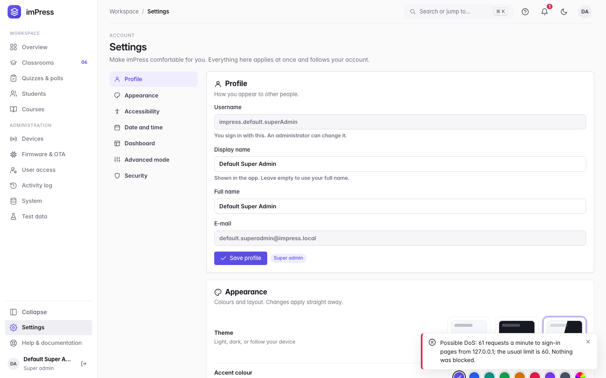</a><br/><sub><b>Settings</b>: appearance, accessibility, dates and times</sub></td>
</tr>
<tr>
<td><a href="docs/images/system-features.png">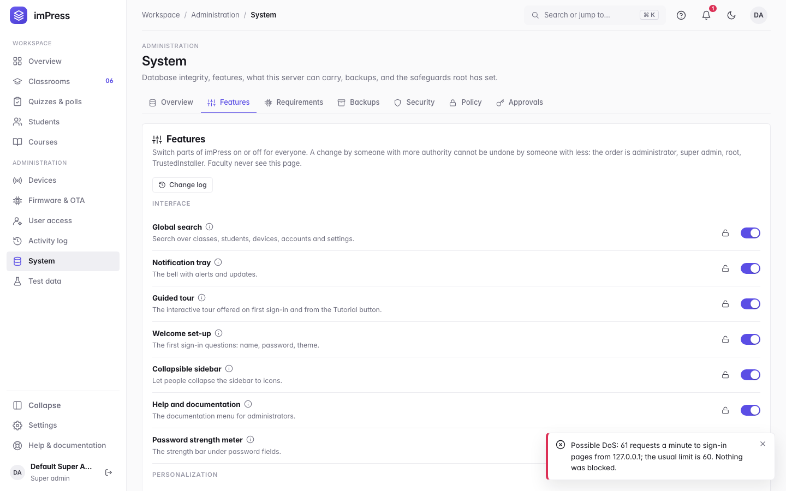</a><br/><sub><b>Features</b>: who switched what, and when</sub></td>
<td><a href="docs/images/system-requirements.png">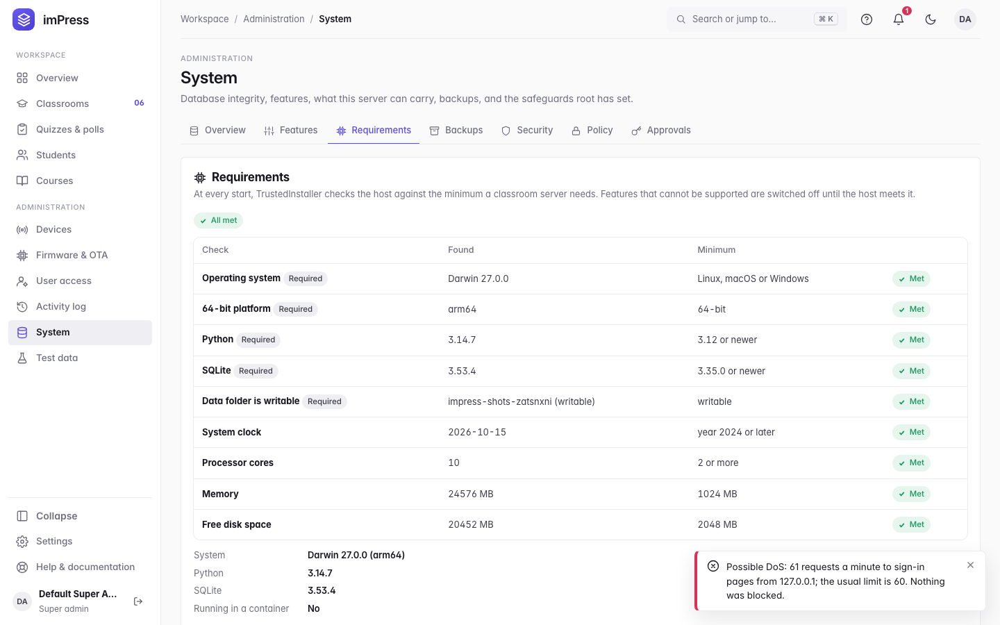</a><br/><sub><b>Requirements</b> TrustedInstaller checked at start-up</sub></td>
</tr>
<tr>
<td><a href="docs/images/activity-history.png">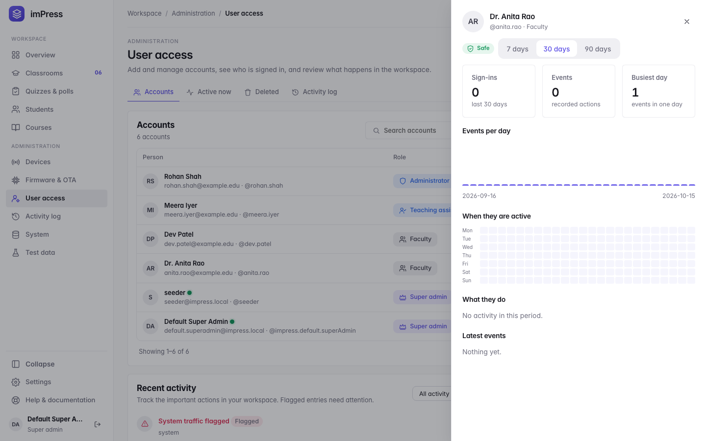</a><br/><sub><b>Activity history</b>: charts per account</sub></td>
<td><a href="docs/images/overview-dark.png">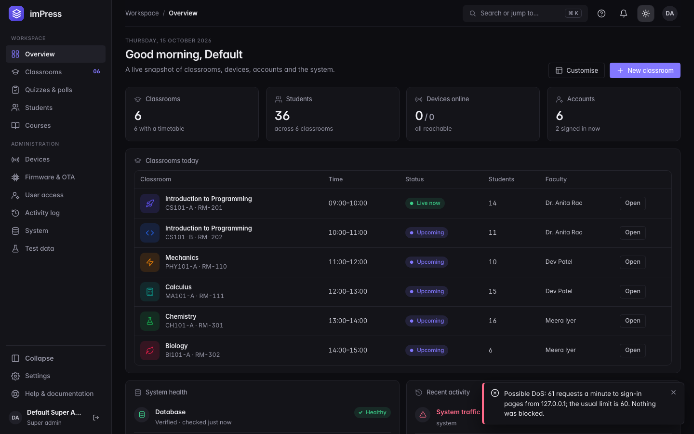</a><br/><sub><b>Dark mode</b>, accent colours, colour-vision modes</sub></td>
</tr>
<tr>
<td><a href="docs/images/update-notice.png">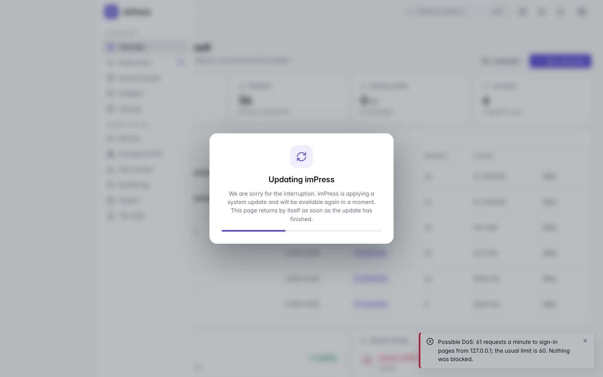</a><br/><sub><b>Notices</b>: updating, or an account disabled</sub></td>
<td align="center"><a href="docs/images/phone.png">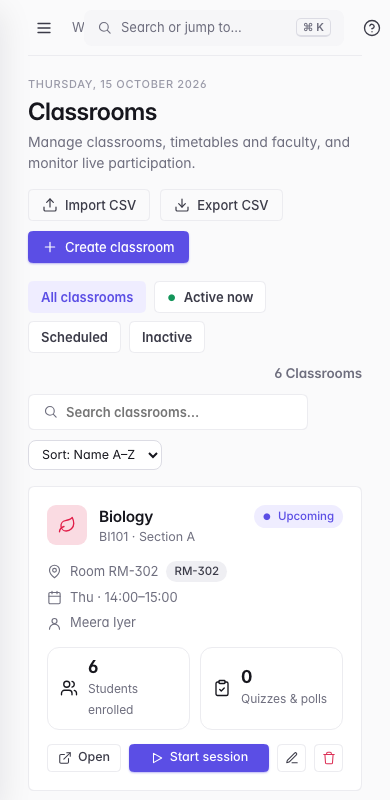</a><br/><sub><b>On a phone</b></sub></td>
</tr>
</table>

<p align="center"><a href="docs/images/root-screen.svg">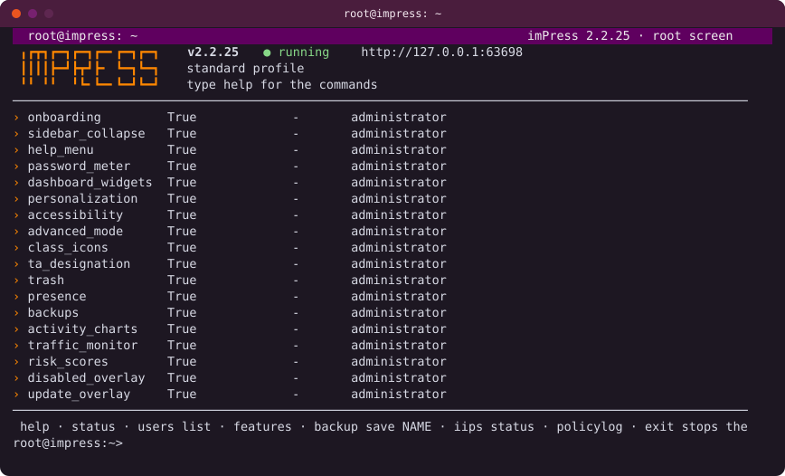</a><br/><sub><b>The root screen</b>: what root sees when imPress starts in a terminal (or <code>docker run -it</code>)</sub></p>

The interface is deliberately minimal: flat surfaces, hairline borders, one typeface (Inter) and one accent colour. It follows Apple's Human Interface Guidelines for layout and Material 3 Expressive for motion; pages update live without reloading. [Design notes](docs/design/ui-design.md).

## Features

| Area | What you get |
|---|---|
| **Live participation** | Quizzes (planned or impromptu, per-question or total timing) and polls (live or planned), with per-option results as they arrive |
| **Mesh networking** | Multi-hop ESP-NOW relaying (TTL 5) with de-duplication at the student, hub and server layers: one press is one answer. Lost answers are re-sent until the hub confirms them |
| **Classrooms** | Courses and sections, timetables with clash warnings, co-faculty, enrolment, attendance, CSV import and export ([guide](docs/guides/csv-imports.md)) |
| **People and access** | `super_admin` › `admin` › `teacher` (and teaching assistants); faculty see **only the classes they manage**; temporary first passwords and a welcome set-up; a password rule with a strength meter; accounts you can disable, enable and delete (restorable for 30 days); who is active now with activity charts; **one device per account**; 5-minute idle limit for everyone (30 minutes for faculty during their class) ([guide](docs/guides/accounts-and-onboarding.md)) |
| **Devices** | Live presence, health states with reasons, diagnostics, and an inventory of every student module a gateway has seen |
| **Firmware and OTA** | A validated, immutable registry; qualification before approval; staged deployments (canary, batches, retries, timeouts); automatic rollback; operator rollback; per-family views |
| **Live web app** | A collapsible sidebar, light and dark themes with an animated change, pages that refresh as data changes without glitches while you type, a guided tour, a notification tray, and notices that blur the page when your account is disabled or an update is running |
| **Search and personalization** | One search over classrooms, students, quizzes, accounts and devices (Ctrl/⌘ K) with settings as live widgets; accent colours, date and time formats, dashboards you arrange, advanced mode for administrators; accessibility: reduced motion, high contrast, text size, colour-vision modes, screen-reader support ([guide](docs/guides/personalization.md)) |
| **Features** | Every small capability is a switch that administrators, super admins, root and TrustedInstaller can set, in that order of authority, with a change log of who and when ([guide](docs/guides/launch-flags.md)) |
| **Backups** | Save, view and restore backups of the database and the system state; reset the system ([guide](docs/guides/backups.md)) |
| **Test data** | Test mode works on a copy of the database: a spreadsheet editor (paste from Google Sheets or Excel, upload CSV), a seeded generator of consistent, natural-looking data, simulated activity; save, export or delete the result |
| **Security and integrity** | A database gateway, sealed rows, automatic repair, dual control, an external audit trail, signed policy, code and exports, a hardened profile: [below](#security-and-integrity) |
| **Root's tools** | A root screen (logo, live log, command line), a root console for accounts and policy, launch flags such as `--test-mode` and `--no-ota` ([guide](docs/guides/console.md)) |
| **Privacy toolkit** | Data inventory, notice template, retention schedule, rights-request runbook, incident response: [below](#privacy-and-compliance) |

## How it works

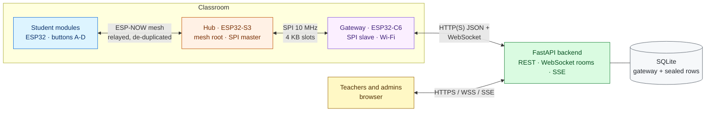

| Component | Where | Does |
|---|---|---|
| Backend and web app | [`backend/`](backend/) | REST API, per-class WebSocket rooms, live events, authentication and permissions, persistence, firmware store, the teacher and admin web app |
| Gateway firmware | [`firmware/class_c6/`](firmware/class_c6/) | Bridges the room to the backend: batched uploads, WebSocket commands, its own OTA client, diagnostics |
| Hub firmware | [`firmware/class_s3/`](firmware/class_s3/) | ESP-NOW mesh root, de-duplication, SPI master, over-the-air updates |
| Student firmware | [`firmware/student/`](firmware/student/) | Buttons and optional OLED, mesh node and relay, enrollment-number identity |
| Shared protocol | [`firmware/protocol/`](firmware/protocol/) | The single implementation of every on-wire format |

<details>
<summary><strong>How one answer travels</strong></summary>

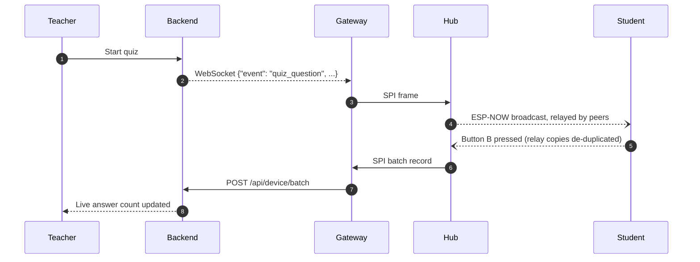

</details>

More: [system overview](docs/architecture/overview.md) · [backend](docs/architecture/backend.md) · [firmware](docs/architecture/firmware.md) · [data flows](docs/architecture/data-flows.md) · [wire protocols](docs/design/protocols.md) · [mesh](docs/design/mesh.md).

## Security and integrity

imPress protects the data in layers, and says plainly what each layer does not do.

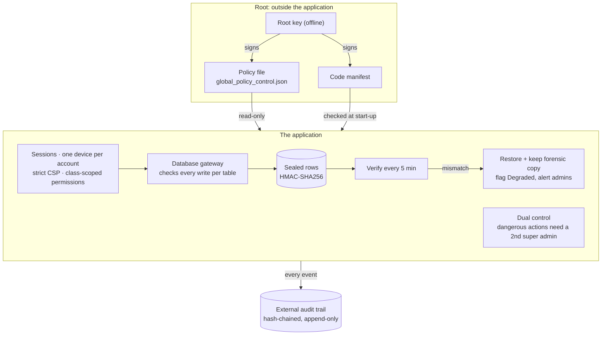

| Layer | What it gives you | What it does not |
|---|---|---|
| **Sessions and passwords** | salted bcrypt over SHA-256, a password rule with a strength meter, temporary first passwords, 5 min idle for everyone (30 for faculty in class), one device per account, strict Content-Security-Policy, HttpOnly cookies | no multi-factor authentication yet ([#211](https://github.com/Kush-Kelaiya22/imPress/issues/211)) |
| **Database gateway** | every write is checked against the acting account's permission for that table; DDL is for the server only | it guards writes made *through* the application |
| **Sealed rows** | a row changed outside imPress (a shell, a hex editor) is found within 5 minutes and repaired from a temporary backup; Degraded is flagged to administrators only | the seal key is derived from `IMPRESS_JWT_SECRET`: protect `.env` like the database |
| **Dual control** | accepting a changed database, or clearing or resetting data, needs a *second* super admin's approval, a password re-entry at each step, a delay, an expiry and a single use | one person holding two super-admin accounts defeats it |
| **External audit trail** | every event is also written to a hash-chained file or webhook that the application cannot rewrite; `audit-verify` checks the chain; it never holds students' personal data | put it on append-only storage, administered by someone else |
| **Global policy control** | the switches belong to **root**: a signed policy file and inline overrides; the web app can show them but not change them; two profiles, *standard* and *hardened*, the second refusing to start insecurely | root on the host is outside what the application can defend |
| **Host verification (TrustedInstaller)** | imPress is locked at start until the operating system, Python, SQLite, data folder, clock, processor, memory and disk are checked against the minimum; features the host cannot carry are switched off and come back when it can; in a container the separate root console is closed ([design](docs/design/trusted-boot.md)) | it trusts what the operating system reports |
| **File integrity (IIPS)** | the program's own files and folder structure are hashed at first start; any change, addition, removal or move disables imPress until root accepts it (`--rehash`); `--bypass-iips` starts anyway with a red warning on every page ([design](docs/design/integrity-protection.md)) | it checks files at start, not a running process |
| **Traffic monitor and account safety** | per-endpoint rate limits per origin and account; a DoS or DDoS suspicion alerts administrators with the origin, pages and account (nothing is blocked); each account has a *Safe* / *Potentially Unsafe* / *Likely Compromised* badge and a 0 to 100 score ([design](docs/design/traffic-monitor.md)) | it informs people; it does not defend against an attack by itself |
| **Session identifier (1PSID)** | a session id is bound to the server run that issued it: a restart ends every session and a copied token is dead | |
| **Signing** | signed policy, signed code manifest, signed exports (verify with `scripts/verify_export.py`), signed firmware | device messages themselves are not authenticated (below) |

**Known limits.** ESP-NOW frames between student modules and the hub are not authenticated, so a nearby device could forge or replay an answer ([proposal](docs/design/mesh-authentication.md), [#187](https://github.com/Kush-Kelaiya22/imPress/issues/187)): run pilots in a controlled room until it ships. Boards do not use secure boot or flash encryption. Hardware checks for TLS, signed OTA and rollback are still open. The [risk register](docs/compliance/risk-register.md) lists every finding of the v2.2 security audit with its status.

Read more: [security model](docs/design/security-model.md) · [data integrity](docs/design/data-integrity.md) · [global policy control](docs/design/gpc.md) · [trusted boot](docs/design/trusted-boot.md) · [integrity protection](docs/design/integrity-protection.md) · [traffic monitor](docs/design/traffic-monitor.md).

## Privacy and compliance

imPress holds students' names, enrollment numbers, attendance and results, and staff accounts. The [toolkit](docs/compliance/README.md) gives the institution what it needs to run that responsibly: a [data inventory](docs/compliance/data-inventory.md), a [privacy notice template](docs/compliance/privacy-notice-template.md), a [retention schedule](docs/compliance/retention-schedule.md), a [rights-request runbook](docs/compliance/dsar-runbook.md) (erasing a student also scrubs the activity log), [incident response](docs/compliance/incident-response.md) with notification checklists, and a [control mapping](docs/compliance/control-mapping.md) to OWASP ASVS, NIST CSF and GDPR Article 32. It is a toolkit, **not legal advice and not a certification**: whether GDPR, India's DPDP Act, CERT-In directions or another law applies to you is for you and your counsel to decide.

## Going to production

The *standard* profile is for trying it. A server with real student data should run the **hardened** profile, which refuses to start until the following are true:

- [ ] real secrets, debug off, HTTPS for staff and for devices, per-device keys
- [ ] a site firmware signing key; one administrator uploads an image and a different one approves it
- [ ] an external audit sink on append-only storage
- [ ] root's key kept off the server; the signed policy and code manifest installed read-only
- [ ] off-host, encrypted backups with a rehearsed restore (`scripts/backup.sh`)

The full order of work, with commands: [production hardening](docs/guides/production-hardening.md). Server setup (systemd, nginx, TLS): [deployment](docs/guides/deployment.md).

## Hardware

| Role | Chip | Minimum (shipped images) | Notes |
|---|---|---|---|
| Gateway | ESP32-C6 | 8 MB flash | Wi-Fi to the backend; updates over the air |
| Hub | ESP32-S3 | 32 MB **octal** flash; PSRAM optional | 8 MB quad-flash modules need the [reduced-flash profile](docs/hardware/CLASSROOM_NODE_REQUIREMENTS.md#reduced-flash-hub-profile-built-not-booted) (built, not yet booted) |
| Student module | ESP32 (classic) | 4 MB flash, four buttons | updated over serial |

Up to 300 student modules per room. Footprints and configurations: [classroom node requirements](docs/hardware/CLASSROOM_NODE_REQUIREMENTS.md), [device compatibility](docs/hardware/DEVICE_COMPATIBILITY.md). Wiring and pins: [hardware reference](docs/reference/hardware.md).

```bash
# Build a firmware image without installing ESP-IDF:
docker run --rm -v "$PWD/firmware":/project -w /project/class_c6 espressif/idf:v6.1 idf.py build
# or with ESP-IDF v6.1 installed:
cd firmware/class_c6 && idf.py menuconfig && idf.py -p <PORT> flash monitor
```

Repeat for `class_s3` and `student`. The first flash of each gateway and hub is over serial; after that they update over the air.

<details>
<summary><strong>Firmware, OTA and rollback in a paragraph each</strong></summary>

**Registry.** Upload the app `.bin`; the backend reads target, chip and version from the image, checks its integrity and refuses anything that isn't a valid imPress image. Images are immutable; approve one before it can be deployed. [Versioning](docs/firmware/FIRMWARE_VERSIONING.md).

**Deployment.** Deploy an approved image to chosen devices, a class, a type or everything compatible: a canary first, then batches, with a concurrency limit, retries, timeouts and a pause on failure. Hubs and gateways update over the air; student modules update over serial. [OTA guide](docs/guides/ota-updates.md) · [architecture](docs/firmware/OTA_ARCHITECTURE.md).

**Rollback.** A new image must pass its health check after the reboot, or the bootloader reverts and the device reports `rolled_back`. An operator can also deploy an older approved image, or follow the [recovery procedure](docs/firmware/RECOVERY_PROCEDURE.md).

</details>

## Testing

```bash
python3 -m venv .venv && . .venv/bin/activate
pip install -r backend/requirements-dev.txt
python run_tests.py                          # every default suite, one consolidated report
python run_tests.py --list                   # what there is
python run_tests.py --with-ui --with-idf     # + browser checks and the ESP-IDF builds
```

| Suite | Scope |
|---|---|
| `backend` | every router and service, migrations, security controls, end-to-end flows through a simulated gateway |
| `host:*`, `firmware-static` | firmware C built on the host with AddressSanitizer and UBSan; structural rules |
| `repo` | CI, documentation consistency, install and backup scripts, the runner itself |
| `ui` | Playwright browser checks: pages, permissions, strict CSP, motion, cross-site scripting |
| `idf:*` | ESP-IDF v6.1 builds of the three firmware projects |

CI runs all of it, plus the launchers on Linux, macOS and Windows, a clean install, container images for both architectures and an emulator boot test, behind one **CI result** check. What each layer proves, and what still needs a bench: [test strategy](docs/testing/TEST_STRATEGY.md) · [hardware validation](docs/testing/HARDWARE_VALIDATION.md).

## Troubleshooting

| Symptom | First check |
|---|---|
| The server won't start: default secrets | run `./launcher.sh` or `scripts/install.sh` (it generates them), or set `IMPRESS_JWT_SECRET` and `IMPRESS_DEVICE_API_KEY` |
| The hardened profile won't start | the error lists every unmet item at once: [production hardening](docs/guides/production-hardening.md) |
| *Already signed in on another device* (409) | one device per account: sign out there, or an administrator uses **End sessions** (User access) |
| A red **Degraded** badge | the database changed outside imPress and was restored; read the log entry and the kept copy, then acknowledge on **System**: [data integrity](docs/design/data-integrity.md) |
| A gateway never shows online | device key, backend address and Wi-Fi in its NVS; `GET /health` from the room's network |
| A deployment paused | the failed device's error on the Firmware page; resume to accept it, or cancel |
| The port is in use | the launcher asks before stopping its owner; if you decline, stop it manually and retry. The server always uses port 8000 |

More: [troubleshooting guide](docs/guides/troubleshooting.md) · [known issues](docs/reference/known-issues.md).

## Documentation

| Area | Pages |
|---|---|
| **Guides for people** | [First 30 minutes](docs/user-guide/README.md) · [Administrator](docs/user-guide/administrator.md) · [Teacher](docs/user-guide/teacher.md) · [Glossary](docs/user-guide/glossary.md) · [FAQ](docs/user-guide/faq.md) |
| **Install and operate** | [Platforms](docs/install/platforms.md) · [Flashing](docs/install/flashing.md) · [Deployment](docs/guides/deployment.md) · [Production hardening](docs/guides/production-hardening.md) · [Configuration](docs/guides/configuration.md) · [CSV imports](docs/guides/csv-imports.md) · [Test mode and test data](docs/guides/test-mode.md) · [Accounts and first sign-in](docs/guides/accounts-and-onboarding.md) · [Personalization and accessibility](docs/guides/personalization.md) · [Backups](docs/guides/backups.md) · [Root console and screen](docs/guides/console.md) · [Launch flags and features](docs/guides/launch-flags.md) · [OTA updates](docs/guides/ota-updates.md) · [Troubleshooting](docs/guides/troubleshooting.md) |
| **Architecture and design** | [System overview](docs/architecture/overview.md) · [Backend](docs/architecture/backend.md) · [Firmware](docs/architecture/firmware.md) · [Data flows](docs/architecture/data-flows.md) · [Protocols](docs/design/protocols.md) · [Mesh](docs/design/mesh.md) · [Mesh authentication (proposal)](docs/design/mesh-authentication.md) · [Authorization](docs/design/authorization.md) · [Scheduling](docs/design/scheduling.md) · [Web app design](docs/design/ui-design.md) · [Decisions](docs/design/decisions.md) |
| **Security and privacy** | [Security model](docs/design/security-model.md) · [Data integrity](docs/design/data-integrity.md) · [Global policy control](docs/design/gpc.md) · [Trusted boot](docs/design/trusted-boot.md) · [Integrity protection](docs/design/integrity-protection.md) · [Traffic monitor](docs/design/traffic-monitor.md) · [Privacy and compliance toolkit](docs/compliance/README.md) · [Risk register](docs/compliance/risk-register.md) |
| **API** | [REST](docs/api/rest-api.md) · [WebSocket](docs/api/websocket-api.md) · [Device and gateway](docs/api/device-api.md) |
| **Hardware and firmware** | [Node requirements](docs/hardware/CLASSROOM_NODE_REQUIREMENTS.md) · [Compatibility](docs/hardware/DEVICE_COMPATIBILITY.md) · [OTA architecture](docs/firmware/OTA_ARCHITECTURE.md) · [Versioning](docs/firmware/FIRMWARE_VERSIONING.md) · [Recovery](docs/firmware/RECOVERY_PROCEDURE.md) · [Wiring](docs/reference/hardware.md) |
| **Reference and engineering** | [Data model](docs/reference/data-model.md) · [Known issues](docs/reference/known-issues.md) · [Placeholders](docs/reference/placeholders.md) · [System audit](docs/engineering/SYSTEM_AUDIT.md) · [Migrations](docs/engineering/DATABASE_MIGRATIONS.md) · [v2.2 plan](docs/engineering/V2.2_PLAN.md) |

The [documentation index](docs/README.md) says when to read each page, and the [wiki](https://github.com/Kush-Kelaiya22/imPress/wiki) covers the same ground as step-by-step guides.

## Repository layout

```text
imPress/
├── backend/                FastAPI application, web app (static/), tests, requirements, .env.example
│   └── app/                gpc.py (policy), dbgateway.py (writes and seals), serve.py and rootscreen.py (launch flags, root screen), console.py (root console), services/ (boot_verify, iips, traffic, features, …), routers/, static/
├── firmware/               protocol/ (shared), class_c6/ (gateway), class_s3/ (hub), student/, contract/, sim/ (simulator)
├── docs/                   architecture, design, API, guides, compliance, install, user guides, images
├── scripts/                install.sh, start.sh, console.sh (root console), gpc.py (policy tool), backup.sh, verify_export.py, smoke_test.py, screenshots.py, …
├── tests/ ui_tests/        repository checks; Playwright browser checks
├── launcher.sh/.bat        one-step setup and start for macOS, Linux and Windows
├── frontend/               optional React reference dashboard (not shipped)
├── run_tests.py            unified test runner
└── .github/workflows/      CI and releases
```

## Releases and status

Every push to an integration line that passes CI becomes its next patch release, named after the line's owner (for example `varun/v2.2.21`), with the firmware images, the documentation and a container image (`ghcr.io/kush-kelaiya22/impress-backend`). What changed is in [`CHANGELOG.md`](CHANGELOG.md); the per-issue history of earlier lines is in [v2.1](docs/reference/changelog-v2.1.md) and [v2](docs/reference/changelog-v2.md). A release is **Beta** while its hardware test issues are open and **Stable** when they are closed ([how](docs/guides/releases.md)). The version is in [`VERSION`](VERSION) and reported by `GET /health`.

| Line | Branch | Summary |
|---|---|---|
| **2.2** | `varun/v2.2` | New web app (live pages, search, personalization, accessibility, dashboards you arrange, a guided tour), accounts with temporary passwords, TAs and a trash, a root screen and console, launch flags and features, TrustedInstaller host checks, file integrity protection, a traffic monitor, one device per account, a database gateway with sealed rows and self-repair, dual control, signed policy and an external audit trail, test mode and test data, backups, one-step launchers, the privacy toolkit |
| 2.1 | `varun/v2.1` | CSV imports, firmware registry and staged OTA with rollback, gateway OTA client, diagnostics, module inventory, migrations, timed quizzes, container image |
| 2.0 | `v2` | the October 2026 audit fixes, test suite, CI and documentation |

**Hardware status.** Nothing in 2.1 or 2.2 has been verified on real boards yet. The bench checks and their status: [hardware validation](docs/testing/HARDWARE_VALIDATION.md); the plan is tracked in [#94](https://github.com/Kush-Kelaiya22/imPress/issues/94) and the issues labelled `needs:hardware`.

> [!WARNING]
> Databases containing user and session data were committed to git history before `v2`. Purge them and rotate the affected passwords before publishing the repository ([deployment checklist](docs/guides/deployment.md#4-go-live-checklist)).

## Contributing

Branch from the integration line (`feat/…`, `fix/…`, `docs/…`, one branch per issue), change code and tests together, run `python run_tests.py`, and open a pull request: it merges when the **CI result** check is green. Security reports: do **not** put exploit details in a public issue ([CONTRIBUTING §16](CONTRIBUTING.md)). Rules and workflow: [CONTRIBUTING.md](CONTRIBUTING.md) · [Version policy and history](CONTRIBUTING.md#14-version-policy-and-change-history) · [Code of Conduct](CODE_OF_CONDUCT.md) · [development setup](docs/guides/development-setup.md).

## License

The repository has no license file, so no license has been granted: all rights are reserved by the authors. Adding one (for example MIT or Apache-2.0) is the owners' decision.
