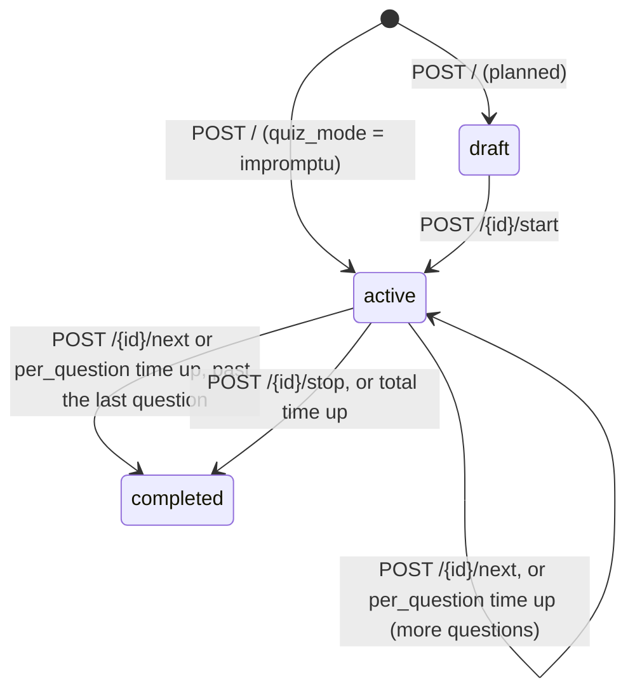

# REST API

Base URL: `http(s)://<host>:<port>`. All bodies are JSON unless marked *multipart*. The interactive OpenAPI UI is at **`/docs`** (Swagger) and **`/redoc`** on a running backend; it is generated from the same code this page describes.

> Device/gateway endpoints (`/api/device/*`, and `/vote` / `/answer`) are in the [Device API](device-api.md). Live events are in the [WebSocket API](websocket-api.md).

## Conventions

| Topic | Rule |
|---|---|
| Auth header | `Authorization: Bearer <access_token>` (an opaque `impress_…` token from `/api/auth/login`) |
| Guards | **public** · **session** (any logged-in user) · **teacher+** (teacher, admin, super_admin) · **class access** (teacher+ *and* primary teacher / co-faculty of that class, or admin) · **admin** (admin, super_admin) · **super_admin**. Each guard is a named permission in [`policy.py`](../../backend/app/policy.py); the exact permission per role is in the [authorization model](../design/authorization.md#permission-matrix) (#122) |
| Class access | One rule everywhere (classes, quizzes, polls, results): the **primary teacher**, any **co-faculty** member, or an **admin**. Anyone else gets 403. Primary-only actions: deleting the class. |
| Timestamps | ISO-8601, naive **IST** (e.g. `2026-10-07T21:35:16.319308`) unless the field says otherwise |
| Validation errors | `422` with FastAPI's `{"detail":[{"loc":[…],"msg":…,"type":…}]}` |
| Other errors | `{"detail": "<message>"}` with the status below. Account rules return `{"detail": {"code": "<CODE>", "message": "<text>"}}` (codes below) |

### Error status codes

| Status | Meaning in imPress |
|---|---|
| 400 | Business rule violated (duplicate code/username, wrong state such as "Quiz is already active") |
| 401 | Missing/invalid token, or an expired session: `detail: "SESSION_EXPIRED"` + header `X-Session-Code: idle|hard` |
| 403 | Authenticated but not allowed (role, class ownership, disabled account at login, wrong device key). `SELF_LOCKOUT`: deactivating, deleting or changing the role of your own account |
| 404 | Entity not found |
| 409 | Conflict: quiz without a current question; a section that already exists for the course; a lost race on an enrollment. `LAST_SUPER_ADMIN`: the change would leave no active super admin |
| 422 | Request body/params failed validation (including a new password that is shorter than 10 characters, common, or equal to the username, #153) |
| 429 | `TOO_MANY_ATTEMPTS`: too many failed logins (or wrong current passwords); wait `Retry-After` seconds (#153) |

---

## Auth: `/api/auth`

### `POST /api/auth/login`: public
```json
// request
{"username": "admin", "password": "…"}
// 200
{"access_token": "impress_Q3h…", "token_type": "bearer",
 "expires_at": "2026-10-08T03:35:16", "created_at": "2026-10-07T21:35:16",
 "idle_timeout_s": 300, "hard_timeout_s": 21600, "server_time": "2026-10-07T21:35:16"}
```
Errors: `401` wrong username/password · `403` account disabled · `409 ALREADY_SIGNED_IN` the account is signed in on another device (v2.2, below).

**One device per account (v2.2).** While the account has a live session from another device (a different client address, or a different browser or operating system), the sign-in is refused with `409 {"code": "ALREADY_SIGNED_IN", "message"}`, written to the activity log as a flagged `auth.second_sign_in_blocked` entry, and administrators get a toast. Signing in again from the **same** device is allowed and creates another session. The other device must sign out, or its session must expire, or an administrator ends it (`POST /api/admin/users/{id}/end-sessions`). `IMPRESS_SINGLE_SESSION=false` turns the rule off.

**Two-step verification (v2.2, super admins).** `GET /api/auth/mfa` (state), `POST /api/auth/mfa/setup {password}` (returns the secret and an `otpauth://` link, once), `POST /api/auth/mfa/enable {code}` (returns ten single-use recovery codes, once), `POST /api/auth/mfa/disable {password, code}` and `POST /api/auth/mfa/recovery-codes {password, code}`. Every dual-control step, and a backup restore, then takes `code` next to `password` (an authenticator code or a recovery code): `403 MFA_CODE_REQUIRED`, `403 STEP_UP_FAILED` (wrong, or a code already used), `403 MFA_ENROLMENT_REQUIRED` (policy `dual_control.mfa_required` and not enrolled), `403 MFA_REQUIRED_BY_POLICY` (turning it off). Wrong codes count with wrong passwords towards `429 STEP_UP_LOCKED`.

**Policy and errors (v2.2).** `GET /api/admin/system/policy` (every flag: value, source, who set it and when, who enforces it since when, who may change it), `GET /api/admin/system/policy/history?flag=&limit=` (the hash-chained change history and the restrictions). A **super admin** may change the operational flags only: `PUT /api/admin/system/policy/{name}` with `{value, note, password, code}` and `DELETE /api/admin/system/policy/{name}?password=&code=`; every other flag is root's, in the console (`403 POLICY_FORBIDDEN`). `GET /api/system/errors` returns the error catalogue. Every error response carries `error: {code, status, title, message, reference?}` next to the unchanged `detail`, and the `X-Impress-Error` header ([error reference](../reference/errors.md)).

**Idle limit (v2.2).** `idle_timeout_s` is 900 (15 minutes, `IMPRESS_SESSION_IDLE_MINUTES`). For a teacher or administrator while one of their classes is in session (activated, or inside a timetable slot, as primary teacher or co-faculty) it is 3600 (60 minutes, `IMPRESS_SESSION_CLASS_IDLE_MINUTES`). The session endpoints report the limit that applies now. Requests with `X-Impress-Background: 1` (the web app's live refresh) do not count as activity.

### `GET /api/auth/me`: session
Returns `UserResponse`: `{id, username, email, full_name, role, is_active, created_at}`.

### `PUT /api/auth/me`: session
`{"full_name": "Dr. Rao"}`. The name is trimmed; blank after trimming → `400`; empty string → `422`.

### `POST /api/auth/change-password`: session
`{"current_password": "…", "new_password": "≥6 chars"}`. A wrong current password → `400`.

### `POST /api/auth/logout`: session
Revokes the current session: `{"status":"ok"}`.

### `GET /api/auth/session`: bearer token, no activity refresh
`{user_id, username, role, created_at, last_activity_at, expires_at, idle_timeout_s, hard_timeout_s, server_time, idle_remaining_s, hard_remaining_s}`

### `GET /api/auth/session-status`: bearer token, no activity refresh
`{idle_seconds_remaining, hard_seconds_remaining, warning_active, last_activity_at, expires_at, server_time}`. `warning_active` is true within `SESSION_WARNING_MINUTES` (5) of the hard limit. An expired or invalid token → `401 SESSION_EXPIRED` with `X-Session-Code`.

### `POST /api/auth/activity`: session
An explicit "user is active" ping. Refreshes the idle timer: `{status, last_activity_at, hard_remaining_s, server_time}`. It can't revive an already-expired session (401).

---

## Timetable changes and rooms (#126)

| Method & path | Guard | Body / params | Notes |
|---|---|---|---|
| `GET /api/classes/{id}/exceptions` | class access | – | cancelled, moved and extra occurrences of the class, by date |
| `POST /api/classes/{id}/exceptions` | class access | `{kind: cancelled\|moved\|extra, date, slot_start?, new_date?, new_start?, new_end?, classroom_code?, note?}` | `moved` needs `slot_start`, `new_start`, `new_end`; `extra` needs `new_start`, `new_end`; returns `warnings` when the room is booked then; saved with `source: local` |
| `DELETE /api/classes/{id}/exceptions/{exception_id}` | class access | – | `204`; an AURIS-sourced change → `409 SOURCE_MANAGED` |
| `GET /api/admin/rooms/{classroom_code}/occupancy` | admin | `?start=&end=` (ISO, IST, ≤ 31 days) | `{known, busy: [{start, end, class_id, why}]}`; `known: false` = authoritative timetable stale |

See [scheduling and room occupancy](../design/scheduling.md).

## Users (admin): `/api/admin/users`

| Method & path | Guard | Body / params | Notes |
|---|---|---|---|
| `POST /api/admin/users` | admin | `{username (3-64), email, password (≥6), full_name, role}` | `role ∈ teacher|admin|super_admin`; granting `admin`/`super_admin` needs **super_admin**; duplicate username/email → 400 |
| `GET /api/admin/users` | admin | `?role=` | list of `UserResponse`; each has `allowed_actions`: the subset of `edit, deactivate, reactivate, change_role, reset_password, delete` the caller may perform on that account, computed by the same rule the routes enforce (#119) |
| `PATCH /api/admin/users/{id}` | admin | `{full_name?, email?}` | profile only; `is_active` or `role` in the body → 422 `USE_LIFECYCLE_ENDPOINT`; duplicate email → 400; super-admin targets need super_admin (403 `FORBIDDEN_TARGET`). `PUT` is accepted as an alias for older clients |
| `POST /api/admin/users/{id}/deactivate` | admin | – | reversible; signs the user out everywhere (sessions revoked, WebSockets closed). Yourself → 403 `SELF_LOCKOUT`; the last active super admin → 409 `LAST_SUPER_ADMIN`; super admin by an admin → 403 `FORBIDDEN_TARGET`. Returns the user |
| `POST /api/admin/users/{id}/reactivate` | admin | – | allows logging in again; earlier sessions stay revoked. Returns the user |
| `POST /api/admin/users/{id}/role` | **super_admin** | `{role}` | `role ∈ teacher|admin|super_admin`; signs the user out; yourself → 403 `SELF_LOCKOUT`; an admin caller → 403 `FORBIDDEN_ROLE`; last active super admin → 409; unknown role → 422 |
| `POST /api/admin/users/{id}/end-sessions` | admin | – | signs the user out everywhere (e.g. to free an account held by another device, v2.2) |
| `POST /api/admin/users/{id}/reset-password` | admin | `{new_password (≥6)}` | signs the user out; a super admin's by an admin → 403 |
| `DELETE /api/admin/users/{id}` | admin | – | **permanent** delete → `204`; primary teacher of a class → 409 `USER_OWNS_CLASSES`; yourself → 403 `SELF_LOCKOUT`; the last active super admin → 409. Retention rules: [security model → data handling](../design/security-model.md#data-handling). To keep the account, use `/deactivate` |
| `POST /api/admin/users/import` | admin | *multipart* `file` (CSV) | columns `username,email,password,full_name,role` (all required); per-row errors returned; `admin` rows need super_admin |

CSV import response (used by both user and student imports):
```json
{"inserted": 1, "total_rows": 4,
 "skipped": [{"row": 3, "roll_number": "bob", "error": "password must be at least 6 characters"}]}
```

---

## Courses: `/api/courses`

| Method & path | Guard | Notes |
|---|---|---|
| `POST /api/courses/` | admin | `{code (1-16, unique), name, description, credits, department, exam_date?, exam_start_time?, exam_end_time?}`; duplicate code → 400 |
| `GET /api/courses/` | teacher+ | list `CourseResponse` |
| `GET /api/courses/{id}` | teacher+ | 404 if missing |
| `PUT /api/courses/{id}` | admin | partial update; taking another course's code → 400 |
| `DELETE /api/courses/{id}` | admin | |

---

## Classes

### Admin routes: `/api/admin/classes`

| Method & path | Guard | Notes |
|---|---|---|
| `POST /api/admin/classes` | admin | `ClassCreate` (below). The primary teacher = `teacher_ids[0]` or `teacher_id` or the caller. Returns `ClassResponse` with schedule **warnings**. Created **inactive**. **409** if `(course_id, course_section)` is already taken (also on `PUT`). |
| `GET /api/admin/classes` | admin | all classes |
| `PUT /api/admin/classes/{id}` | admin | `ClassUpdate` (partial) |
| `DELETE /api/admin/classes/{id}` | admin | |
| `POST /api/admin/classes/{id}/assign-teacher` | admin | `{teacher_id}` |
| `PUT /api/admin/classes/{id}/faculty` | admin | `{teacher_ids: [...]}`; the first becomes primary |
| `POST /api/admin/classes/{id}/import-students` | admin | *multipart* CSV (see students) |
| `GET /api/admin/classes/{id}/devices` | admin | gateways/hubs for a class |

`ClassCreate`:
```json
{"name": "Physics", "code": "PHY101", "subject": "", "course_id": null, "course_section": "A",
 "term": "Monsoon", "year": 2026, "start_date": "2026-07-15", "end_date": "2026-11-15",
 "exam_start_date": "2026-11-20", "exam_end_date": "2026-11-28",
 "meeting_schedule": [{"day": "Mon", "start": "09:00", "end": "10:00"}],
 "location": "RM-1", "capacity": 60, "teacher_id": 2, "teacher_ids": [2, 5], "classroom_code": "RM-201"}
```
- `term ∈ {"", Monsoon, Winter, Summer}`; `code` unique (1-32); `classroom_code` unique.
- `warnings`: `[{"type":"teacher"|"room","message","class_id","class_name","day","start","end"}]`. A clash is reported only if the windows overlap: same term+year, else overlapping date ranges, else unknown → flagged. Back-to-back slots don't clash; overnight slots are clamped to 23:59.

### Importing and exporting courses and sections (#32)

| Method & path | Guard | Notes |
|---|---|---|
| `GET /api/admin/classes/import-template.csv` | public | example file |
| `POST /api/admin/classes/import?mode=create\|update&dry_run=true\|false` | admin | *multipart* `file`; `dry_run` defaults to **true** (plan only). With `dry_run=false`: **all-or-nothing**. Any invalid row returns 422 `{"message", "report"}` and nothing is stored. |
| `GET /api/admin/classes/export.csv` | admin | every course section in the import layout; `X-Omitted-Classes` counts classrooms without a course (not exportable: `course_code` is required). Cells starting with `= + - @` are prefixed with `'` (formula injection). |

One row per **section** (`ClassSession`). Courses are created when the code is new and matched by code otherwise.

| Column | Required | Notes |
|---|---|---|
| `course_code` | yes | ≤ 16, upper-cased |
| `course_name` | yes | ≤ 128; must equal the existing course's name (a rename is a conflict, never silent) |
| `section` | yes | ≤ 16; unique per course |
| `class_code` | yes | ≤ 32; the class join code, unique |
| `teacher_username` | yes | an active **teacher**; becomes primary teacher and faculty |
| `class_name` | no | default `"<course_code> <section>"` |
| `classroom_code` | no | physical room label, unique |
| `term`, `year`, `capacity`, `location` | no | `Monsoon`/`Winter`/`Summer`; 2000–2100; 0–5000 |

The layout from the v2.1 brief is also accepted: `classroom_code, classroom_name, section_code, section_name` (= course code, course name, section, class name). The physical room is then given as `room`.

**Row statuses**

| Status | Meaning | Mode |
|---|---|---|
| `create` | a new section (and, if needed, its course) | both |
| `duplicate` | the class already exists; skipped | create |
| `update` | the class exists and `changes` lists the fields that will change (empty cells change nothing) | update |
| `unchanged` | the class exists and already matches | update |
| `invalid` | `errors` explain why | both |

Conflicts reported as errors:
- a course code with a different name;
- a section that exists under another class code;
- a class code used by another course or section;
- a room assigned to another class;
- duplicates within the file;
- an unknown teacher, or invalid term, year or capacity.

### Teacher routes: `/api/classes`

| Method & path | Guard | Notes |
|---|---|---|
| `GET /api/classes/` | teacher+ | teacher: own and co-taught; admin: all |
| `POST /api/classes/` | teacher+ | `ClassCreate`; default teacher = the caller |
| `GET /api/classes/{id}` | teacher+ | 403 if not your class |
| `GET /api/classes/{id}/presence` | teacher+ | live device snapshot ([device API](device-api.md#presence-snapshot)) |
| `POST /api/classes/{id}/activate` · `POST /api/classes/{id}/deactivate` | teacher+ | toggles `is_active` (gateways auto-link only to active classes) |
| `POST /api/classes/join` | teacher+ | `{code}`; the caller becomes **co-faculty** (idempotent) and the primary teacher is never replaced (#19); unknown → 404, inactive → 400 |
| `DELETE /api/classes/{id}` | teacher+ | primary teacher or admin; deletes the class with its quizzes, polls, answers, votes, attendance and enrollments (same as the admin delete) |
| `GET /api/devices/live` · `/api/devices/tree` | teacher+ | device presence across the caller's classes |

`ClassResponse` adds `teacher_name, is_active, course_code, course_name, exam_date, exam_start_time, exam_end_time, reading_week_start, teacher_ids, faculty_names, student_count, quiz_count, poll_count, warnings`.

---

## Students: `/api/students` and enrollment

| Method & path | Guard | Notes |
|---|---|---|
| `POST /api/students/` | teacher+ | `{roll_number, student_name, email, phone, program, enrollment_year, graduation_year, device_mac}`; `roll_number` = exactly 10 alphanumerics, stored **upper-case**; duplicate → 400 |
| `POST /api/students/bulk` | teacher+ | `{students: [StudentCreate…], class_session_id?}`; optionally enrolls into the class |
| `GET /api/students/` | teacher+ | `?search=` matches roll number or name (case-insensitive substring). Any teacher can find a student to enrol them, but `email`, `phone` and `device_mac` come back **empty** for students outside the caller's scope (below) |
| `GET /api/students/{id}` | teacher+ | the same redaction |
| `PUT /api/students/{id}` | teacher+, **in scope** | partial update (`StudentUpdate`); outside the caller's scope `403 STUDENT_OUT_OF_SCOPE` |
| `DELETE /api/students/{id}` | teacher+, **in scope** | **soft** delete (`is_active=false`); `403 STUDENT_OUT_OF_SCOPE` outside scope |
| `DELETE /api/students/{id}/hard-delete` | admin only (403 for teachers) | permanently removes the student, their enrollments and attendance rows; their quiz answers and poll votes are kept **anonymised** so results keep their totals |
| `GET /api/students/{id}/classes` | teacher+ | `[{enrollment_id, class_id, course_code, course_name, subject, course_section, term, year, meeting_schedule, location, teacher_name, is_active}]` |
| `POST /api/students/import` | teacher+ | *multipart* CSV, below |
| `POST /api/students/classes/{id}/import-students` | teacher+ | same CSV, plus enroll into the class |
| `POST /api/admin/students` · `POST /api/admin/students/bulk` | teacher+ | admin-path equivalents |
| `POST /api/admin/classes/{id}/enroll` | teacher+ | `{student_id}` |
| `POST /api/admin/classes/{id}/enroll-bulk` | teacher+ | `{student_ids: [...]}` |
| `DELETE /api/admin/classes/{id}/unenroll/{student_id}` | teacher+ | |
| `GET /api/admin/students/class/{id}` | teacher+ | roster |
| `GET /api/admin/students/summary` | students.read | one row per visible student for the Students page: `[{id, classes, module_linked, attendance_pct, participation_pct}]` (percentages over the classes and quizzes of that student's classes; `null` when there is nothing to count) |
| `GET /api/admin/students/{id}/participation` | teacher+ | `{student, quizzes_answered, total_quiz_answers, polls_voted, total_poll_votes, attendance_count, total_classes, quiz_details, poll_details}` |

**Student CSV:** exactly these 7 columns, all required:
`roll_number, student_name, email, phone, program, enrollment_year, graduation_year`.

Per-row rules:
- `roll_number` is 10 alphanumerics, unique in the file and in the DB;
- name and program ≤ 128;
- valid email; phone of 7–15 characters (digits, spaces, `+ - ( )`);
- both years in 2000–2099, with graduation ≥ enrollment.

Valid rows are inserted and invalid rows are returned in `skipped`. Missing or extra columns → 400; a non-`.csv` file → 400.

---

## Quizzes: `/api/quizzes`



**Timing (`timing_mode`, #73).** `manual`: only the teacher advances. `per_question`: the server moves to the next question `question_time_limit` seconds after the current one went live (and completes the quiz after the last). `total`: the server completes the quiz `total_time_limit` seconds after it started, whatever question it is on. A limit of `0` means no limit. The scheduler checks every second and keeps its state in the database, so it resumes after a restart. In every mode the teacher can still call `next` or `stop` early; `next` restarts the per-question timer. Answers that arrive more than 2 s (mesh latency allowance) after the deadline are refused: `409` on the HTTP route, skipped in a device batch.

| Method & path | Guard | Notes |
|---|---|---|
| `POST /api/quizzes/` | class access | `{class_session_id, title, questions: [{question_text, options (2-4), correct_option}], quiz_mode: planned|impromptu, timing_mode: per_question|total|manual, question_time_limit, total_time_limit}`; ≥ 1 question; `correct_option` must be `< len(options)` (422, #22). At most **4 options** (student modules have four buttons, #49). The response has `warnings`: text longer than a module can show (question 139, option 14 bytes of UTF-8) is accepted but truncated on the device. |
| `GET /api/quizzes/class/{class_id}` | class access | newest first |
| `GET /api/quizzes/overview` | participation.read | quizzes and polls of every class the caller can see, newest first, with `class_name`, `class_code` and the number of `answers` / `votes` (the Quizzes & polls page) |
| `GET /api/quizzes/{id}` | class access (#20) | `QuizResponse {id, class_session_id, title, status, quiz_mode, timing_mode, question_time_limit, total_time_limit, current_question, is_live, question_count, created_at, started_at}` |
| `POST /api/quizzes/{id}/start` | class access | draft only: already active → 400, completed → 409 (its answers are kept; create a new quiz, #76); broadcasts `quiz_question` (q 0) |
| `POST /api/quizzes/{id}/next` | class access | any timing mode; not active → 400; broadcasts the next `quiz_question`, or completes. If the timer advanced the same question a moment earlier, returns the current state without advancing again |
| `POST /api/quizzes/{id}/stop` | class access | active → completed, broadcasts `quiz_end`; draft → 409; already completed → returns it unchanged, no broadcast (#76) |
| `GET /api/quizzes/{id}/results` | class access (#20) | below |

```json
{"quiz_id": 1, "title": "Q", "status": "active", "quiz_mode": "impromptu", "timing_mode": "manual",
 "results": [{"question_num": 0, "question_text": "2+2?", "options": ["3","4","5"], "correct_option": 1,
              "total_answers": 3, "option_counts": [0, 2, 1]}]}
```

### Importing questions from CSV (#31)

| Method & path | Guard | Notes |
|---|---|---|
| `GET /api/quizzes/questions/template.csv` | public | example file (`text/csv`, attachment) |
| `POST /api/quizzes/questions/parse` | teacher+ | *multipart* `file`. Validates and returns a `QuestionImportReport`; **stores nothing**. Used by the create-quiz page, which loads the valid rows into the form for review. |
| `POST /api/quizzes/{id}/questions/import?dry_run=true\|false` | class access | *multipart* `file`. Draft quizzes only (409 otherwise). `dry_run` defaults to **true**. With `dry_run=false`: **all-or-nothing**. Any invalid row returns 422 `{"message", "report"}` and nothing is stored; duplicates are skipped; questions are appended after the existing ones. |

**File format.** UTF-8 (a BOM from Excel is fine), comma-separated, the first row is the header.

- **Size limits:** at most **1 MB** (413) and **500 rows** (422).
- **Column names** are case-insensitive and may come in any order. Unknown columns are rejected, so a column like `marks` is never silently dropped.

| Column | Required | Accepts | Aliases |
|---|---|---|---|
| `question_text` | yes | 1–1000 characters; may contain commas and line breaks inside quotes | `question`, `text` |
| `option_a`, `option_b` | yes | 1–200 characters | `a`, `b`, `option_1`, `option_2` |
| `option_c`, `option_d` | no | as above; no gaps (D needs C) | `c`, `d`, `option_3`, `option_4` |
| `correct_option` | yes | `A`–`D` or `1`–`4`, pointing at a filled option | `correct`, `correct_answer`, `answer` |

**Report** (`QuestionImportReport`):

```json
{"total": 3, "valid": 2, "invalid": 1, "duplicate": 0, "imported": 0, "skipped": 3, "committed": false,
 "rows": [{"line": 2, "status": "valid", "question_text": "What is 2 + 2?", "options": ["3","4","5","6"],
           "correct_option": 1, "errors": [], "warnings": [], "duplicate_of": null},
          {"line": 4, "status": "invalid", "question_text": "Boiling point?", "options": ["90","100"],
           "correct_option": null, "errors": ["correct_option 'E' must be a letter A–D or a number 1–4"],
           "warnings": [], "duplicate_of": null}]}
```

- **Statuses:**
  - `valid`
  - `invalid` (with `errors`)
  - `duplicate` (with `duplicate_of`: `"line N"` or `"already in this quiz"`). Duplicate detection ignores case and extra spaces.
- **`warnings`:** text a student module will truncate (#49).
- **Re-sending a file** (a retry or a double click) imports nothing twice: its rows are then `already in this quiz`.
- **Concurrency:** two imports into one quiz at the same time can't interleave (unique `(quiz_id, order_num)`); the slower one gets 409.
- **Database error:** 503, nothing stored.

## Polls: `/api/polls`

| Method & path | Guard | Notes |
|---|---|---|
| `POST /api/polls/` | class access | `{class_session_id, title (1-256), options (2-4), poll_mode: live|planned}`; `live` → active immediately + `poll_start` broadcast. `warnings` as for quizzes (poll title 63 bytes, option 14). |
| `GET /api/polls/class/{class_id}` | class access | |
| `GET /api/polls/{id}` | class access (#20) | `PollResponse {id, class_session_id, title, options, poll_mode, status, is_live, total_votes, created_at}` |
| `POST /api/polls/{id}/start` | class access | draft → active; already active → 400, closed → 409 (its votes are kept, #76); broadcasts `poll_start` |
| `POST /api/polls/{id}/end` | class access | active → closed, broadcasts `poll_end` with `option_counts`; draft → 409; already closed → returns it unchanged, no broadcast (#76) |
| `GET /api/polls/{id}/results` | class access (#20) | `{poll_id, title, options, poll_mode, status, total_votes, option_counts}` |

---

## Modules and firmware (admin): `/api/admin`

| Method & path | Guard | Notes |
|---|---|---|
| `GET /api/admin/modules` · `GET /api/admin/modules/{id}` | admin | `DeviceResponse` (identity, presence, telemetry, OTA state, linked class, and since #39 `health`, `health_reasons` and the latest diagnostics; see [health states](device-api.md#health-states)) |
| `POST /api/admin/modules/{id}/access` | admin | `{is_active}` enable/disable a module |
| `POST /api/admin/modules/{id}/verify` | admin | stamps `verified_at` |
| `POST /api/admin/modules/{id}/reset-key` | admin | forgets the device's own key (#66): it stops working at once (`401`); the device registers again with the shared key and is issued a new one. `DeviceResponse.key_state`: `shared` \| `issued` \| `active` |
| `POST /api/admin/modules/{node_id}/link-device` · `POST /api/admin/modules/{id}/unlink` | admin | set/clear `gateway_id` relations |
| `GET /api/admin/student-modules?class_id=&gateway_id=&state=connected\|seen&q=` | admin | the student module inventory (#40), most recently seen first; `q` matches the device ID (hex) or enrollment, partially. Rows as in the [presence snapshot](device-api.md#presence-snapshot). Teachers see their own class's modules in that snapshot |
| `GET /api/admin/classes/{id}/devices` | admin | `{node, student_devices, student_modules}`: the class gateway, `EspDevice`s linked to it, and the inventory rows for the class |
| `POST /api/admin/firmware` | admin | *multipart* `file`, optional `channel` (`stable`/`beta`), `release_notes`. The file must be a valid imPress ESP-IDF app image. **Target, chip and version are read from the image** (see below). Returns `FirmwareArtifactResponse` with `created`: identical bytes → `created: false`; a different image for an existing target+version → **409**; invalid → **422** with the reason; > 4 MB → 413 |
| `POST /api/admin/firmware/upload` | admin | pre-v2.1 form: `device_type`, `version`, `file`. Same validation; the form values must match the image (422 otherwise) |
| `GET /api/admin/firmware?target=` | admin | registered images, newest version first per target: `[{id, sha256, size, target, chip, project, version, idf_version, build_date, elf_sha256, status, channel, release_notes, legacy, uploaded_by, uploaded_at, approved_by, approved_at, deprecated_at, devices_running, devices_pending, latest_approved, signer, signed_by_site_key}]`. `signer`: Secure Boot V2 key digest of the image's signature, `""` if unsigned. `signed_by_site_key`: `null` without `IMPRESS_FIRMWARE_SIGNING_KEY`, else whether that key signed it (#66) |
| `GET /api/admin/firmware/{id}` | admin | `{artifact, devices: [{id, mac_address, device_name, firmware_version, pending_version, ota_status, is_connected}], history: [{action, timestamp, user_id, device_id, details}]}`: devices running or pending this version, plus upload / approval / push / result events |
| `POST /api/admin/firmware/{id}/approve` | admin | `uploaded`/`deprecated` → **approved** (pushable). Idempotent |
| `POST /api/admin/firmware/{id}/deprecate` | admin | → **deprecated**: no new pushes; devices running it, or with it already pending, are unaffected (it stays downloadable for them) |
| `PATCH /api/admin/firmware/{id}` | admin | `{channel: stable\|beta, release_notes}` only; the binary and its facts are immutable |
| `DELETE /api/admin/firmware/{id}` | admin | **409** while approved (deprecate first), or while any device runs it or has it pending (kept as the recovery path); otherwise removes the row and the file |
| `POST /api/admin/modules/{id}/ota` | admin | `{version}` → `pending_version`. **404** unless an image exists for the device's type and version (#33/#35); **409** unless it is **approved** (#36). For an S3 with a gateway, sends `device_command ota_update` to the gateway's class room |
| `GET /api/admin/activity` | admin | activity log |

**What makes an upload valid** (`services/firmware_image.py`, #35):

| Check | Rejects |
|---|---|
| magic byte `0xE9`, plausible segment count, ≥ header + descriptor + hash | random bytes, other files |
| chip id ∈ {0 esp32, 9 esp32s3, 13 esp32c6} | images for other chips |
| app descriptor magic `0xABCD5432` | bootloader / partition-table binaries |
| `project_name` ∈ {`impress_class_c6`, `impress_class_s3`, `impress_student`}, built for its chip | other applications; a C6 project built for the S3 |
| `version` is `X.Y.Z` | images built without `version.txt` (version `"1"`) |
| appended SHA-256 present and correct | corrupted or truncated uploads |
| size ≤ the target's OTA slot (`partitions.csv`) | images that can't be installed |

Images are stored as `<FIRMWARE_DIR>/<sha256>.bin`, a name derived from the content and never from user input. A target+version names exactly one set of bytes (immutable). At startup, valid `<type>-<version>.bin` files from the pre-v2.1 store are adopted (`legacy: true`); invalid ones are logged and no longer served.

## Firmware deployments (#38)

| Method & path | Guard | Notes |
|---|---|---|
| `POST /api/admin/deployments?dry_run=` | admin | `{artifact_id, device_ids?, class_id?, device_type?, running_version?, all_compatible?, strategy?, allow_downgrade?, idempotency_key?}`. At least one selector; they narrow each other. The image must be **approved** (409). `dry_run=true` returns `{included: [{device_id, mac_address, stage, from_version, window: {now, next_at, reason}}], excluded: [{device_id, mac_address, reason}]}`. `strategy` also takes `window_min` (default 20), `buffer_min` (10) and `ignore_schedule` (super admin only, 403 otherwise) (#128). Otherwise returns `{deployment, excluded, replayed}` and starts the canary at once. **409** if no selected device can take the image (with `excluded`). The same `idempotency_key` returns the earlier deployment with `replayed: true`. |
| `GET /api/admin/deployments` | admin | newest first: `[{id, artifact_id, target, version, kind (update\|rollback), state (running\|paused\|completed\|cancelled), note, strategy, total, counts: {state: n}, stages, created_at, started_at, finished_at}]` |
| `GET /api/admin/deployments/{id}` | admin | the same, plus `targets: [{device_id, mac_address, device_name, device_type, stage, state, attempts, from_version, final_version, error, error_code, started_at, updated_at, finished_at, is_connected, deferred_until}]`. `state: deferred` = a hub or gateway waiting for its room's maintenance window; `error` says why |
| `POST /api/admin/deployments/{id}/pause` · `POST /api/admin/deployments/{id}/resume` · `POST /api/admin/deployments/{id}/cancel` | admin | **pause:** running → paused. **resume:** paused → running; failures that paused it are accepted. **cancel:** devices still `waiting`/`deferred`/`queued`/`precheck` are cancelled, the rest finish. 409 from the wrong state |

`strategy`: `{canary: 1, batch_size: 5, max_concurrent: 5, max_failures: 0, max_attempts: 2, timeout_s: 900}`. States and rules are in the [OTA architecture](../firmware/OTA_ARCHITECTURE.md).

`POST /api/admin/modules/{id}/ota {version, allow_downgrade?}` is a one-device deployment, with the same exclusions: `409` with the reason.

## System and data integrity (v2.2)

See [data integrity](../design/data-integrity.md).

| Method & path | Permission | Notes |
|---|---|---|
| `GET /api/system/status` | public | `{version, test_mode, test_mode_since}`; what every page needs for its banner. The database's integrity state is not public: administrators get it in the `status` events of `/api/events` (`{"type": "status", "db": "ok"\|"degraded"}`, to administrators only) |
| `GET /api/events` | session (no activity refresh) | Server-Sent Events, one stream per signed-in browser. Events (`data:` JSON): `{"type": "status", "db", "test_mode"}` on connect and on change; `{"type": "changed", "topics": [table names]}` (coalesced, at most one per 300 ms), so open pages refetch; `{"type": "alert", "message", "level"}` (toasts; most go to administrators only); `{"type": "session_ended", "reason"}` then the stream closes. A comment line every 15 s keeps proxies from closing it |
| `GET /api/admin/system/integrity` | audit.read | `{db, degraded: {since, message, restored_from}, last check {verified_at, ok, summary, rows}, test_mode, backups: [{name, size, modified}], backup_dir, interval_s}` |
| `POST /api/admin/system/integrity/verify` | users.manage | verify now; refreshes the rolling backup if it verifies, restores and flags Degraded if not |
| `POST /api/admin/system/integrity/acknowledge` | users.manage | `{accept_current: false, approval_id}`: clear the Degraded flag. `accept_current: true` (super admin only) also reseals the database as it is now and needs an **approved** `integrity.accept_current` request (`approval_id`, see *Dual control* below) |
| `GET /api/admin/system/clear` | users.assign_role | `{scopes: {scope: {description, confirm}}, dual_control, delay_minutes, retained_audit_days}`; the `everything` scope is left out when policy switches it off |
| `POST /api/admin/system/clear` | users.assign_role | `{scope: "class_data"\|"everything", confirm: "DELETE CLASS DATA"\|"RESET EVERYTHING", approval_id}`; needs an approved `system.clear.<scope>` request; a backup is taken first; `{status, backup}`. Wrong phrase: `422 CONFIRM`; no approval: `403 APPROVAL_REQUIRED`; full reset switched off by policy: `403 POLICY_DISABLED`. Activity-log entries younger than `audit.min_retention_days` survive a reset |
| `GET /api/admin/system/policy` | audit.read | the effective **global policy**: `{profile, file: {serial, issued_at, key_id}\|null, problems, flags: [{name, value, source: default\|file\|inline, standard, hardened, description}], audit: {file, url, webhook_failures}, code_manifest: {present, problems}}`. Read-only: no route changes the policy (root does, [global policy control](../design/gpc.md)) |
| `POST /api/system/csp-report` | public | where browsers report content the page's Content-Security-Policy blocked (`application/csp-report`). Public because browsers send it without credentials, so: body capped at 4 KB, at most 30 reports a minute for the whole server, **no database write** (log and external audit trail only). `204` |
| `GET /api/system/signing-key` | public | `{alg: "ed25519", public_key (base64), key_id}`: verifies the `SIGNATURE.json` in exports (`scripts/verify_export.py`). Only the public half |

### Dual control: `/api/admin/approvals` (super admin)

A dangerous action runs only after a second super admin approved it (policy `dual_control.*`, see [data integrity](../design/data-integrity.md#dual-control)). Each step re-checks the caller's password (*step-up*; 5 wrong ones in 15 minutes: `429 STEP_UP_LOCKED`) and is logged and copied to the external audit sink.

| Method & path | Notes |
|---|---|
| `GET /api/admin/approvals` | `{actions: {name: description}, requests: [{id, action, description, params, status, requested_by, requested_at, approved_by, approved_at, not_before, expires_at, executed_at}]}`, newest first |
| `POST /api/admin/approvals` | `{action: "integrity.accept_current"\|"system.clear.class_data"\|"system.clear.everything", params: {}, password}` → `201 {id, status: "pending"}`. Wrong password: `403 STEP_UP_FAILED`; unknown action `422`; reset switched off `403 POLICY_DISABLED` |
| `POST /api/admin/approvals/{id}/approve` | `{password}` → `{id, status: "approved", not_before, expires_at}`. A different super admin must approve: `403 SELF_APPROVAL` (the requester may approve only when policy `dual_control.single_operator_ok` is on and they are the only active super admin). `not_before` is the approval plus `dual_control.delay_minutes` |
| `POST /api/admin/approvals/{id}/deny` | pending or approved → denied |

The requester then calls the action with `approval_id`: it must be approved, for exactly that action and parameters, requested by the caller, past its delay (`409 NOT_YET`), before it expires (`409 EXPIRED`), and it is spent by the call (`409 NOT_APPROVED` on a second use). Other errors: `403 APPROVAL_REQUIRED`, `403 APPROVAL_MISMATCH`.

A write the database gateway refuses answers `403 {"code": "DB_WRITE_REFUSED", "message"}` on any route.

## Debug mode and test data (v2.2)

Super admins only (`users.assign_role`). See [debug mode and test data](../guides/test-mode.md).

| Method & path | Notes |
|---|---|
| `GET /api/admin/test-mode` | `{on, since, by, pending: [{id, size}], datasets: [{name, size, saved_at, by, counts}], test_password}` |
| `POST /api/admin/test-mode/enable` | `{dataset: null\|"<name>"}`. Verifies and snapshots the real database first (`409 DB_NOT_VERIFIED`, `409 ALREADY_ON`, `404 NO_DATASET`) |
| `POST /api/admin/test-mode/disable` | back to the real database (its SHA-256 is checked first); the test database waits for a decision: `{…state, pending_id}` |
| `POST /api/admin/test-mode/pending/{id}` | `{action: "save", name}` (1–48 letters, digits, spaces, `. _ -`; `409 NAME_TAKEN`) or `{action: "delete"}` |
| `GET /api/admin/test-mode/{kind}/{id}/export.zip` | `kind` is `pending` or `dataset`; a zip with one CSV per table |
| `DELETE /api/admin/test-mode/datasets/{name}` | |
| `GET /api/admin/test-data/schema` | the sheets and their columns, generator defaults and limits, current table counts |
| `POST /api/admin/test-data/generate` | `{seed, counts}` → `{seed, sheets}`; stores nothing |
| `POST /api/admin/test-data/validate` | `{sheets}` → `{ok, errors: [{sheet, row, column, message}]}` |
| `POST /api/admin/test-data/import` | `{sheets, simulate_activity, seed}` → `{ok, imported, activity}`; all or nothing (`422 INVALID_ROWS` with `errors`) |

The `test-data` routes answer `409 TEST_MODE_OFF` while debug mode is off.

## Accounts, preferences and platform (v2.2)

Accounts start with a **temporary password** and are *pending setup* until their owner chooses their own: until then every
route except `/api/auth/me`, `change-password`, `logout`, `preferences`, `onboarding`, `session` and `session-status`
answers `403 PASSWORD_CHANGE_REQUIRED`. The password rule for administrators and faculty: at least 8 characters, one
lower-case and one upper-case letter, one number and one special character; super admins need 10 characters and may keep a
simpler rule otherwise. A session that has ended says why in the `X-Session-Code` header: `idle`, `hard`, `disabled`
(the account was disabled while signed in) or `restart` (the server restarted; session ids carry the identity of the server
run that issued them, called the 1PSID).

### Own account: `/api/auth`

| Method & path | Guard | Body / params | Notes |
|---|---|---|---|
| `GET /api/auth/preferences` | session | – | the saved preferences, defaults filled in (theme, accent, motion, contrast, scale, colour-vision mode, density, sidebar, advanced mode, dashboard layout, date and time formats, week start, number format, landing page) |
| `PUT /api/auth/preferences` | session | any subset | validated; unknown keys or values → 422. `advanced` is kept only for administrators |
| `POST /api/auth/onboarding` | session | `{display_name, theme}` | finishes the welcome set-up; needs the password to have been changed first (`409 PASSWORD_CHANGE_REQUIRED`) |

### Accounts: `/api/admin/users` (additions)

| Method & path | Guard | Body / params | Notes |
|---|---|---|---|
| `POST /api/admin/users` | admin | `{username, email, password?, full_name, display_name, role, designation}` | no `password`: one is generated and returned once as `temporary_password`. `role` is `teacher` or `admin` (granting `admin` needs a super admin); `super_admin` → 403 `SUPER_ADMIN_VIA_CONSOLE`. `designation` is `faculty` or `ta` |
| `POST /api/admin/users/{id}/designation` | admin | `{designation: faculty\|ta}` | a teaching assistant has faculty permissions; only faculty accounts can be TAs |
| `GET /api/admin/users/deleted` | admin | – | the trash: `{retention_days: 30, accounts: [{id, username, deleted_at, deleted_by, days_left, ...}]}` |
| `POST /api/admin/users/deleted/{id}/restore` | admin | – | restores the account (administrator accounts need a super admin); the name must still be free (`409`) |
| `DELETE /api/admin/users/deleted/{id}` | admin | – | removes it for good → `204` |
| `GET /api/admin/presence` | admin | – | who is signed in now, last activity, recently active accounts and the number of accounts |
| `GET /api/admin/users/{id}/activity-summary` | admin | `?days=30` (1-180) | per-day counts, counts by kind, a 7x24 heat map, sign-in count and the latest events: what the activity graphs draw |

### Features, requirements, traffic and risk: `/api/admin`

| Method & path | Guard | Notes |
|---|---|---|
| `GET /api/admin/features` | features.manage | every feature with `enabled`, `set_by`, `set_at`, `set_rank` and `min_rank` (the least authority that may change it) |
| `PUT /api/admin/features/{name}` | features.manage | `{enabled?, min_rank?}`. A change needs at least the authority of whoever set it last and of `min_rank`; `min_rank` can only be raised up to the caller's own level. Refused → `403 FEATURE_LOCKED` |
| `GET /api/admin/features/log` | features.manage | `?flag=&limit=`: who changed what, when (administrator, super admin, root, TrustedInstaller) |
| `GET /api/admin/system/requirements` | features.manage | what TrustedInstaller found at start-up: each check, its minimum, and which features it switched off |
| `GET /api/admin/traffic` | sessions.read | unusual-traffic alerts (DoS or DDoS: origin, pages, rate, limit, account), the busiest origins and the limits per kind of endpoint. Nothing is blocked |
| `GET /api/admin/risk` | sessions.read | `{account id: {score 0-100, label, reasons}}`; labels *Safe*, *Potentially Unsafe*, *Likely Compromised* |
| `POST /api/admin/users/{id}/end-sessions` | **super_admin** | signs the account out everywhere (administrators cannot) |

### Search and backups

| Method & path | Guard | Notes |
|---|---|---|
| `GET /api/search` | session | `?q=` (2+ characters): results grouped by kind, limited to what the caller may see (faculty: their own classes and the students they registered; administrators: accounts and devices too) |
| `GET /api/admin/backups` | admin | named and rolling backups of the database and system state |
| `POST /api/admin/backups` | admin | `{name}`: save one now |
| `GET /api/admin/backups/{kind}/{name}` | admin | what is in it |
| `POST /api/admin/backups/{kind}/{name}/restore` | admin | restore it (the current database is kept aside; the hardened profile needs an approval) |
| `DELETE /api/admin/backups/{kind}/{name}` | admin | delete a saved backup |

### Status for the web app

`GET /api/system/status` (public) also returns `release` (with the patch number), `banners` (the integrity-protection and test-mode
banners to show, in order), `integrity_protection`, `locked`, `updating` (`active` while a firmware rollout is running, with the message to show),
and `feature_flags` (every feature, on or off).

---

## Misc

| Method & path | Guard | Notes |
|---|---|---|
| `GET /health` · `GET /api/health` | public | `{"status":"healthy","version":"2.1.0","schema_version":7}`: the release (the repository's `VERSION` file, #42) and the applied database migration |
| `GET /{any other path}` | public | the SPA (`templates/index.html`) |
| `GET /static/*` | public | SPA assets |
