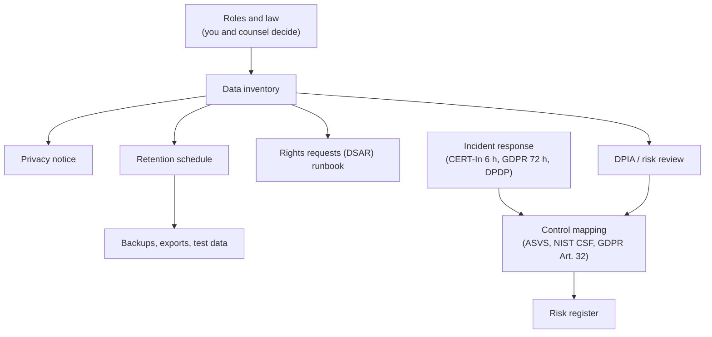

# Privacy and compliance toolkit

imPress processes students' names, enrollment numbers, attendance and quiz and poll results, and staff accounts. This folder is a toolkit for the **institution** that runs it: templates and checklists to fill in, and an honest account of what the software does and does not do. It is **not legal advice and not a certification**. Whether GDPR, India's DPDP Act and Rules, CERT-In directions or another law applies, and in what role, depends on facts only you and your counsel know.

| Page | Use it to |
|---|---|
| [Data inventory](data-inventory.md) | list what personal data imPress holds, why, where, who sees it and for how long |
| [Privacy notice template](privacy-notice-template.md) | tell students and staff what you do with their data |
| [Retention schedule](retention-schedule.md) | decide how long each kind of data (and each copy) is kept, and see what imPress enforces |
| [Data-rights (DSAR) runbook](dsar-runbook.md) | find, correct, export or erase one person's data in every place it lives |
| [Incident response](incident-response.md) | run the first hours of a security incident, with notification checklists |
| [Control mapping](control-mapping.md) | show how the software's controls support OWASP ASVS, NIST CSF and GDPR Article 32 (and where they don't) |
| [Risk register](risk-register.md) | the audit findings, their status in this release, owners and residual risk |

## Roles to decide first

| Question | Typical answer for a school or university | Why it matters |
|---|---|---|
| Who decides the purposes and means? | the institution (GDPR *controller*; DPDP *data fiduciary*) | notices, rights requests and breach duties fall on it |
| Who runs the software? | the institution's IT, or a vendor acting on its instructions (*processor*, DPDP *data processor*) | a processor needs a written agreement (DPA) with instructions, security and breach assistance |
| Who is the contact for rights and complaints? | a named privacy lead or DPO, with a published address | rights requests have deadlines |
| Where does the data live, and who else touches it? | the server's location, backup storage, any hosting or support vendor | transfers and sub-processors need to be listed |
| Are students children? | possibly, depending on age and country | special rules (consent from a parent or guardian, restrictions on tracking) can apply |

## What imPress does for you, and what it does not

**Does:** role-based access (staff only, class-scoped), server-side sessions with idle limits, one device per account, hashed and salted passwords, a database gateway that checks every write, sealed rows that expose changes made outside the application, dual control and an external audit trail for dangerous actions, erasure of a student that also scrubs the activity log, signed exports, and a policy profile that refuses to run insecurely.

**Does not:** publish a notice, decide your lawful basis or consent model, decide how long to keep things (set the periods in the [retention schedule](retention-schedule.md) and the signed policy), erase data from backups you made yourself, authenticate the radio messages between student modules and the hub (a nearby device could forge an answer), or make the institution compliant by being installed.

Open items are tracked as issues: [#200](https://github.com/Kush-Kelaiya22/imPress/issues/200) (this toolkit and its drills), [#202](https://github.com/Kush-Kelaiya22/imPress/issues/202) (off-host backups, log retention).
