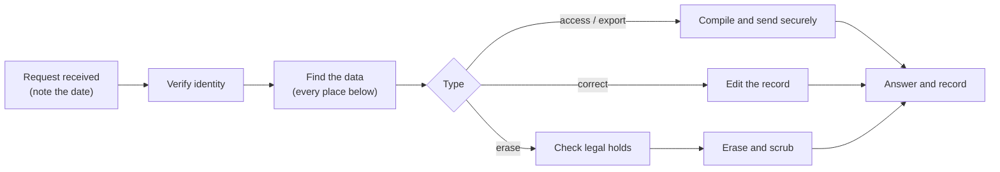

# Data-rights (DSAR) runbook

For a request to see, correct, export or erase one person's data. Fill in the contacts and deadlines your law sets. Keep a record of each request: who, when received, identity check, what you did, when you answered.

## 1. Where one student's data lives

| Place | How to find it | Notes |
|---|---|---|
| Student record | **Students** page, search by name or enrollment number | `students` table |
| Enrolments and classes | the student's detail page; `GET /api/students/{id}/classes` | |
| Attendance, quiz and poll participation | the student's detail page; `GET /api/admin/students/{id}/participation` | counts and per-quiz and per-poll detail |
| Module link | **Devices** → student modules | the enrollment number the module is provisioned with |
| Activity log | **Activity log**, search the name or class | entries about the student; staff entries may name them in details |
| External audit trail | filtered: it holds **no** student personal data | nothing to search |
| Test-data copies | **Test data** page: pending test data, saved datasets | copies of the real database can contain them |
| Exports you downloaded | your downloads folder, shared drives | not tracked by imPress |
| Backups | the integrity backups and **your off-host backups** | see erasure below |

For a staff member: **User access** (account), **Activity log** (their actions), the same backups and copies.

## 2. Access and export

1. Open the student's detail page and the participation view; export what the person is entitled to (the page offers CSV).
2. Add anything from the activity log that concerns them.
3. Send it by a channel you trust. If you send a signed export (test data), tell them how to verify it.

## 3. Correction

Edit the student on the **Students** page (name, e-mail, programme, years). The change is logged. Corrections of marks or attendance follow your academic procedure, not this page.

## 4. Erasure

1. **Check holds:** is the record needed for a legal obligation, an open dispute, or an academic record you must keep? If so, restrict instead of erasing and tell the person why.
2. **Erase:** on the Students page choose *Delete permanently* (administrators), or `DELETE /api/students/{id}/hard-delete`. This removes the student, their enrolments and attendance, unlinks any module, **clears the link on their answers and votes** (so completed results keep their totals but are anonymous), and **scrubs their name and number from the activity-log entries about them**. The erase entry itself holds only a keyed reference (`student_ref`).
3. **Copies:** delete pending or saved test-data copies that contain them (Test data page), and delete exports you downloaded.
4. **Backups:** the person remains in older backups until they expire. Record the expiry date, and re-apply the erasure if a backup is restored (see the [retention schedule](retention-schedule.md)).
5. **Answer** the person: what you erased, what you kept and why, and when backups expire.

An administrator who still holds the enrollment number can recompute the reference to check that an erasure was recorded; nobody else can learn who it was.

## 5. Drill

Run this on a **test server** with generated data (Test data → generate) once a term:

1. Generate a small dataset, pick one student, note the enrollment number and name.
2. Do steps 1 to 4 above for that student. Search the activity log for the name and number: there should be no hits after the erase.
3. Confirm the audit sink file has no hit for the name or number.
4. Record the time it took and anything that was hard to find.
