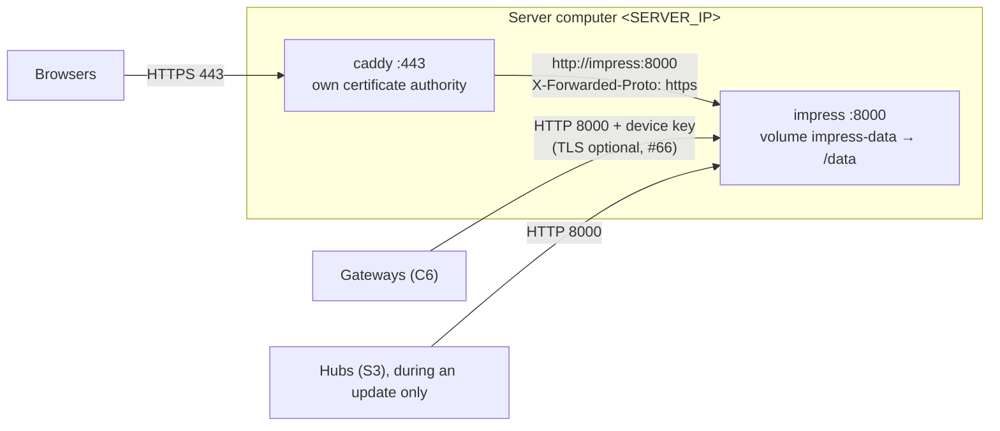

# Container image

The imPress backend (REST API, WebSocket class rooms, firmware store and the web app) is published as a container image:

```text
ghcr.io/kush-kelaiya22/impress-backend
```

It runs on **linux/amd64** (most PCs and servers) and **linux/arm64** (Apple silicon Macs, Raspberry Pi 4 and 5 with a 64-bit OS, ARM cloud servers). `docker pull` picks the right one automatically (#136).

This page covers what you need to run it in a classroom. It assumes Docker Engine 24 or later, or Docker Desktop. For a native install without containers, see the [deployment guide](../guides/deployment.md).

## Quick start (a classroom: HTTPS for browsers)

Browsers must reach imPress over **HTTPS**: from version 2.1 with #152, the server refuses logins and class data over plain HTTP from other computers, so that passwords and student records are never sent unencrypted. Gateways and hubs keep talking to the server directly on port 8000 (their own TLS is optional, #66).

The simplest setup runs the server with [Caddy](https://caddyserver.com/) in front of it. Caddy creates its own certificate authority and serves HTTPS with no further setup.

1. Save this as `compose.yaml`. Replace `<SERVER_IP>` with the address teachers will type: this computer's IP address on the classroom network, or its host name ([how to find it](../reference/placeholders.md)):

   ```yaml
   services:
     impress:
       image: ghcr.io/kush-kelaiya22/impress-backend:varun-latest
       restart: unless-stopped
       ports:
         - "8000:8000"          # gateways and hubs (device API)
       volumes:
         - impress-data:/data
       environment:
         IMPRESS_FORWARDED_ALLOW_IPS: "*"   # trust X-Forwarded-Proto from Caddy (see below)
     https:
       image: caddy:2.10
       restart: unless-stopped
       command: caddy reverse-proxy --from https://<SERVER_IP> --to impress:8000 --internal-certs
       ports:
         - "443:443"            # teachers' and admins' browsers
       volumes:
         - caddy-data:/data

   volumes:
     impress-data:
     caddy-data:
   ```

2. Start it and read the first-start output. It contains the **admin password** (only on the very first start) and the **device API key** that every gateway and hub needs (`CONFIG_DEVICE_API_KEY`):

   ```bash
   docker compose up -d
   docker compose logs impress
   ```

   To choose the admin password yourself, add `IMPRESS_INITIAL_ADMIN_PASSWORD: "<a strong password>"` under `environment` before the first start.

3. **Trust Caddy's certificate on each staff computer** (once). Copy it out:

   ```bash
   docker compose cp https:/data/caddy/pki/authorities/local/root.crt ./impress-root.crt
   ```

   Then install `impress-root.crt` as a trusted root: Windows: double-click → *Install Certificate* → *Local Machine* → *Trusted Root Certification Authorities*; macOS: double-click → Keychain *System* → set *Always Trust*; Linux (Chrome/Firefox): import under *Settings → Certificates → Authorities*. Without this step the browser warns about the certificate, but the connection is still encrypted.

4. Open `https://<SERVER_IP>` and log in as `admin`. Change the password at once: *⚙️ Settings → Change password*.

5. Check that the server is healthy:

   ```bash
   docker compose ps                       # impress: healthy
   curl -k https://<SERVER_IP>/health
   ```

Expected result: the web app opens over `https://` from another computer on the network; opening `http://<SERVER_IP>:8000` from another computer shows *HTTPS required*; `/health` answers `{"status": "healthy", "version": …, "schema_version": …}`.

`IMPRESS_FORWARDED_ALLOW_IPS: "*"` lets the server believe the `X-Forwarded-Proto: https` header Caddy adds. Someone sending that header directly to port 8000 only fools the server about their *own* connection, which then stays unencrypted; it gains them nothing. If port 8000 is reachable only from the gateways' network, nothing changes.

### Lab or single-computer use without HTTPS

On the computer that runs the server, `http://127.0.0.1:8000` always works (the traffic never leaves the computer). For an isolated lab network you may switch the rule off, knowing that passwords then cross the network in plain text:

```bash
docker run -d --name impress --restart unless-stopped -p 8000:8000 -v impress-data:/data \
  -e IMPRESS_REQUIRE_HTTPS=false ghcr.io/kush-kelaiya22/impress-backend:varun-latest
```

If something differs, see [troubleshooting → container](../guides/troubleshooting.md#container).

## Choosing a tag

| Tag | Use it when |
|---|---|
| `varun-latest` | you want the newest **Stable** release of the `varun` line |
| `varun-beta` | you test the newest **Beta** release |
| `varun-2.1` | you stay on the 2.1 line and take its newest release on every pull |
| `varun-2.1.N` | you need one exact release that never changes (recommended for a classroom server) |
| `sha-<12 characters>` | you need one exact commit |

Every tag points to both architectures. Release status (Beta or Stable) and the full tag rules are in [releases → the backend container image](../guides/releases.md#the-backend-container-image).

## Network requirements




Gateways reach the server over the classroom network, so:

- Publish the port on all interfaces (`-p 8000:8000`, the default). Inside the container the server already listens on `0.0.0.0`.
- Open the port in the host firewall. On Windows (including a Mobile Hotspot network), run once in an administrator PowerShell:

  ```powershell
  New-NetFirewallRule -DisplayName "imPress 8000" -Direction Inbound -Protocol TCP -LocalPort 8000 -Action Allow
  ```

- Set each gateway's `BACKEND_HOST` to this computer's address on that network and `BACKEND_PORT` to the published port.
- Check from a phone or laptop on the same Wi-Fi: `http://<server address>:8000/health`.

A gateway log line `backend unreachable: …` means one of these points is not met ([troubleshooting](../guides/troubleshooting.md#gateway-and-hub-first-boot)).

## Data and the `/data` volume

Everything that must survive an upgrade lives in `/data`:

| Path | Content |
|---|---|
| `/data/impress.db` | the SQLite database: users, classes, students, quizzes, answers, devices |
| `/data/firmware_bins/` | uploaded firmware images (created on the first upload) |
| `/data/.env` | secrets generated on the first start (`IMPRESS_JWT_SECRET`, `IMPRESS_DEVICE_API_KEY`), mode 600 |

Always start the container with the same volume. Without `-v impress-data:/data`, a new container starts empty.

The server runs as the unprivileged user `impress` (UID 10001). A bind mount (`-v /srv/impress:/data`) must be writable by that UID: `sudo chown -R 10001:10001 /srv/impress`.

## Configuration

Settings are `IMPRESS_*` environment variables, passed with `-e` or an env file (`--env-file impress.env`). Values given with `-e` override `/data/.env`. Every setting is listed in the [configuration guide](../guides/configuration.md); the ones most often set in a container are:

| Variable | Why |
|---|---|
| `IMPRESS_INITIAL_ADMIN_PASSWORD` | choose the first admin password instead of reading it from the log |
| `IMPRESS_DEVICE_API_KEY` | keep the provisioning key your devices are already flashed with |
| `IMPRESS_DEVICE_KEYS_REQUIRED=true` | after every device has its own key: refuse the shared key except for registration |
| `IMPRESS_FIRMWARE_SIGNING_KEY` | require signed firmware ([OTA → signing](../guides/ota-updates.md#signing-images)); mount the public key and give its path |
| `IMPRESS_FLAGS_FILE` | where the [flags file](../guides/launch-flags.md) lives; the image sets `/data/impress.flags.json`, so it is written on the first start and kept in the volume. Edit it, then restart the container |
| `IMPRESS_SESSION_IDLE_MINUTES`, `IMPRESS_SESSION_HARD_MINUTES` | change how long logins last |
| `IMPRESS_REQUIRE_HTTPS` | `false` only for an isolated lab: allows logins over plain HTTP (#152) |
| `IMPRESS_FORWARDED_ALLOW_IPS` | addresses of the reverse proxy whose `X-Forwarded-Proto` is trusted (default `127.0.0.1`) |
| `IMPRESS_DEVICE_HTTPS_ONLY` | `true` once every gateway and hub uses `BACKEND_TLS`: devices must use HTTPS/WSS too |

Never set `IMPRESS_DEBUG=true` on a classroom server: it allows the public default secrets and unauthenticated WebSockets.

## Docker Compose

Save as `compose.yaml`, then run `docker compose up -d` and `docker compose logs impress`:

```yaml
services:
  impress:
    image: ghcr.io/kush-kelaiya22/impress-backend:varun-latest
    restart: unless-stopped
    ports:
      - "8000:8000"
    volumes:
      - impress-data:/data
    environment:
      IMPRESS_INITIAL_ADMIN_PASSWORD: "change-me-on-first-login"

volumes:
  impress-data:
```

## HTTPS (TLS)

Browsers on other computers need HTTPS (#152); devices built with `BACKEND_TLS` need it too (#66). Options:

1. **Reverse proxy** (recommended): Caddy as in the quick start, or nginx with your own certificate. The proxy must forward WebSocket upgrades for `/ws/` ([nginx example](../guides/deployment.md#tls-reverse-proxy-websockets-included)) and set `X-Forwarded-Proto`; list the proxy's address in `IMPRESS_FORWARDED_ALLOW_IPS`.
2. **Directly in the container:** mount the certificate and key and set both paths:

   ```bash
   docker run -d --name impress --restart unless-stopped \
     -p 443:8000 -v impress-data:/data -v /etc/impress/tls:/tls:ro \
     -e IMPRESS_SSL_CERTFILE=/tls/server.crt -e IMPRESS_SSL_KEYFILE=/tls/server.key \
     ghcr.io/kush-kelaiya22/impress-backend:varun-latest
   ```

   The certificate must name the address the devices use (`BACKEND_HOST`), as a DNS name or an IP address in its subject alternative names. The files must be readable by UID 10001. See [TLS for devices](../guides/deployment.md#tls-for-devices).

## Backups

Back up while the server runs. This writes a consistent copy of the database into the volume, then copies it out:

```bash
docker exec impress python -c "import sqlite3; s=sqlite3.connect('/data/impress.db'); d=sqlite3.connect('/data/backup.db'); s.backup(d); d.close()"
docker cp impress:/data/backup.db ./impress-$(date +%F).db
```

To archive the whole volume (database, firmware and secrets), stop the server first so the database is not written during the copy:

```bash
docker stop impress
docker run --rm -v impress-data:/data -v "$PWD":/backup python:3.12-slim tar czf /backup/impress-data.tgz -C /data .
docker start impress
```

Keep the archive private: `.env` holds the secrets.

**Restore** into a new, empty volume:

```bash
docker volume create impress-data-restored
docker run --rm -v impress-data-restored:/data -v "$PWD":/backup python:3.12-slim tar xzf /backup/impress-data.tgz -C /data
docker run --rm -v impress-data-restored:/data python:3.12-slim chown -R 10001:10001 /data
```

Then start the server with `-v impress-data-restored:/data`.

## Upgrading

1. Back up (above).
2. Pull the new tag and start it with the same volume:

   ```bash
   docker pull ghcr.io/kush-kelaiya22/impress-backend:varun-2.1.N
   docker stop impress && docker rm impress
   docker run -d --name impress --restart unless-stopped -p 8000:8000 -v impress-data:/data \
     ghcr.io/kush-kelaiya22/impress-backend:varun-2.1.N
   ```

3. Database migrations run at startup. Before the first pending migration the server writes a copy of the database next to it (`/data/impress.db.bak-<from>-to-<to>-<timestamp>`).
4. Check `docker logs impress` and `/health`.

To go back, start the previous tag with the volume restored from your backup. A newer database schema is not guaranteed to work with an older image.

## Recovering administrator access

If no super admin can log in (for example a database from an older version where every super admin was disabled), run on the server:

```bash
docker exec -w /app/backend impress python -m app.manage restore-super-admin --username admin
```

It prints a one-time password, signs out the account's old sessions and records the action in the activity log. There is no web route for this; it needs access to the host. Details: [deployment → recovering administrator access](../guides/deployment.md#recovering-administrator-access).

## Logs and health

| Command | Shows |
|---|---|
| `docker logs -f impress` | server log: startup, migrations, warnings, device connections |
| `docker inspect -f '{{.State.Health.Status}}' impress` | `healthy` when `/health` answers (checked every 30 s) |
| `curl http://127.0.0.1:8000/health` | `{"status": "healthy", "version", "schema_version"}` |
| `docker exec impress uname -m` | the architecture in use: `x86_64` or `aarch64` |

## How the image is built and tested

- Built from the repository's [`Dockerfile`](https://github.com/Kush-Kelaiya22/imPress/blob/varun/v2.1/Dockerfile) on `python:3.12-slim`, pinned by digest, with the hash-checked `backend/requirements-lock.txt` that the test suite also uses.
- Every pull request builds both architectures on native GitHub runners and runs `scripts/smoke_test.py` against each (CI job *Container image*).
- Every release builds each architecture natively, smoke-tests it, pushes it, and then joins both into one multi-platform tag with the package description and links (release job *Backend image*). Pushes are retried on transient registry errors.
- The release workflow also publishes per-architecture helper tags, `sha-<commit>-amd64` and `sha-<commit>-arm64`. Use the multi-platform tags above instead.

Other architectures (32-bit ARM, for example a Raspberry Pi with a 32-bit OS) are not published. Use a 64-bit OS, or the native install.
