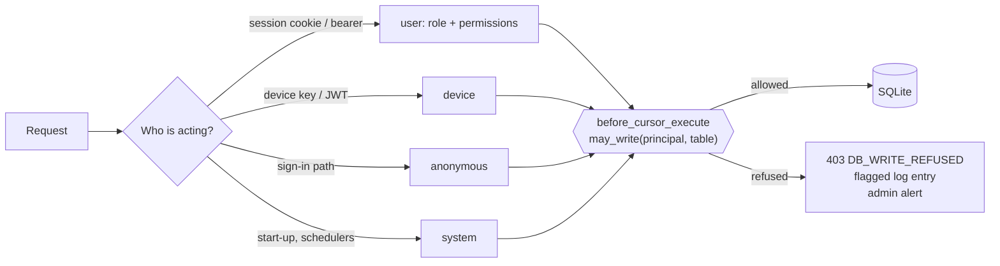
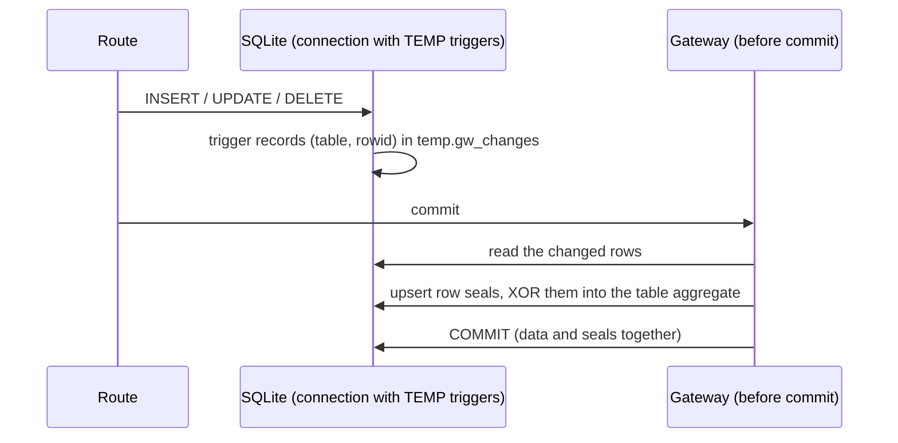
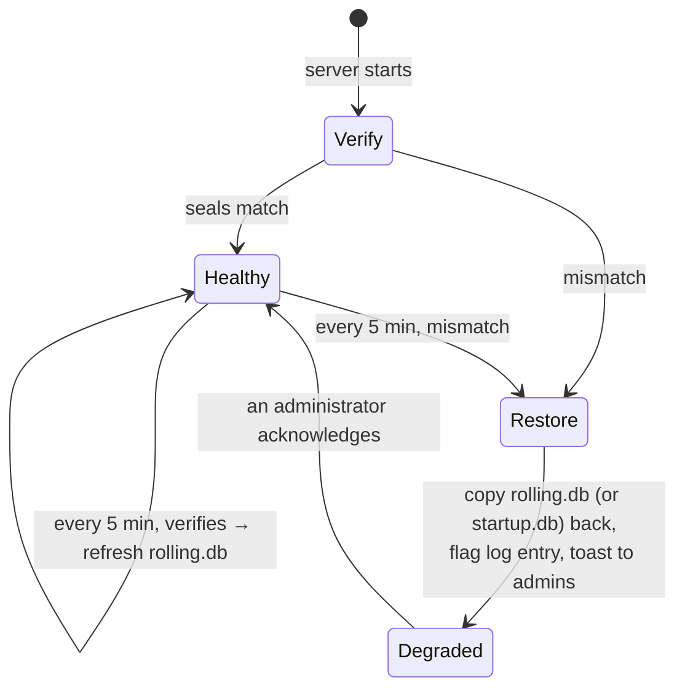
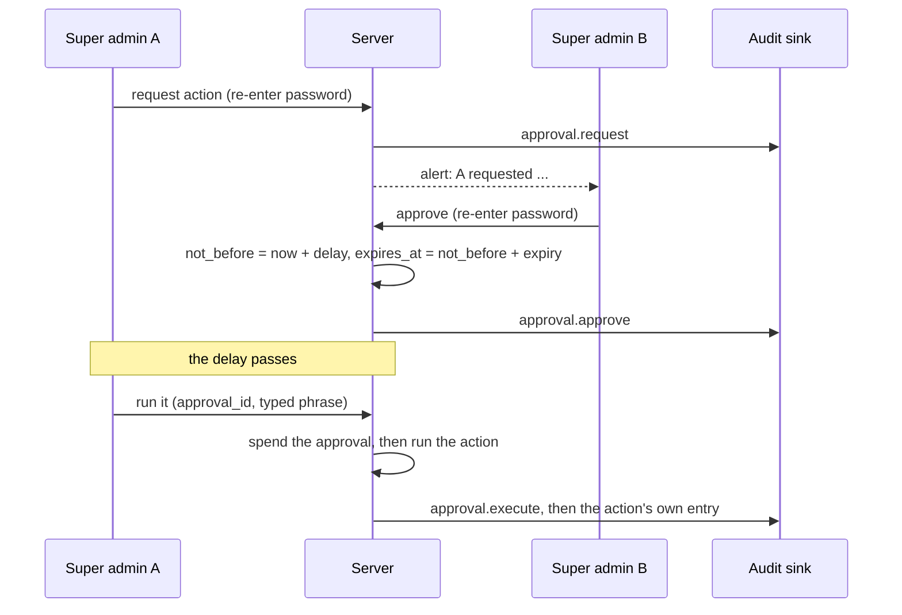

# Data integrity: the database gateway, seals and self-repair

From v2.2 the database is guarded. The application never writes it without a check, a change made **outside** the application is detected within minutes, and the server repairs itself from a recent good copy. Clearing or resetting the data is a super-admin action in the web app, never a command.

| Piece | Code | What it does |
|---|---|---|
| Database gateway | `backend/app/dbgateway.py` | checks every write against the acting principal; seals every changed row at commit |
| Integrity service | `backend/app/services/integrity.py` | verifies the seals at start-up and every 5 minutes; keeps two temporary backups; restores and flags **Degraded** |
| System API | `backend/app/routers/system.py` | status, verify now, acknowledge, clear data |
| Events | `backend/app/services/events.py` | pushes alerts and status to the web app (toasts, the Degraded badge) |

## 1. Every write goes through the gateway

Every SQL statement the application sends passes SQLAlchemy's `before_cursor_execute`. The gateway reads the table a write names (`INSERT`, `UPDATE`, `DELETE`, `REPLACE`) and asks whether the **principal** running the request may write it. If not, the statement is refused **before it runs**: the request gets `403 DB_WRITE_REFUSED`, the refusal is written to the activity log as a flagged `db.write_refused` entry, and administrators get an alert.



| Principal | May write |
|---|---|
| **system** (start-up, migrations, schedulers, the clear-data action) | everything, including schema changes |
| **anonymous** (the sign-in path) | `login_throttle`, `activity_logs` |
| **device** (gateway / hub calls) | its own records: devices, modules, answers, votes, attendance, deployment progress, enrolments and classes it links |
| **user** (an active member of staff) | any application table its routes reach, except: firmware needs `firmware.manage`, deployments `firmware.deploy`, timetable sources `classes.manage_all`. A `users` row may change only its own name and password unless the user has `users.manage` |
| anyone but the system | never the seal tables, `schema_migrations`, or `CREATE` / `DROP` / `ALTER` |

The route's own permission check (`policy.py`) still runs first; the gateway is a second, independent line that also catches a route that forgot a check.

## 2. Seals: detecting changes made outside imPress

Every row of every application table has a **seal**: an HMAC-SHA256 of its column values under a key derived from `IMPRESS_JWT_SECRET` (only this server has it). Each table also has a sealed **aggregate**: the XOR of its row seals plus its row count.

| Table | Holds |
|---|---|
| `integrity_seals` | `(table, primary key) → seal` |
| `integrity_tables` | `table → XOR of seals, row count, MAC of both` |
| `integrity_meta` | the fingerprint of the sealing key |

Sealing is cheap enough for tables that grow all day (answers, logs): each of the application's database connections carries TEMP triggers that record the rows a statement touches, whatever made the change (ORM, bulk statement, cascade). At commit, the gateway reseals **only those rows** in the same transaction, one HMAC per changed row, and updates the aggregate with two XORs. A commit that touches more than 300 rows of one table reseals that table in one pass.



`verify()` recomputes every row's seal and every aggregate, **inside one read snapshot** (the database runs in WAL mode, so the check never blocks a request and never sees half of a commit). A failing check is repeated once a second later before anything is restored, because a restore loses data. Before this, the check read each table at a different moment while the server kept writing, and a request that committed in between looked like a change made outside imPress: a false *Degraded* alarm and a restore of an older backup, most often seen right after start-up.

A change made with an `sqlite3` shell, a hex editor or a copied-in file cannot produce valid seals, so verification reports it:

- a row whose seal does not match (**changed**)
- a row with no seal (**added**)
- a seal with no row (**removed**)
- an aggregate that does not add up

A rotated `IMPRESS_JWT_SECRET` changes the key fingerprint. At start-up the database is then resealed as it is, and the event is flagged so an administrator can confirm the rotation was intended.

## 3. Temporary backups and self-repair

Two copies are kept in the backup folder: `IMPRESS_TEMP_BACKUP_DIR`, by default `<system temp>/impress-backups/<database>-<hash>/`, readable by the server's user only.

| File | Written |
|---|---|
| `startup.db` | when the server starts, after the database verifies |
| `rolling.db` | every `IMPRESS_INTEGRITY_INTERVAL_S` (300 s), **only if** the database still verifies |
| `before-clear-<time>.db` | before every clear / reset |



When a check fails, the service restores `rolling.db` (or `startup.db` if there is no rolling copy yet) with SQLite's backup API, then:

1. marks the database **Degraded** in `<database>.state.json`, next to the database, so the state survives a restart;
2. writes a flagged `system.db_degraded` entry to the activity log, saying what changed and which copy was restored;
3. sends a toast to every signed-in administrator and super admin, and shows a red **Degraded** badge and banner to them until one of them acknowledges it on the **System** page.

A super admin may instead **accept the current state** (reseal the database as it is) after a second super admin approved it. Do that only when an intended change was made outside the app, for example after restoring a backup by hand.

```{note}
Changes between the last good check and the tampering are lost in a restore: at most one interval (5 minutes). The rolling copy is refreshed only from a database that verifies, so a tampered database never overwrites the good copy.
```

## 4. Clearing, resetting and accepting a changed database

There is no command for it, and **no single super admin can do either alone** (see [Dual control](#dual-control)). On **System → Approvals**, a super admin requests the action; a *different* super admin approves it; the policy's delay passes; the requester runs it, typing the confirmation phrase:

| Scope | Phrase | Removes | Keeps |
|---|---|---|---|
| `class_data` | `DELETE CLASS DATA` | courses, classes, students, enrolments, quizzes, polls, answers, votes, attendance, timetable changes | accounts, devices, firmware |
| `everything` | `RESET EVERYTHING` | all of the above, plus devices, firmware records, deployments, the activity log, and every account except yours | your account and session |

A backup (`before-clear-<time>.db`, kept `integrity.before_clear_days`, 30 by default) is taken first. The deletion runs through the gateway as the system, so the seals stay consistent. Everyone gets a notice that the data was cleared. Activity-log entries younger than the policy's `audit.min_retention_days` are **not** deleted by a reset (their account link is cleared if the account is deleted), and the external audit sink is never touched. The hardened profile switches the *reset everything* scope off entirely (`system.reset_everything_allowed`). API: `POST /api/admin/system/clear {scope, confirm, approval_id}` (`users.assign_role`).

## Dual control

The seals are not an independent witness: whoever can *accept the current state* or *reset* decides what the system trusts. So those actions are two-person actions, controlled by root-set policy ([global policy control](gpc.md)):



| Rule | Detail |
|---|---|
| Who | requester and approver are different super admins; with only one active super admin, the standard profile lets them approve their own request (`dual_control.single_operator_ok`) and the hardened profile refuses |
| Step-up | each step re-checks the caller's password; five wrong passwords in 15 minutes lock step-up for a while |
| Exactly this | an approval is for one action and its parameters; it can't be used for another action |
| Once | the approval is spent before the action runs: a second use is refused |
| Delay and expiry | the action may run only after `dual_control.delay_minutes` (15 in the hardened profile) and within `dual_control.expiry_minutes` after that |
| Runs as | the requester, never a third person |
| Records | every step is an activity-log entry (flagged) and an event in the external audit sink, and an alert for the other administrators |

Actions covered: `integrity.accept_current` (accept the database as it is now), `system.clear.class_data`, `system.clear.everything`. Root can switch dual control off (`dual_control.enabled`) in a signed policy; the web app cannot.

**What it is not:** a second pair of eyes at the same keyboard. If one person controls two super-admin accounts, or controls the host, dual control does not help. That is why the hardened profile also requires an audit sink the application cannot rewrite, and why root's key is kept off the server.

## External audit trail

Every activity-log entry is also appended to a **hash-chained** file (`audit.sink_path`) and optionally sent to a webhook (`audit.sink_url`, signed with an HMAC the receiver can check). Each line holds the SHA-256 of the previous line's hash plus its own content, so an edited, removed, reordered or truncated line is found:

```bash
cd backend && python -m app.manage audit-verify /var/log/impress/audit.jsonl
```

A chain makes tampering *evident*, not impossible: put the file on an append-only or write-once volume, or the URL on a collector that is not administered by the application's administrators. Entries about students are reduced to non-identifying fields before they are written (the sink can't be erased), and erasing a student also scrubs their entries from the database log. The event is written when the action is logged, before its database transaction commits, so a rolled-back action can appear as an attempt.

## Forensic copy before a restore

When a check fails, the changed database is first copied to `forensic-<time>.db` (0600; the newest `integrity.forensic_copies` are kept), and only then replaced by the last good backup. The alert and the flagged log entry say which backup was used, **how many minutes old it was** (the changes since then are lost) and the name of the forensic copy. Investigate the forensic copy before acknowledging.

## 5. Where it shows up in the app

- **Sidebar and top bar** (administrators): a **Degraded** badge next to *System* while the database is degraded.
- **Banner** (administrators): what happened and a link to the System page.
- **Toasts**: write refusals, Degraded, blocked second sign-ins, clear / reset, debug mode on and off. These arrive live over `/api/events` (Server-Sent Events).
- **System page**: last verification, row count, the backups (start-up, rolling, forensic copies, copies taken before a clear) with size and time, *Verify now*, *Acknowledge*, the read-only **policy** (every flag, its value and where it came from), and the **Approvals** list with *Request*, *Approve*, *Run* and *Deny* for dangerous actions (super admin).
- **Activity log**: flagged entries (`db.write_refused`, `system.db_degraded`, `auth.second_sign_in_blocked`, `system.clear_*`) are marked and can be filtered.

## 6. Limits

- The gateway guards writes made **through the application**. Someone with shell access to the server can still change the file; the seals make that visible and reversible, but they don't prevent it. Keep the database folder readable by the service account only.
- Restores and backups apply to SQLite databases (the supported deployment). With another database URL, the gateway's write rules still apply, but there are no file backups.
- The seal key comes from `IMPRESS_JWT_SECRET`. Anyone who has that secret and the file can forge seals: protect `.env` like the database itself.
- **Root is outside what the application can defend.** Someone who controls the host can replace the code, the policy file and its public key together. The signed manifest, the signed policy and the external audit sink move that boundary (the application can then *notice*, and the evidence is somewhere else), but only separation of duties does the rest: root's key off the server, the audit volume administered by someone other than the application's administrators, a second person for dangerous actions. See [production hardening](../guides/production-hardening.md).
- Restoring a stale copy loses the changes made since it was taken (at most one check interval). The alert states the age, and the failed database is kept for investigation (see above).
