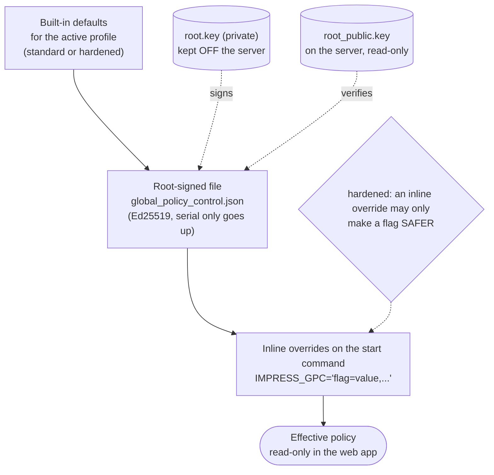

# Global policy control (GPC)

Security and integrity policy belongs to **root**, the person or system that owns the server and its keys, not to an application super admin. GPC is the single place for those switches: a set of typed feature flags with safe built-in defaults, an optional **root-signed** file, and **inline overrides** on the command that starts the server. The web app shows the effective policy and where each value came from; **nothing in the web app or the API can change it.**



## Why not a setting in the database or an admin screen?

A super admin who can switch off dual control, integrity checks or test-mode limits in the same place they use the app is not a control. Policy therefore comes from outside the application's own data:

| Source | Who can change it | Notes |
|---|---|---|
| Built-in defaults | the code (a release) | Two profiles, below |
| `global_policy_control.json` | whoever holds root's **private** key | The server holds only the public key. The file is signed (Ed25519). A **serial** must be higher than the last one applied, so an old file can't be put back. A file that fails verification is never half-applied |
| `IMPRESS_GPC` / `IMPRESS_PROFILE` | whoever starts the server process | In the **hardened** profile an inline value may only tighten a flag; loosening needs a signed file |

Residual trust, stated plainly: someone with root on the host (or who can replace both the file and the public key) is outside what the application can defend. Keep the public key and the file read-only for the service user (for example `/etc/impress/`, owned by root), and keep `root.key` on another machine.

## Profiles

| Profile | For | Behaviour |
|---|---|---|
| `standard` (default) | a lab, a first try, a small site | Today's behaviour, plus protections that need no setup: dual control (one super admin can approve their own request, after the delay), signed exports, the external audit sink when you set one, forensic copies |
| `hardened` | a production classroom server | Every protection on, and the server **refuses to start** unless the configuration meets the floor below |

Choose with `IMPRESS_PROFILE=hardened`, or by `profile` in the signed file (a root-signed file may also move a site back to `standard`).

### The hardened floor

At start-up the hardened profile checks, and lists everything it is unhappy about at once:

- `IMPRESS_DEBUG` is off and the default secrets are replaced
- staff HTTPS is not switched off (`IMPRESS_REQUIRE_HTTPS`), WebSocket authentication is on, one device per account is on
- device HTTPS and per-device keys are required (policy flags `device.https_required`, `device.keys_required`; the shared key only enrols)
- firmware: a site signing key is configured (`IMPRESS_FIRMWARE_SIGNING_KEY`), unsigned images are not allowed, and the uploader of an image can't approve it (`IMPRESS_FIRMWARE_SINGLE_APPROVER` off)
- an external audit sink is set (`audit.sink_path` or `audit.sink_url`)
- the root public key is present, and the server's code matches the root-signed manifest (`code.verify_manifest=enforce`)

The launchers never select the hardened profile and never switch debug or plain HTTP on for you. See [production hardening](../guides/production-hardening.md) for the checklist.

## The flags

| Flag | Type | `standard` | `hardened` | What it controls |
|---|---|---|---|---|
| `dual_control.enabled` | bool | `True` | `True` | Destructive or baseline-changing actions (accepting the current database state, clearing data) need a second super admin's approval. |
| `dual_control.single_operator_ok` | bool | `True` | `False` | Allow the requester to approve their own action when they are the only active super admin. |
| `dual_control.delay_minutes` | int | `0` | `15` | Minutes between an approval and the earliest moment the action may run. |
| `dual_control.expiry_minutes` | int | `240` | `30` | Minutes an approval stays usable after its delay has passed. |
| `system.reset_everything_allowed` | bool | `True` | `False` | Allow the 'reset everything' clear scope in the web app at all. |
| `audit.sink_path` | str | empty | empty | Hash-chained, append-only audit file outside the database (put it on a WORM or remote-logged volume). |
| `audit.sink_url` | str | empty | empty | HTTP(S) endpoint that also receives every audit event, signed with an HMAC (off-host copy). |
| `audit.min_retention_days` | int | `0` | `180` | A clear or reset never deletes activity-log entries younger than this many days. |
| `audit.purge_days` | int | `0` | `365` | Activity-log entries in the database older than this many days are deleted (0 = never; never sooner than audit.min_retention_days). The external audit sink is not touched. Only a signed policy can change it in the hardened profile. |
| `integrity.forensic_copies` | int | `3` | `10` | How many copies of a failed database are kept before an automatic restore replaces it. |
| `integrity.before_clear_days` | int | `30` | `14` | Days the full copy taken before a clear or reset is kept (0 = never deleted). It is your way back, and a copy of the data. |
| `test_mode.allowed` | bool | `True` | `False` | Debug mode and test data (copies of the database) may be used at all. |
| `test_mode.forced` | bool | `False` | `False` | Test mode is forced on by root (launch flag --test-mode) and nobody can turn it off; the default super admin then signs in with a fixed lab password. |
| `ota.enabled` | bool | `True` | `True` | Over-the-air firmware updates exist at all (off with --no-ota): uploads, deployments and pushes are refused and devices are offered nothing. |
| `deadlock_prevention.enabled` | bool | `True` | `True` | If no active super admin exists, roll the database back and create a recovery account (global_deadlock_prevention). |
| `backups.restore_requires_approval` | bool | `False` | `True` | Restoring a backup needs a second super admin's approval (so only a super admin can request it). |
| `test_mode.export_allowed` | bool | `True` | `False` | Test-data copies may be exported as CSV files. |
| `test_mode.pending_ttl_hours` | int | `168` | `24` | Hours a finished test database waits for a decision before it is deleted (0 = never). |
| `test_mode.dataset_ttl_days` | int | `0` | `30` | Days a saved test dataset is kept (0 = never). |
| `code.verify_manifest` | enum | `warn` | `enforce` | Check the server's own files against the root-signed MANIFEST.json at start-up. |
| `device.https_required` | bool | `False` | `True` | Gateways and hubs must use HTTPS/WSS (same effect as IMPRESS_DEVICE_HTTPS_ONLY). |
| `device.keys_required` | bool | `False` | `True` | The shared device key may only enrol; every device must use its own key (same as IMPRESS_DEVICE_KEYS_REQUIRED). |
| `firmware.signing_required` | bool | `False` | `True` | A site firmware signing key must be configured and unsigned images are never accepted. |
| `features.disabled` | str | empty | empty | Comma-separated features switched off by root; administrators cannot switch them on (see the System page for the list). |
| `root.allow_access` | bool | `True` | `True` | Whether the separate root console may be opened (ssh, docker exec). TrustedInstaller switches it off inside a container: use the console attached to the container instead. |
| `iips.enabled` | bool | `True` | `True` | imPress Integrity Protection Service: refuse to start when the program's own files changed since the last baseline. |
| `iips.auto_accept_updates` | bool | `True` | `False` | When the program was updated (a different release or git commit than the one the baseline was made from), its new files become the reference by themselves instead of locking imPress. Files edited by hand under the same release still lock it. Off in the hardened profile: root accepts an update with --rehash. |
| `traffic.monitor` | bool | `True` | `True` | Watch request rates per endpoint, address and account and alert administrators to unusual traffic. |

"Safer" for an inline override in the hardened profile: `true`/`false` flags can only move to their protective value, numbers only in their protective direction (shorter lifetimes, longer retention; for the `0 = never` expiries any limit is safer than none), `code.verify_manifest` only towards `enforce`, a text flag (audit sink) may be filled in but not replaced, and `audit.purge_days` is *locked*: in the hardened profile only a signed file may change it, because neither direction is simply safer.

## Using it

```bash
# once, on a machine that is not the server
scripts/gpc.py keygen --dir ~/impress-root            # root.key (keep!) and root_public.key

# sign a policy: serial goes up by one each time you sign over the same file
scripts/gpc.py sign --key ~/impress-root/root.key --profile hardened \
    --set dual_control.delay_minutes=30 --set audit.sink_path=/var/log/impress/audit.jsonl \
    --out global_policy_control.json
scripts/gpc.py show global_policy_control.json --public ~/impress-root/root_public.key

# on the server (read-only for the service user)
install -m 0644 root_public.key global_policy_control.json /etc/impress/
IMPRESS_PROFILE=hardened IMPRESS_GPC_FILE=/etc/impress/global_policy_control.json \
    IMPRESS_ROOT_PUBLIC_KEY=/etc/impress/root_public.key scripts/start.sh

# a one-off, tightening override without a file
IMPRESS_PROFILE=hardened IMPRESS_GPC="dual_control.delay_minutes=60" scripts/start.sh
```

The server re-reads the file every 30 seconds. A valid new file is applied (an alert and an audit event say so); an invalid one is **refused and the previous policy stays in force**, with an alert. Administrators see the result on the **System** page (*Policy*) and at `GET /api/admin/system/policy`.

## The signed code manifest

`scripts/gpc.py manifest --key root.key` writes `backend/app/MANIFEST.json` (the SHA-256 of every file the server runs) and `MANIFEST.sig` (root's signature). At start-up the server checks its own files against it. `code.verify_manifest` decides what a mismatch does: `off`, `warn` (alert and audit event, keep running), or `enforce` (refuse to start; also refuses a missing manifest). Run the command again after every upgrade. It proves the files are the ones root signed; it can't prove anything about a host that is already compromised.

## Related

- [Data integrity](data-integrity.md): dual control, the audit sink, forensic copies
- [Security model](security-model.md)
- [Configuration](../guides/configuration.md)
