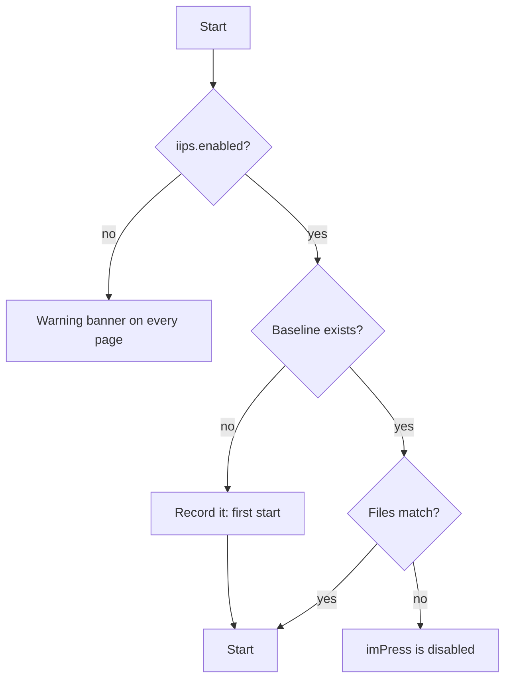

# imPress Integrity Protection Service (IIPS)

IIPS checks that **imPress's own files** are the files it started with. It complements the [database gateway and seals](data-integrity.md) (which protect the data) and the [signed code manifest](gpc.md) (which proves the files came from root).

## What it records

At the **first start**, it hashes every file of the program, hashes every folder from the names and hashes inside it, and hashes the whole tree. Because a folder's hash is made from its children's names and hashes, **moving a file or a folder to another place changes it too**, even if no byte changed. The result is the **baseline**, stored next to the database, signed with a key derived from the server's secret so that editing it by hand does not make a changed file pass.

| Covered | Not covered (it is expected to change) |
|---|---|
| `backend/app` (the program and its web files), `scripts`, `VERSION`, the launchers, the requirements | the database and its sidecar files (it has its own seals and backups), logs, state files, caches and `__pycache__`, uploaded firmware, test data, backups, `.env`, the virtual environment, `.git` |

A container image carries its own baseline (`IIPS-BASELINE.json`, made when the image is built and read-only for the server's user), which takes the place of the one next to the database.

## At every start

When something differs, imPress **does not start**. The message is:

> imPress has been disabled by Root: an integrity violation was detected in the source folder (3 differences: backend/app/main.py, …). Restore the original files, or start with --rehash to accept the current ones as the new reference.

The start command exits with code 3. If imPress was started in another way (for example `uvicorn app.main:app`), it starts but answers every request with `503 INTEGRITY_VIOLATION` and the same message.

Each difference is classified: **changed**, **added**, **removed** or **moved** (the same content at another path).

## Root's choices

| To… | Do |
|---|---|
| accept the files as they are now (after you changed something on purpose) | start with `--rehash` (`restart --rehash` in the root screen), or `iips rehash` in the console |
| update imPress (pull a new release, switch branch) | nothing: in the **standard** profile a different build (git commit, or release) than the one the baseline was made from is an *update*, and the new files become the reference by themselves (policy `iips.auto_accept_updates`, on in `standard`, off in `hardened`). Files edited by hand under the **same** build still lock imPress |
| start although the check failed | start with `--bypass-iips`. **Every page, including the sign-in page and super admins' pages, shows a red banner**: *imPress Integrity Protection Service is disabled. Proceed with caution.* It cannot be dismissed. Not allowed in the hardened profile |
| see the differences | `iips status` in the console |
| turn it off for good | policy flag `iips.enabled=false`; the banner stays |

If test mode is also on, the two banners stack: the integrity warning first, then the test mode notice.

## Limits

IIPS finds changes made while imPress was stopped. A change to a running process's memory, or to files by someone who also has the server's secret, is outside its reach: the hardened profile adds the root-signed manifest (`code.verify_manifest=enforce`), whose signing key stays off the host.

## Bound to the machine, and root's password to accept

The reference file (`<database>.iips.json`) is sealed with a key that includes the **device fingerprint** (policy `iips.device_binding`: `off`, `warn` (standard), `enforce` (hardened)). The fingerprint is a SHA-256 of the first stable hardware identity found: the platform hardware UUID (macOS IOPlatformUUID, the Windows SMBIOS UUID, Linux `product_uuid`), else the installation's machine id (`/etc/machine-id`, Windows MachineGuid), else the lowest MAC of a physical adapter. It deliberately ignores everything that changes: IP address, host name, operating-system and Python versions, user name, and the folder the program is in. `IMPRESS_DEVICE_ID` replaces it (a cloned virtual machine, or a lab image). In a container there is nothing to bind to and the image's own read-only reference is used.

| What the start finds | Result |
|---|---|
| reference intact, same device | normal start |
| reference sealed for **another device** (code and reference copied or pasted here) | `warn`: an alert and a banner on every start until root accepts it; `enforce`: imPress is locked (*made on another device*) |
| reference **edited** (its seal does not verify) | locked, whatever the binding |
| reference made before binding existed | bound to this device at the first clean start |
| folder renamed or moved, system updated, new IP | nothing: none of these is part of the fingerprint |

**Accepting files needs root's password.** `--rehash` (and `restart --rehash` on the root screen, and `iips rehash`) ask for it. Before it replaces anything it **verifies what is there** (intact, edited, from another device, missing) and writes that finding, who accepted it and when into the new reference's own hash-chained history (`iips history`). A reference that was edited or copied can therefore be replaced by root, but never silently.

