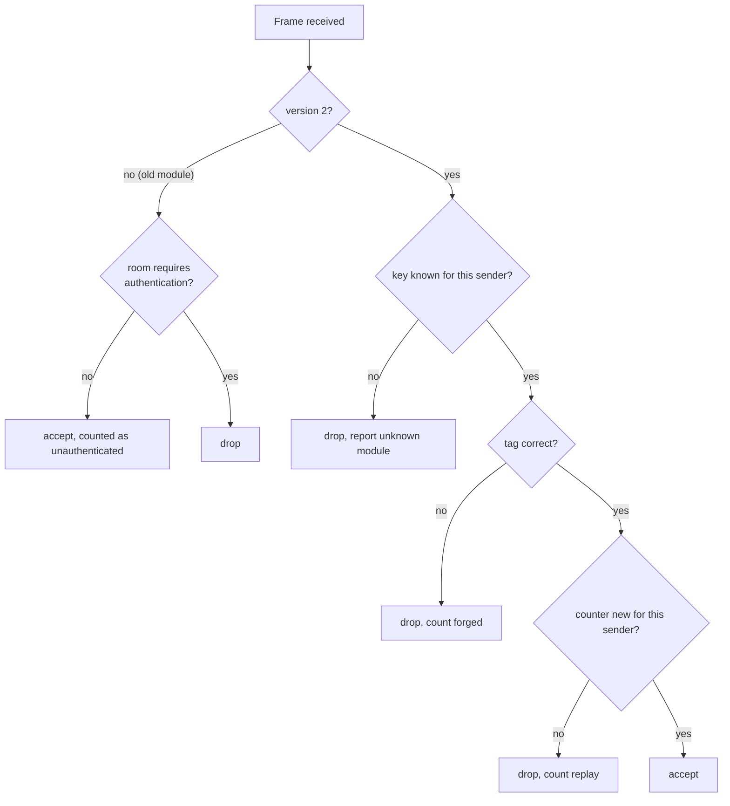
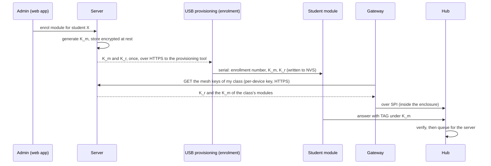

# Mesh frame authentication (design, proposed)

Status: **proposed, for review** ([#187](https://github.com/Kush-Kelaiya22/imPress/issues/187)). Nothing on this page is implemented. The three decisions at the end need a maintainer's answer before any code is written.

## Why

Student modules and the hub talk over ESP-NOW broadcast. A frame carries a CRC16 against corruption and nothing against forgery: the security model lists this as an accepted risk ([T9](security-model.md#threats-and-mitigations)). The server limits the damage (known students only, enrolled in the class since #186, the gateway's own class, one answer per student and question), but it cannot tell a real module from a device that copies a classmate's enrollment number.

| Threat | In scope | Notes |
|---|---|---|
| A device answers or votes **as another student** | **yes**, the main one | today only the enrollment number identifies a student on air |
| **Replay**: a recorded answer, join or vote sent again later | yes | e.g. into the next quiz with the same quiz id and question |
| A rogue device sends **hub commands** (questions, quiz end, ACKs) | yes | visible to the class, low value, but confusing |
| Reading answers off the air (confidentiality) | no | ESP-NOW encrypts only unicast peers (a few per device), not broadcast; answers are visible in the room anyway |
| Jamming | no | radio denial of service cannot be prevented in software |
| Keys extracted from a stolen module's flash | partly | only with flash encryption, which current modules don't enable |

## Proposed design

### Keys

| Key | Held by | Protects | Why this split |
|---|---|---|---|
| **Module key** `K_m`, 128-bit, one per module | the module (NVS), the server, the hub of the module's class | frames **from** that module (join, answer, vote) | a classmate's module doesn't have it, so it cannot answer for them |
| **Room key** `K_r`, 128-bit, one per classroom node | every module of that room, the hub | frames **from** the hub (questions, polls, ends, ACKs) | one broadcast reaches every module, so every module must be able to check it. A module could forge a hub frame: visible and low value, accepted |

A digital signature for hub frames would remove that last risk, but a 64-byte signature does not fit: a question payload is 208 bytes and the mesh budget is 238 ([#170](protocols.md)).

### Frame

A version-2 mesh header replaces the 6-byte header:

```
┌─────┬────────────┬──────┬─────┬──────────────┬───────────────┬──── protocol frame ────┐
│ TTL │ SENDER u32 │ HOPS │ 0x2 │ COUNTER u32  │ TAG (8 bytes) │ AA TYPE LEN … CRC        │
└─────┴────────────┴──────┴─────┴──────────────┴───────────────┴──────────────────────────┘
TAG = first 8 bytes of HMAC-SHA256(key, SENDER ‖ COUNTER ‖ frame)
```

- `TTL` and `HOPS` change at every relay, so they are outside the tag; everything else is covered.
- +13 bytes per frame: the mesh payload budget falls from 238 to **225** bytes; the largest message (a question, 208) still fits.
- A resend (#181) repeats the identical frame, counter included, so de-duplication and acknowledgements work unchanged.

### Replay

Every sender keeps a 32-bit counter that only goes up. It is stored in NVS every 64 frames; after a reboot the sender continues 64 above the stored value, so a counter is never reused and flash is written rarely. Each receiver keeps, per sender, the highest counter seen and a 32-frame window (as IPsec does), so relayed copies that arrive out of order are still accepted once.



### Getting the keys where they belong



- Keys are **never sent over the radio in the clear**. A module gets them by USB at enrolment, the same moment its enrollment number is set (the serial provisioning path already exists).
- The hub gets only the keys of its own class, from the server through the gateway (HTTPS with the gateway's own key, then the SPI link in the enclosure).
- **Rotation:** a new room key each term: the hub sends it to each module **encrypted and authenticated under that module's `K_m`** (AES-CCM, unicast), so no USB visit is needed. A module key is replaced by USB.
- **Revocation:** delete a module's key on the server; the hub drops its frames after the next key refresh.

### Migration

A per-room setting, *Require authenticated mesh frames*, off by default while modules are re-provisioned. Off: version-2 frames are verified, and version-1 frames from modules without keys are still accepted and counted as unauthenticated, so the teacher can see who still needs a USB visit. On: version-1 frames are dropped.

## Cost

| | |
|---|---|
| Airtime | +13 bytes per frame (≈ 5 % for an answer frame) |
| CPU | one HMAC-SHA256 per frame; hardware SHA on all three chips |
| Hub RAM | key table and replay windows for up to 300 modules: about 9 KB |
| Module flash writes | one NVS write per 64 frames sent |

## Test plan

- Host C: HMAC against the RFC 4231 vectors; the replay window (in order, reordered, duplicated, old, counter jump after a reboot); version-1 and version-2 frames side by side.
- Simulator (`firmware/sim/classroom_sim.py`): forged tags, replayed frames, a module answering with another module's identity: none counted.
- Backend: key generation, storage encrypted at rest, the gateway's key fetch scoped to its class.
- Hardware: a rulebook issue for Kush once implemented (provisioning, rotation, a cloned enrollment number, a replayed recording).

## Decisions needed

1. **Per-module keys (proposed) or one key per class?** A class key is simpler but lets any classmate answer for another, which is the threat that matters most.
2. **USB provisioning at enrolment acceptable?** It means one USB connection per module per student, at the start of the term.
3. **Migration default:** off by default, turned on per room by an admin once every module there has a key (proposed), or on for new installations?
