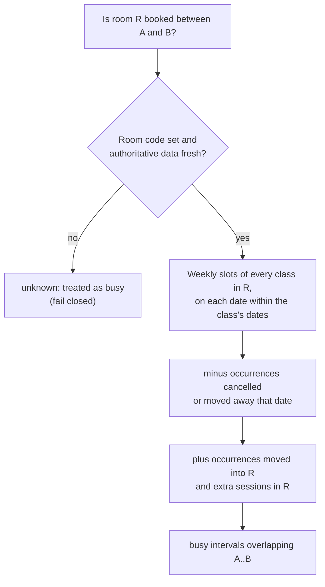
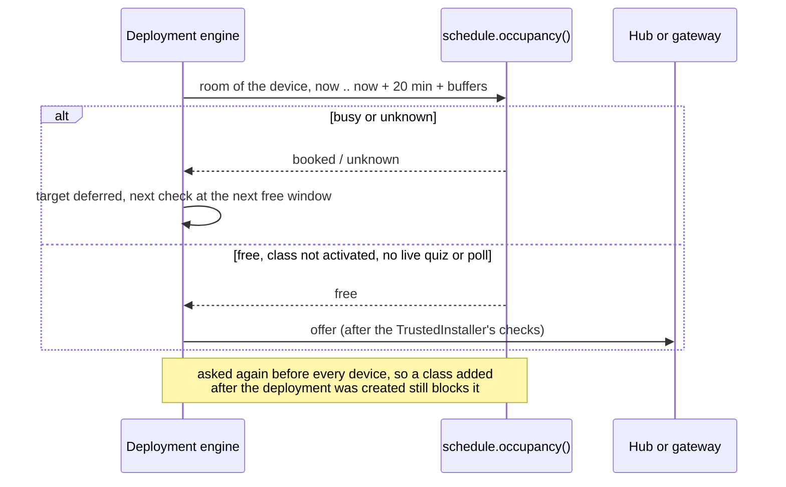

# Scheduling and room occupancy

imPress needs to know when a classroom is in use for one main reason: firmware updates for the room's hub and gateway must not start during a class (#128). This page explains where timetable data comes from, how dated changes are recorded, and how the backend answers "is this room booked between A and B?" (#126).

## Who owns which data

| Data | Authoritative source | In imPress |
|---|---|---|
| Courses, terms, sections, faculty assignments, weekly timetable, rescheduled and cancelled classes, room allocation | **AURIS** (the institution's academic system) | imported copies, marked `source = auris` once an AURIS import exists (#127, blocked on an authorized export) |
| The same data on a site without an AURIS import | imPress itself | entered by administrators and faculty (`source = local`) |
| Quizzes, polls, answers, participation, devices, firmware | imPress | never taken from AURIS |

imPress does not try to replace AURIS: it keeps only what participation and device maintenance need.

## The model

- **Weekly timetable:** each class has `meeting_schedule`, a list of `{day, start, end}` (`day` is the English weekday name, times `HH:MM`, IST), valid between the class's `start_date` and `end_date`, in the room `classroom_code`.
- **Dated changes:** `class_occurrence_exceptions`, one row per change:

| `kind` | Meaning | Fields used |
|---|---|---|
| `cancelled` | the occurrence on `date` does not take place | `slot_start` (which slot; empty = every slot that day) |
| `moved` | the occurrence on `date` at `slot_start` takes place on `new_date` `new_start`–`new_end` | `classroom_code` = the room it moves to (empty = same room) |
| `extra` | an additional occurrence on `date` `new_start`–`new_end` | `classroom_code` (empty = the class's room) |

- **Freshness:** `schedule_sources` records when each authoritative source last synchronised. With no row, imPress's own timetable is authoritative and never stale. Once a source has synchronised, its data older than `IMPRESS_SCHEDULE_MAX_AGE_HOURS` (default 48; 0 = never stale) makes occupancy **unknown**.

## Occupancy

`schedule.occupancy(db, classroom_code, start, end)` returns the booked intervals overlapping `[start, end)`:

1. every regular slot of every class in that room, on each date within the class's dates;
2. minus slots cancelled or moved away on that date;
3. plus occurrences moved into that room and extra sessions there;
4. or `None` (**unknown**) when the room code is empty or the authoritative data is stale.

Callers treat unknown as busy (fail closed). Room codes are compared without case and surrounding spaces.

## Using it

| Who | How |
|---|---|
| Faculty of a class, administrators | Class page → **Schedule changes**: cancel a class, move it, or add an extra session. A moved or extra session that overlaps another booking of its room is saved with a warning. API: `GET/POST /api/classes/{id}/exceptions`, `DELETE /api/classes/{id}/exceptions/{exception_id}` |
| Administrators | `GET /api/admin/rooms/{classroom_code}/occupancy?start=…&end=…` (at most 31 days) returns `{known, busy: [{start, end, class_id, why}]}` |
| The OTA scheduler | asks `occupancy()` before every hub and gateway update (#128): see [OTA updates → maintenance windows](../guides/ota-updates.md#maintenance-windows-for-hubs-and-gateways) |

Changes imported from AURIS cannot be removed in imPress (`409 SOURCE_MANAGED`); the next import updates them.

## Limits

- A room is identified by `classroom_code`. Classes without one have no room, so their gateway's maintenance windows are unknown (#128 then waits for an administrator).
- Holidays that cancel every class are recorded per class today; a site-wide calendar is a candidate for the AURIS import (#127).
