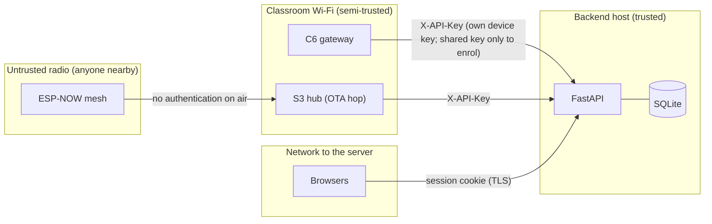
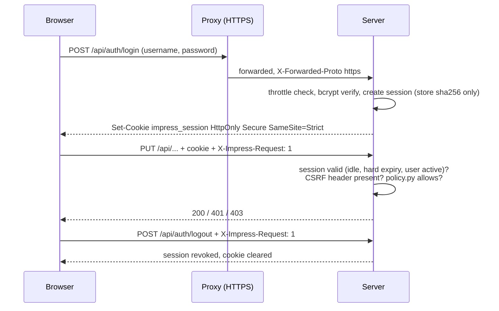
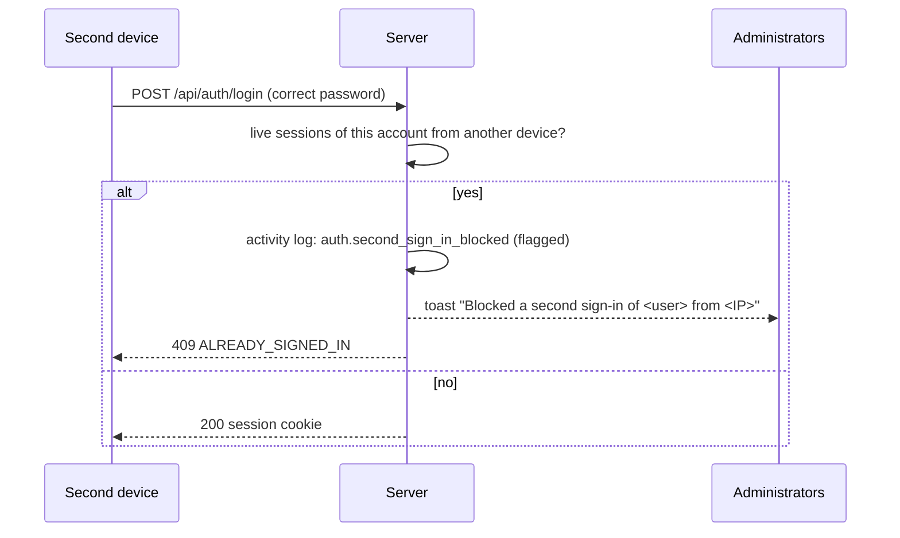

# Security model

## Assets

| Asset | Why it matters |
|---|---|
| Student PII (names, emails, phones, enrollment numbers) | privacy, regulatory exposure |
| Quiz and poll results, attendance | academic integrity |
| Admin and teacher accounts | full control of classes, users and firmware |
| Device API key | lets its holder impersonate every gateway (submit data, download firmware) |
| Firmware images | code execution on classroom hardware |

## Trust boundaries

Each path in detail (v2.2):

| Path | Protection | What is trusted, and what is left |
|---|---|---|
| Browser → server | TLS required for staff traffic (HSTS); `HttpOnly`, `SameSite=Strict`, `Secure` session cookie; `X-Impress-Request` on cookie-authenticated changes; `Origin` checked on teacher sockets | the server certificate (your CA or a public one) |
| Server → TrustedInstaller | the same process; no HTTP route reaches it; its reports are sealed with a key derived from `IMPRESS_JWT_SECRET` | the server host and its secret |
| Gateway (C6) → server | per-device key, scoped to the gateway's class; TLS when `BACKEND_TLS` is on (`IMPRESS_DEVICE_HTTPS_ONLY` refuses plain HTTP) | without device TLS anyone on the classroom network can read device traffic: turn it on (#92) |
| Hub (S3) ↔ gateway (C6), SPI | CRC16 per 4096-byte slot, bounded records | **physical**: both boards sit in one enclosure; whoever can attach wires can inject frames. No cryptography. A corrupted slot is lost today (#182) |
| Student modules ↔ hub, ESP-NOW | CRC16, de-duplication, enrollment format checks, delivery acknowledgement (#181) | **none on air**: unauthenticated broadcast (#187). The server limits the damage: known students only, active quiz only, the gateway's own class, one answer per student and question |
| Firmware to devices | approved, qualified (sealed report for these exact bytes), site-signed image; the device checks SHA-256 before it boots it | the site signing key, kept off the server's repository |

## Authentication and authorization

| Principal | Mechanism | Details |
|---|---|---|
| Transport | **HTTPS required** for staff traffic (#152) | Logins, the web app, the staff API and teacher WebSockets over plain HTTP from another computer are refused (`403 HTTPS_REQUIRED`, WS close 4403). TLS is what encrypts passwords and class data in transit; there is no second application-level cipher, because its key would travel over the same channel. Headers on every response: HSTS (over HTTPS), Content-Security-Policy on the app pages, `X-Frame-Options: DENY`, `nosniff`, `Referrer-Policy: no-referrer`, `Permissions-Policy`, `Cache-Control: no-store` on the API. Device-key routes may use HTTP until `IMPRESS_DEVICE_HTTPS_ONLY` |
| Password guessing | **Throttled** (#153) | Failed logins are counted per username (5 free per 15 min) and per client address (20 free); then each failure doubles the wait (30 s … 15 min), answered `429 TOO_MANY_ATTEMPTS` with `Retry-After`, without checking the password. Counters are in the database (survive restarts); no permanent lockout. A wrong current password on *Change password* is throttled the same way. New passwords: ≥ 10 characters, not a common password, not the username, ≥ 4 different characters; existing passwords keep working |
| Users | Opaque server-side **sessions** | `POST /api/auth/login` issues `impress_<urlsafe 64>`. Only `sha256(token)` is stored (`user_sessions.token_hash`; the legacy `session_token` column also holds the hash, #12). Validation checks revoked → hard expiry (6 h) → idle expiry (**15 min**, or **60 min** for staff while one of their classes is in session; v2.2) → user active. **One device per account** (v2.2): a sign-in while the account is live on another device is refused (409) and flagged; see [Sessions and passwords](#sessions-and-passwords-v22). Logout revokes. **Browsers** keep the token in an `impress_session` cookie (`HttpOnly`, `SameSite=Strict`, `Secure` over HTTPS, path `/`, lifetime = hard expiry): page scripts cannot read it, so an injected script cannot copy the session out; nothing is kept in `localStorage` (v2.2). API clients and scripts send the returned token as `Authorization: Bearer`. Deactivation, deletion, a role change and an admin password reset revoke **all** of the user's sessions and close their open WebSockets (code 4401); changing your own password keeps only the current session (#118). |
| Roles | `teacher` < `admin` < `super_admin`, closed `Literal` set; permissions per role, scope rules and integrity rules in one module: [authorization model](authorization.md) (#122) | Only a super admin can grant or remove admin-level roles; nobody changes their own role (#10), deactivates or deletes their own account. **At least one active super admin always exists:** database triggers abort any write that would remove the last one, so no API route, concurrent pair of requests or internal code path can lock the installation out (#116). Teachers only see and operate their classes: one access rule (primary teacher, co-faculty, admin) for class, quiz, poll and results routes (#20, #21). |
| Gateways and hubs | Shared `X-API-Key` for registration, then a per-device key (#66) | Constant-time comparison (`secrets.compare_digest`). WebSocket: `X-API-Key` header (the legacy `?api_key=` still accepted) (#11). A gateway's own key acts for its class only: its socket joins only the linked class (#121), and its batches record answers, votes and room links only for that class, and attendance only there (v2.2); a gateway linked to no class records none. The shared key is site-wide: set `IMPRESS_DEVICE_KEYS_REQUIRED=true` so it is accepted for registration only. |
| Teacher WebSocket | The browser's session cookie (or a bearer header from a script); **never a URL parameter** (v2.2: URLs end up in proxy and server logs) | Same validator as REST, no activity refresh (#8). A browser handshake whose `Origin` is not this server is refused (4403: cross-site WebSocket hijacking). Joins only classes the user may access; a gateway's per-device key joins only its linked class; browsers cannot send device commands (#121). Requires `wss://` in deployment. |
| Students | **None on air** | ESP-NOW frames are unauthenticated; identity is the enrollment number inside the payload. |

## Policy, dual control and signing (v2.2)

Security and integrity switches are **root's**, set outside the application ([global policy control](gpc.md)): built-in defaults for a *standard* or *hardened* profile, optionally a root-signed file (Ed25519, rollback-proof serial), optionally inline overrides that in the hardened profile may only tighten. A super admin can read the policy but not change it.

| Control | What it gives | Where |
|---|---|---|
| Dual control | accepting a changed database and clearing or resetting data need a second super admin's approval, a password re-entry at each step, a delay, an expiry, and run once | [data integrity](data-integrity.md#dual-control) |
| External audit trail | every activity entry is also written to a hash-chained file / signed webhook the application cannot rewrite; students' personal data is never written to it | [data integrity](data-integrity.md#external-audit-trail) |
| Signed code manifest | the server checks its own files against root's signature at start-up | [GPC](gpc.md#the-signed-code-manifest) |
| Signed exports | exports carry a signature a receiver can verify offline | [test data](../guides/test-mode.md#signed-exports) |
| Hardened floor | the server refuses to start with debug on, default secrets, HTTP, unsigned firmware, shared device keys, or no external audit sink | [production hardening](../guides/production-hardening.md) |
| Content-Security-Policy | `script-src 'self'` with `script-src-attr 'none'`: no inline script, no inline event handlers, no `eval`; `object-src 'none'`, `base-uri 'none'`, `frame-ancestors 'none'`. Styles keep `'unsafe-inline'` for `style=` attributes. Violations are reported to `POST /api/system/csp-report` (rate limited, audited). The web app's handlers are delegated (`data-action`, `data-call` against a fixed allowlist) | `transport.py`, `ui.js` |
| Erasure | erasing a student removes their name and number from the activity log; the erase entry holds only a keyed reference | [data rights](../compliance/dsar-runbook.md) |

Device messages are **not** signed or authenticated by this layer: the radio and the gateway protocols are unchanged. Authenticating the ESP-NOW frames is a separate proposal ([mesh authentication](mesh-authentication.md)).

## Host, files and traffic (v2.2)

| Control | What it gives | Where |
|---|---|---|
| TrustedInstaller start-up verification | imPress is **locked** until it has checked the operating system, Python and SQLite, the data folder, the clock, processor, memory and disk against the minimum for a classroom server; features the host cannot carry are switched off, and anything that cannot run at all stays locked and says why. In a container it closes the separate root console | [trusted boot](trusted-boot.md) |
| Authority order for features | administrator < super admin < root < TrustedInstaller: a lower level cannot undo what a higher one set, and every change is logged with who and when | [launch flags and features](../guides/launch-flags.md#who-can-change-a-feature) |
| Integrity protection (IIPS) | the program's own files and the folder structure are hashed at first start; a difference disables imPress until root accepts it (`--rehash`) or bypasses it (`--bypass-iips`, with a warning on every page) | [integrity protection](integrity-protection.md) |
| Traffic monitor | per-endpoint rate limits per origin and per account; a DoS or DDoS suspicion alerts administrators with the origin, pages and account; **nothing is blocked**; a super admin can sign an account out | [traffic monitor](traffic-monitor.md) |
| Account safety badges | a 0 to 100 score per account from its behaviour: *Safe*, *Potentially Unsafe*, *Likely Compromised* | [traffic monitor](traffic-monitor.md#account-safety-badges) |
| Default super admin and deadlock prevention | a protected `impress.default.superAdmin` whose password is new at every start; if no active super admin exists the database is rolled back and a recovery account with a 12-character password is created | [accounts](../guides/accounts-and-onboarding.md) |
| Super admins only from the root console | no web or API route can create one | [console](../guides/console.md) |
| 1PSID | a session identifier bound to the server run that issued it: a restart ends every session | [traffic monitor](traffic-monitor.md#1psid-the-first-party-session-identifier) |

## Sessions and passwords (v2.2)

**The password rule** for administrators, faculty and teaching assistants is 8 or more characters with lower and upper case, a number and a special character (super admins: 10 or more characters); new and reset passwords are temporary until the owner chooses their own. See [accounts](../guides/accounts-and-onboarding.md).

**Passwords** are stored as `$i2$` + bcrypt(base64(SHA-256(password))): bcrypt with its own random salt per password and cost factor, after a SHA-256 prehash so that long passphrases are not cut at bcrypt's 72-byte limit. Hashes from earlier versions (plain bcrypt) are still accepted and are upgraded at the next successful sign-in.

**Idle limit.** A session ends after **15 minutes** without activity, **for every account including administrators and super admins**. For faculty while one of their classes is in session (activated, or inside a timetable slot, as primary teacher or co-faculty) the limit is **60 minutes**, so a teacher who talks for a while without touching the laptop is not signed out mid-lecture. The class check is cached for a minute per user. The web app's live refresh marks its requests `X-Impress-Background: 1`, which do not count as activity: an unattended screen still times out.

**One device per account.** A device is the client address plus the browser and operating-system family from the `User-Agent` (a browser update is the same device; the same browser on another computer is not). While the account has a session that is still live from another device, a new sign-in is refused:

The first device keeps working. To move to another device: sign out on the first one, wait for it to time out, or have a super admin use **Sign out everywhere** on the account (administrators cannot). `IMPRESS_SINGLE_SESSION=false` disables the rule (for example behind a proxy that hides client addresses).

**Database writes** go through the database gateway, which checks the acting user's permissions per table and seals every change; changes made outside the application are detected and reverted. See [data integrity](data-integrity.md).

## Threats and mitigations

| # | Threat | Mitigation | Status |
|---|---|---|---|
| T1 | Default credentials (`admin`/`admin123`, published secrets) | Random first-run admin password; startup **refuses** default `JWT_SECRET` / `DEVICE_API_KEY` unless `DEBUG` (#11) | ✅ |
| T2 | Session theft from a DB copy / backup / git history | Hash-only token storage; legacy raw rows revoked at startup (#12) | ✅ (history purge pending, see the [deployment guide](../guides/deployment.md)) |
| T3 | Privilege escalation admin → super_admin | Closed role set + grant rules (#10) | ✅ |
| T4 | Ballot stuffing via anonymous endpoints | `/vote`, `/answer` require the device key and a registered device; option range checked (#9) | ✅ |
| T5 | Duplicate or forged answers via the gateway path | Backend validates active quiz/poll, question, option, known student; one row per student (#6) | ✅ |
| T6 | Cross-origin requests from malicious sites (CSRF, cross-site WebSocket) | CORS restricted to `CORS_ORIGINS` (#11). The session cookie is `SameSite=Strict`, and a state-changing request authenticated by the cookie must also carry `X-Impress-Request: 1`, which another site cannot add without a CORS preflight this server refuses (403 otherwise). Teacher sockets check `Origin` (v2.2) | ✅ |
| T7 | Secrets in logs | SQL echo off by default; the C6 no longer logs the API key (#11) | ✅ |
| T8 | Malicious firmware via OTA | Download only of the version an admin pushed to that device (#13); app **rollback** on boot failure (#13); **signed images** (#66): with the signed-app profile each device verifies every update's RSA-3072 signature against the site key in `esp_ota_end()`, and with `IMPRESS_FIRMWARE_SIGNING_KEY` the backend refuses unsigned or foreign images at upload | ✅ with the signed profile and site key in use (both opt-in: the key is each site's own). Physical attacks need hardware Secure Boot (not enabled) |
| T9 | Radio spoofing: a rogue device sends answers with someone else's enrollment number | Answers count only for enrolled students and only once each. **No cryptographic protection on air.** | ⚠️ accepted risk |
| T10 | Radio flooding / jamming | De-dup and bounded queues keep nodes alive; jamming can't be prevented in 2.4 GHz | ⚠️ accepted risk |
| T11 | Path traversal via firmware version/type | Stored files are named by their SHA-256 only (`artifact_path` refuses anything else); versions are strict semver; tested | ✅ |
| T14 | Wrong, corrupt or foreign image offered to devices | Uploads are parsed as ESP-IDF app images (chip, project, semver version, appended SHA-256, slot size) and registered immutably (#35); downloads come from the registry, for the device's own type, with `X-Firmware-SHA256` | ✅ (authenticity: T8) |
| T12 | Teacher takes over another teacher's class with its join code | Joining by code only adds co-faculty; the primary teacher is never replaced (#19) | ✅ |
| T13 | Reading other classes' questions, answers and results by enumerating ids | Quiz/poll details and results require class access (#20) | ✅ |
| T16 | Eavesdropping or tampering with device traffic (answers, enrollment numbers, device keys, firmware downloads) on the network | **Backend over TLS** (#66): every device request and the WebSocket use HTTPS/WSS with the server certificate verified against public CAs or an embedded site CA; never a fallback to plain HTTP | ✅ when enabled (a site setting: certificate, host name and port). Mesh radio traffic is separate (T9) |
| T15 | Impersonating a device with the shared key (a leaked key, or one read from any device's flash) | Per-device keys (#66): a device registers with the shared key and is issued its own; once used, only that key can act for its MAC, and only for that MAC. Admins can reset one device's key or disable one device without touching the others. `IMPRESS_DEVICE_KEYS_REQUIRED=true` limits the shared key to registration | ✅ (an unclaimed or reset device can still be claimed by whoever holds the shared key first) |

## Residual risks and recommended hardening

1. ~~Sign OTA images~~: done in #66 (T8): `scripts/firmware_key.sh`, `scripts/build_signed.sh`, `IMPRESS_FIRMWARE_SIGNING_KEY`. See the [OTA guide](../guides/ota-updates.md#signing-images). Hardware Secure Boot V2 (irreversible) remains an option against physical attackers.
2. ~~TLS for devices~~: done in #66 (T16): **Backend over TLS** on the hub and gateway, trusting public CAs or an embedded site CA; the server via a reverse proxy or `scripts/start.sh` with `IMPRESS_SSL_*`. Off by default, because it needs the site's certificate and port.
3. ~~Per-device API keys~~: done in #66 (T15). Turn on `IMPRESS_DEVICE_KEYS_REQUIRED` once every device runs firmware with per-device keys.
4. **Message authentication on the mesh**: proposed in [mesh frame authentication](mesh-authentication.md) (#187), awaiting decisions. ESP-NOW also supports encrypted unicast peers, but not encrypted broadcast.
5. **Purge git history** of the databases committed before v2 and rotate the affected passwords.

## Data handling

- Runtime data (`*.db`, `firmware_bins/`, `.env`, logs) is git-ignored. CI fails if a database is tracked (`test_session_token_storage.py::test_no_databases_tracked_in_git`).
- Activity logs record actor, action, entity and small detail dicts. They don't contain passwords or tokens.
- The student firmware caches name/program/email in NVS but only ever **transmits** the enrollment number.
- **Deactivating** a staff account keeps it (reversible) and signs it out. **Deleting** it is permanent (#117): the `users` row, password hash and sessions are removed; co-faculty links are removed; classes, students, enrolments, firmware and deployments they created stay with the creator field cleared; activity-log entries stay with `user_id` cleared and `details.deleted_user` set to the username, so the audit trail remains readable. Deletion is refused (`409 USER_OWNS_CLASSES`) while the user is the primary teacher of a class; assign another teacher first. Quiz answers, votes and attendance belong to students and devices and are not affected.

## Two-step verification for dual control (#211)

A password re-entry proves the owner is at the keyboard, not that a second factor holds; two stolen passwords would defeat dual control. Super admins can therefore enrol an authenticator app (TOTP, RFC 6238, SHA-1, 6 digits, 30 s, implemented with the standard library). The secret is shown once, ten recovery codes are shown once and stored only as SHA-256 hashes, and a code is accepted once (the newest used time step is remembered, so a seen code cannot be replayed; a window of one step tolerates a clock a few seconds out). From then on request, approve and restore ask for the password **and** a code; wrong codes count towards the same 5-in-15-minutes lockout. Policy `dual_control.mfa_required` (hardened: on) makes it mandatory and unremovable. The secret is stored readable by the server (a verifier needs it); the database seals protect it from alteration, and disk encryption (D16) from copying. Lost phone: root's `mfa reset USER`. WebAuthn/passkeys are not implemented.
