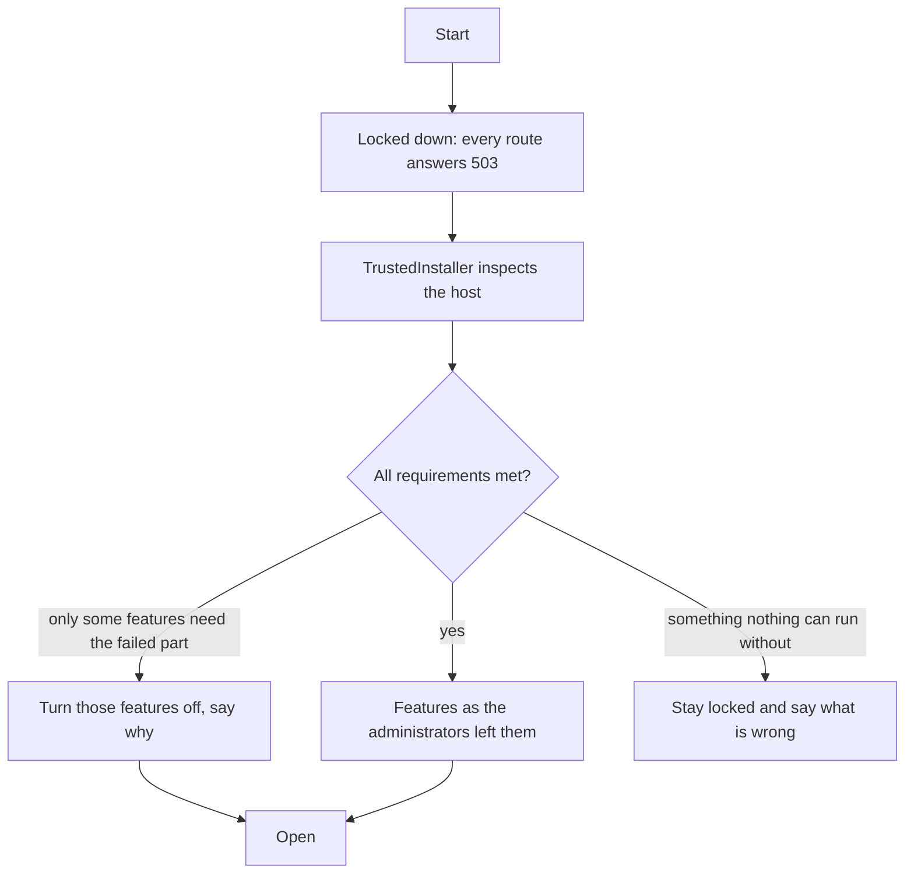
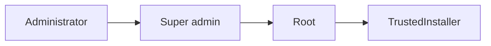

# TrustedInstaller: verifying the host at start-up

TrustedInstaller is imPress's own authority. It is a service, not an account: nobody signs in as it, no route calls it directly, and an administrator cannot override it. It has two jobs. One is the last check before firmware reaches a device ([firmware trust](../guides/ota-updates.md)). The other, described here, is to **verify the machine imPress is running on, every time it starts**.

## Locked until verified

When imPress starts, **nothing is offered**. Every request except the status page and the health check answers `503 LOCKED_DOWN` until TrustedInstaller has finished. The check takes a moment.

Previous sessions' choices are **restored** (they are in the database); TrustedInstaller changes only what the host forces it to. At the next start that passes, the features it turned off come back **and the choice an administrator had made before is put back**, not replaced by the default.

## What it checks

| Check | Minimum | If not met |
|---|---|---|
| Operating system | Linux, macOS or Windows | stays locked |
| Platform | 64-bit | stays locked |
| Python | 3.12 or newer | stays locked |
| SQLite | 3.35 or newer | stays locked |
| Data folder | writable | stays locked |
| System clock | year 2024 or later | reported |
| Processor cores | 2 | turns off `traffic_monitor`, `activity_charts` |
| Memory | 1024 MB | turns off `advanced_mode`, `activity_charts`, `presence`, `backups`, `search` |
| Free disk space | 2048 MB | turns off `backups`, `trash` |

The minimums can be lowered for a lab with `IMPRESS_MIN_CORES`, `IMPRESS_MIN_MEMORY_MB` and `IMPRESS_MIN_DISK_MB`. The result is on *System → Requirements* (what was found, the minimum, which features are off) and `requirements` in the [console](../guides/console.md).

## Containers

TrustedInstaller detects a container (`/.dockerenv`, `/run/.containerenv`, the cgroup of process 1, or `IMPRESS_IN_CONTAINER=1`). Inside one it switches the policy flag **`root.allow_access` off**: the separate root console (`docker exec`, ssh) is refused, and root works on the console of the container's own screen (`docker run -it`). The change is in the change log as made by TrustedInstaller.

## Who changed what

Every change to a feature or policy is recorded: **who** (administrator, super admin, root or TrustedInstaller), **what** (old and new value), **when**, and a note. See it in *System → Features → Change log*, or `policylog` in the console. The boot verification itself is logged (`boot.verification`, passed or failed, with the summary).

A change to the right is never undone by someone to the left.
