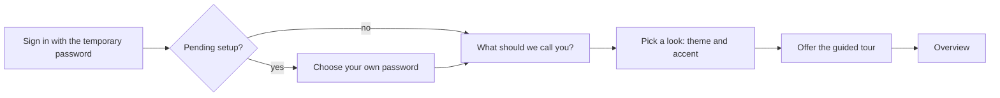

# Accounts, first sign-in and the default super admin

This page explains who can have an account, how an account is created, what happens the first time someone signs in, and how imPress protects itself from being left with nobody in charge.

## Roles and designations

| Role | Who | Sees |
|---|---|---|
| **Super admin** | the people who run the installation | everything, including accounts, features, backups, test data and the System page |
| **Administrator** | day-to-day staff | every classroom, students, devices, firmware, accounts (except super admins), activity |
| **Faculty** | teachers | **only the classrooms they manage** (their own, and ones they co-teach), the students they registered or teach, and their own quizzes and polls |
| **Teaching assistant (TA)** | faculty with a different label | exactly what faculty see: a TA is a faculty account shown with a *TA* badge, nothing more |

A super admin can change an account between faculty and administrator. An administrator or super admin can switch a faculty account between *faculty* and *TA*. Both ask for confirmation: changing between faculty and administrator opens a dialog explaining what the person gains or loses and signs them out so the change takes effect; changing between faculty and TA shows a warning that only the label changes.

Super admin accounts **cannot be created in the web app or the API**. They are created only by root, in the [root console](console.md) (`superadmin create`). This is deliberate: nobody who can sign in to the application can give themselves, or anyone else, the highest role.

### Names

Every account has a **username** (what you type to sign in; 3 to 64 characters) and a **display name** (what the interface calls you). The display name is asked for in the welcome set-up and can be changed in *Settings → Profile*. Where there is no display name the full name, then the username, is used.

## Creating an account

*User access → Accounts → Add account* (administrators and super admins).

1. Enter the full name, an optional display name, the username and the e-mail address.
2. Choose the role (*Faculty*, or *Administrator* for a super admin) and, for faculty, whether the account is shown as *Faculty* or *Teaching assistant*.
3. Choose the first password:
   - **Generate for me** (the default): imPress creates a strong random password and shows it **once**, with a copy button, when the account is added.
   - **I will type one**: type a temporary password; the strength meter shows how it rates and which rules are not yet met.
4. Hand the temporary password to the person in person or through a private channel.

The new account is **pending setup**. Until its owner finishes the welcome set-up, the temporary password opens only the set-up screen; every other request answers `403 PASSWORD_CHANGE_REQUIRED`. Resetting a password does the same: the new password is temporary and the owner must choose their own.

### The password rule

| Account | Rule |
|---|---|
| Administrators, faculty and TAs | at least 8 characters, with a lower-case letter, an upper-case letter, a number and a special character; not a common password; not the username |
| Super admins | at least 10 characters, not a common password, not the username, at least 4 different characters. They may change their password but are never forced to meet the complexity rule |

The strength meter in the interface scores the same way as the server (a test compares the two): *Too weak*, *Weak*, *Fair*, *Good* (12 or more characters) and *Strong* (16 or more).

## The first sign-in

The welcome set-up appears the first time any faculty, administrator or super admin account signs in:

1. **Password** (only when the account started with a temporary one): the temporary password, then the new one twice, with the live strength meter and the list of rules.
2. **Display name.**
3. **Look**: light, dark or match the device, and an accent colour. Each choice applies immediately.
4. **Tour**: *Start the tour* or *Skip for now*.

The **guided tour** is a short spotlight tour of the sidebar, search, notifications, personalization and the dashboard. It can be taken again at any time from the help (?) button in the top bar; keyboard: arrow keys to move, Esc to leave.

## Active accounts, disabling and the trash

- **Disable / Enable** (the person icon on a row) signs the account out at once and blocks sign-in until it is enabled again. A person who is using imPress at that moment sees the page blur and a notice: *Your account has been disabled* ... with a button back to sign-in.
- **Delete** moves the account to **Deleted**, where it stays for **30 days** and can be restored with its password and role. After 30 days it is removed permanently. Records the person created stay; the activity log keeps their name.
- **Active now** lists who is signed in (from where, since when, last activity). **Activity history** opens a panel with a daily chart, a heat map of when the person is active, what they do, and their latest events.
- **Sign out everywhere** ends every session of an account. Only super admins can do it.

Each account also has a **safety badge**: *Safe*, *Potentially Unsafe* or *Likely Compromised*, with a score from 0 to 100 and the reasons on hover. See the [traffic monitor](../design/traffic-monitor.md).

## The default super admin

At every start imPress makes sure the account `impress.default.superAdmin` exists.

- Its password is **new at every start** and printed once on the root screen (the terminal or container log). Setting `IMPRESS_DEFAULT_SUPERADMIN_PASSWORD` (or `IMPRESS_INITIAL_ADMIN_PASSWORD`) fixes it instead.
- It cannot be disabled, deleted, demoted or have its password reset by anyone, in the web app or the console. It exists so that there is always somebody who can sign in.
- When test mode is forced by root (`--test-mode`), its password is the fixed lab password `imPress@2026` and a banner says so. The hardened profile refuses to start in that mode.
- Other super admins are created by root (`superadmin create NAME`), start as **pending setup** and must choose their own password in the welcome set-up.

## Global deadlock prevention

Through the web app it cannot happen: the last active super admin cannot be disabled, demoted or deleted, and the database itself refuses it. It could only happen if the database were altered from outside. If it does, imPress does not wait for somebody to notice:

1. it treats it as tampering: it keeps a forensic copy, **rolls the database back** to the last good backup (the rolling backup, else the start-up one) and verifies it;
2. if there is still no active super admin, it **creates the recovery account** `impress.recovery.superAdmin` with a random **12-character** password;
3. it **prints the credentials once** on the root screen, alerts administrators and records what it did in the activity log.

It runs at every start, after every integrity check and every 30 seconds. The policy flag `deadlock_prevention.enabled` (on in both profiles) controls it; `deadlock check` in the [console](console.md) runs it on demand.

## Sessions

- A session ends after **5 minutes without activity** for **every** account, administrators and super admins included. Faculty get 30 minutes while one of their classes is in session. The hard limit is the same for all.
- **One device per account at a time.** A second sign-in is refused with a message that names where the account is already signed in.
- Session identifiers carry the identity of the server run that issued them (the **1PSID**, first-party session identifier). It is new at every start, so **a restart ends every session**: people are asked to sign in again and an old, copied token no longer works. *Settings → Security* shows a short fingerprint of your own 1PSID, never the identifier itself.
