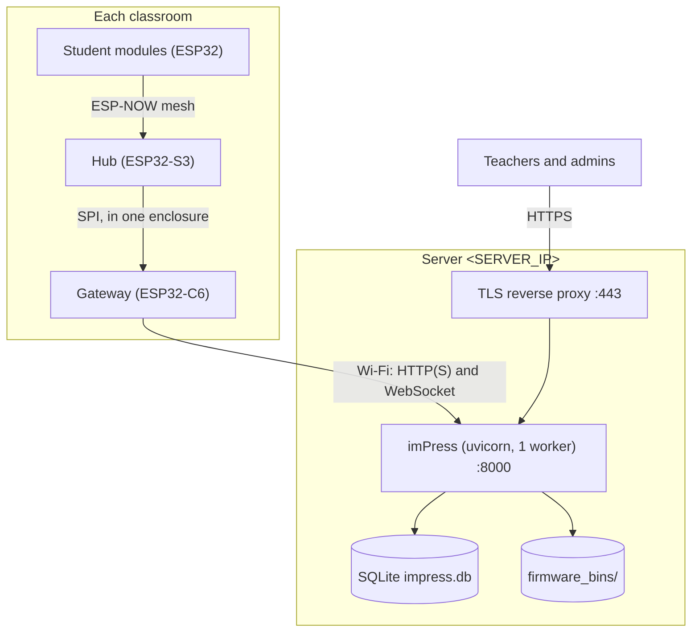
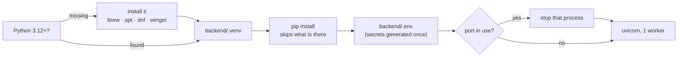
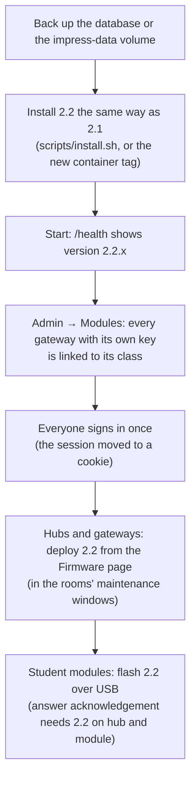

# Deployment

This guide puts imPress into real classrooms: one backend server, and one S3 + C6 pair plus student modules per room.

## 1. Server




### Host and process

**Quick start on one computer (macOS, Linux, Windows): the launcher.** `./launcher.sh` or `launcher.bat` in the repository root installs what is missing (Python 3.12+ with Homebrew, apt, dnf or winget; the virtualenv; the dependencies; `backend/.env` with generated secrets), stops whatever listens on `IMPRESS_PORT` (default 8000) and starts the server in the foreground. Use it for a lab PC, a demo or a first try. For a server that must survive reboots, use the steps below with systemd.



```bash
git clone … imPress && cd imPress
scripts/install.sh      # Python >= 3.12: backend/.venv, dependencies, backend/.env with generated secrets
scripts/start.sh        # uvicorn on 127.0.0.1:8000, one worker (IMPRESS_HOST / IMPRESS_PORT to change)
```
`install.sh` (#42) is safe to re-run, for example after `git pull`:
- **Dependencies:** on Linux x86_64 it installs the **hash-locked** set that CI tests (`requirements-lock.txt`, `--require-hashes`); elsewhere it installs `requirements.txt`.
- **Configuration:** it creates `backend/.env` from `.env.example`. An empty `IMPRESS_JWT_SECRET` or `IMPRESS_DEVICE_API_KEY` gets a random value; it never writes the public defaults and keeps every value already set. The file is `chmod 600`.
- **Check:** it confirms that the app imports.

CI runs exactly this path on a fresh runner, followed by `scripts/smoke_test.py`. Run that yourself after an install to check a live server:
```bash
scripts/smoke_test.py --base http://127.0.0.1:8000 --password <admin password>
```
It checks health and version, login, a course and section, gateway registration and heartbeat, a student join and the inventory, the firmware registry and the web app.

**Container alternative.** The backend is also published as an image, `ghcr.io/kush-kelaiya22/impress-backend:<version>` (linux/amd64 and linux/arm64). It is built from the same hash-locked dependencies, runs unprivileged, keeps its database, uploaded firmware and generated secrets in the `/data` volume, and has a health check:
```bash
docker run -d --name impress --restart unless-stopped -p 8000:8000 -v impress-data:/data \
  ghcr.io/kush-kelaiya22/impress-backend:2.1.0
```
Step-by-step: [container image guide](../deployment/container.md) (network, data, configuration, Compose, TLS, backups, upgrades). Tags: [releases → the backend container image](releases.md#the-backend-container-image). Back up the `impress-data` volume instead of `backend/`.

The manual path still works: a venv in `backend/`, `pip install -r requirements.txt`, `cp .env.example .env` (then set the secrets), and `uvicorn app.main:app --workers 1 --proxy-headers` started from `backend/`.
- **One worker only.** WebSocket rooms live in process memory ([backend scaling](../architecture/backend.md#scaling-and-limits)).
- Run it under a supervisor (systemd unit below) and start it **from `backend/`**.

```ini
# /etc/systemd/system/impress.service
[Unit]
Description=imPress backend
After=network.target

[Service]
WorkingDirectory=/opt/imPress/backend
EnvironmentFile=/opt/imPress/backend/.env
ExecStart=/opt/imPress/backend/.venv/bin/uvicorn app.main:app --host 127.0.0.1 --port 8000 --workers 1 --proxy-headers
Restart=always
User=impress

[Install]
WantedBy=multi-user.target
```

### `.env` for production
```bash
IMPRESS_DEBUG=false
IMPRESS_JWT_SECRET=<python -c "import secrets;print(secrets.token_urlsafe(32))">
IMPRESS_DEVICE_API_KEY=<another random value — also goes into every gateway>
IMPRESS_INITIAL_ADMIN_PASSWORD=<strong, change after first login>   # or leave empty and read it from the log once
IMPRESS_CORS_ORIGINS=["https://impress.example.edu"]
```
With `DEBUG=false` and default secrets the service **won't start**. The error names the variables to set.

### TLS reverse proxy (WebSockets included)
```nginx
server {
    listen 443 ssl;
    server_name impress.example.edu;
    # ssl_certificate …; ssl_certificate_key …;

    location /ws/ {
        proxy_pass http://127.0.0.1:8000;
        proxy_http_version 1.1;
        proxy_set_header Upgrade $http_upgrade;
        proxy_set_header Connection "upgrade";
        proxy_read_timeout 3600s;
        access_log off;            # teacher tokens travel in the WS query string
    }
    location / {
        proxy_pass http://127.0.0.1:8000;
        proxy_set_header X-Forwarded-For $proxy_add_x_forwarded_for;
        proxy_set_header X-Forwarded-Proto $scheme;
    }
}
```
### TLS for devices

Gateways and hubs speak plain `http://` and `ws://` unless they are built with **Backend over TLS** (#66). To turn it on:

1. **Serve TLS.** Use the nginx proxy above, or uvicorn directly:
   ```bash
   IMPRESS_SSL_CERTFILE=/etc/impress/server.crt IMPRESS_SSL_KEYFILE=/etc/impress/server.key \
     IMPRESS_HOST=0.0.0.0 IMPRESS_PORT=443 scripts/start.sh
   ```
   `start.sh` refuses to start if only one of the two is set or a file is unreadable. Check the server with `scripts/smoke_test.py --base https://<host>:<port> --password … [--cafile ca.pem]`.
2. **Configure each board** (`class_c6` and `class_s3`): in `idf.py menuconfig` → *Backend Server*, enable **Use HTTPS / WSS to reach the backend**, and set `BACKEND_HOST` to the name in the certificate and `BACKEND_PORT` to the TLS port. Then choose how to trust the server:

   | Choice | When | What you provide |
   |---|---|---|
   | **Public certificate authorities** | the server's certificate comes from a public CA (e.g. Let's Encrypt) | nothing: ESP-IDF's certificate bundle is built in |
   | **`certs/backend_ca.pem`** | a private CA, or a self-signed server certificate | the CA certificate (PEM) at `firmware/<project>/certs/backend_ca.pem` before building. It is embedded in the image; `.pem` files are git-ignored |

3. **Build and deploy.** TLS lives in the app, so a fleet switches with one OTA update (signed, if you use signing). **Deploy it only after the server serves TLS** on the configured port: a device that can't reach the backend fails its health check and rolls back (the gateway's 120 s watchdog), which is safe but noisy.

The device checks the server's certificate against the chosen trust and the host name; a mismatch is a connection error (logged, retried), never a fallback to HTTP.

### Backups
`scripts/backup.sh --dest <folder or user@host:/path> --encrypt-to <gpg id> --keep 35` writes a consistent, checksummed archive of the database, the firmware folder and `.env` to a place you choose (see the script's header, and the [hardening checklist](production-hardening.md)).

imPress keeps two **temporary** copies for self-repair (start-up and a rolling copy every 5 minutes, in `IMPRESS_TEMP_BACKUP_DIR`, by default under the system temporary folder; see [data integrity](../design/data-integrity.md)). They are not backups: they live on the same machine and are replaced constantly. Point `IMPRESS_TEMP_BACKUP_DIR` at a folder only the service account can read (for example `/temp/backups`), and keep real backups as well:

- `impress.db` is a single SQLite file: back it up with `sqlite3 impress.db ".backup '/backups/impress-$(date +%F).db'"` (safe while running).
- Also back up `firmware_bins/` and `.env` (store `.env` separately, it holds secrets).

### Recovering administrator access

imPress keeps at least one active super admin (#116), so the API cannot lock you out. A database from an older version, or one edited by hand, can still end up with nobody able to manage users. Recover it on the server; there is no web or API route for this, by design (#120).

1. Back up the database first (see *Backups* above).
2. Run the command where the database lives:
   - native install: `cd backend && .venv/bin/python -m app.manage restore-super-admin --username admin`
   - container: `docker exec -w /app/backend impress python -m app.manage restore-super-admin --username admin`
3. The command prints a one-time password. Log in with it and change it at once (*⚙️ Settings → Change password*).

The command makes the named account an active super admin, signs out its old sessions and writes a `user.recovery` entry to the activity log. If the username does not exist it stops with exit code 2; add `--create` to create the account.

## 2. First-run administration

1. Log in as `admin`, change the password, and create other admins (as super admin) and teachers.
2. Create courses, then classes (with `classroom_code` = the physical room label, e.g. `RM-201`, and the meeting schedule).
3. Import students via CSV (`roll_number,student_name,email,phone,program,enrollment_year,graduation_year`) and enroll them into classes.
4. **Activate** a class when it's in session; gateways only auto-link to active classes.

## 3. Per-room hardware

1. **Wire the S3 and C6** ([hardware reference](../reference/hardware.md#s3--c6-wiring)) and power both from a stable 5 V supply (brownout detection is on).
2. **Configure the C6:** `WIFI_SSID`/`WIFI_PASSWORD` (2.4 GHz, WPA2+), `BACKEND_HOST`/`BACKEND_PORT`, `DEVICE_API_KEY` = the server's key. Flash it.
3. **Configure the S3:** the same Wi-Fi, backend and key (used for OTA), and `MESH_WIFI_CHANNEL`. Flash the **full** image once over serial (it has the rollback bootloader).
4. **Link the room:** either set the class's `classroom_code` and register the C6 with that code, or let the C6 auto-link to the single active class without a gateway. Check it in the admin "modules" view or `GET /api/classes/{id}/presence`.
5. **Student modules:** flash `firmware/student` (with the same `MESH_WIFI_CHANNEL`) and provision each module's enrollment number (buttons or serial). Hand modules out; re-provision with CONFIRM + C at boot.

## 4. Go-live checklist

- [ ] `GET /health` OK through the proxy; HTTPS valid.
- [ ] Admin password changed; `IMPRESS_DEBUG=false`; secrets not default.
- [ ] Each room's gateway shows **online** and is linked to the right class.
- [ ] A test quiz shows on a student module, and an answer increments the live count.
- [ ] Backups scheduled.
- [ ] (Recommended) OTA signing enabled ([OTA guide](ota-updates.md#signing-images)).
- [ ] **Git history purged** of the databases committed before v2, and the passwords that were in them rotated:
  ```bash
  pip install git-filter-repo
  git filter-repo --invert-paths --path backend/impress.db --path backend/impress.db.bak-pre-ist --path impress.db
  git push --force --all && git push --force --tags      # coordinate: everyone re-clones
  ```

## 5. Upgrading

1. Back up the DB.
2. `git pull`, then `scripts/install.sh`.
3. Restart the service. The versioned migrations run at startup: they back up the database first and stop the server with instructions if a step can't apply ([database migrations](../engineering/DATABASE_MIGRATIONS.md)). `GET /health` reports `version` and `schema_version`.
4. Update firmware: the S3 and C6 from the [Firmware page](ota-updates.md); students over serial. Read the [changelog upgrade notes](../reference/changelog-v2.1.md#upgrade-notes) for one-time serial flashes.

### From 2.1 to 2.2



1. **Back up** as in step 1 above. 2.2 adds no schema migration (only its own integrity tables, created at start-up), but the backup is your way back.
2. **Install and start** 2.2. Check `GET /health` from the server: `"version": "2.2.<n>"`.
3. **Link every gateway** (*Admin → Modules*). A gateway with its own device key now records answers, votes and attendance **only for the class it is linked to**; an unlinked gateway's answers are skipped. A gateway built with `CLASSROOM_CODE` links itself when it registers.
4. **Sign in again**, on one device per account (v2.2 refuses a second sign-in from another device; an administrator can end a stuck session under *User access → End sessions*). Sessions now end after 5 minutes without activity (30 minutes for a teacher during their class). At the first start, 2.2 seals the existing database (log: *Database re-sealed (first start with the database gateway)*); passwords are upgraded to the new hash as people sign in.
5. **Browsers.** The web app keeps the session in an `HttpOnly` cookie instead of page storage, so each browser signs in once after the upgrade. Scripts that call the API keep using `Authorization: Bearer <token>`; cookie-authenticated changes from your own tools must send the header `X-Impress-Request: 1`.
6. **Firmware.** Upload the 2.2 hub and gateway images on the *Firmware* page. The TrustedInstaller re-qualifies images registered under 2.1 automatically the first time they are needed (their reports were not sealed). Deploy as usual; hubs and gateways update in their rooms' free time.
7. **Student modules** keep working on 2.1 firmware. To get answer acknowledgement (#181), flash 2.2 over USB once; a module only waits for confirmations from a hub that sends them.

To go back, follow [recovery §6](../firmware/RECOVERY_PROCEDURE.md#6-undo-a-backend-upgrade); 2.1 ignores everything 2.2 added.

