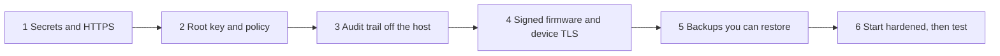

# Production hardening checklist

imPress ships with two policy profiles ([global policy control](../design/gpc.md)). The **standard** profile is for a lab or a first try. A classroom server that holds real student data should run the **hardened** profile, which turns every protection on and **refuses to start** until the items below are true. This page is the order to do them in, and what each one protects.



## 1. Secrets and HTTPS

- [ ] `IMPRESS_JWT_SECRET` and `IMPRESS_DEVICE_API_KEY` are random (the launcher and `scripts/install.sh` generate them). The JWT secret also keys the database seals: keep it with the same care as the database.
- [ ] Staff HTTPS: a TLS reverse proxy or `IMPRESS_SSL_CERTFILE` / `IMPRESS_SSL_KEYFILE` ([deployment](deployment.md#tls-reverse-proxy-websockets-included)). `IMPRESS_REQUIRE_HTTPS` is not `false`; `IMPRESS_DEBUG` is off.
- [ ] The database and `.env` are readable by the service user only. Back up `.env` separately.

## 2. Root key and the signed policy

The policy is root's, not the application's. On a machine that is **not** the server:

```bash
scripts/gpc.py keygen --dir ~/impress-root
scripts/gpc.py sign --key ~/impress-root/root.key --profile hardened \
    --set audit.sink_path=/var/log/impress/audit.jsonl --out global_policy_control.json
```

- [ ] `root.key` (private) is kept offline or on a separate, restricted machine. It never sits on the server.
- [ ] `root_public.key` and `global_policy_control.json` are on the server, **owned by root and read-only** for the service user (for example in `/etc/impress/`).
- [ ] Start with `IMPRESS_PROFILE=hardened`, `IMPRESS_GPC_FILE=/etc/impress/global_policy_control.json`, `IMPRESS_ROOT_PUBLIC_KEY=/etc/impress/root_public.key`.
- [ ] Sign the code: `scripts/gpc.py manifest --key ~/impress-root/root.key`, again after every upgrade (the hardened profile enforces `code.verify_manifest`).

## 3. An audit trail the application cannot rewrite

- [ ] `audit.sink_path` points to a file on an **append-only or write-once** location (`chattr +a`, an object-lock volume, or a remote-logged mount), and/or `audit.sink_url` sends every event to a collector the application's administrators don't control.
- [ ] Verify it regularly: `cd backend && python -m app.manage audit-verify /var/log/impress/audit.jsonl` (the chain breaks if a line is edited, removed or reordered).
- [ ] Keep it at least as long as your retention schedule says (`audit.min_retention_days`, 180 by default in the hardened profile; see [retention](../compliance/retention-schedule.md)).

The sink contains staff account names and actions. It never contains students' names or enrollment numbers: those are removed before an event is written, because the sink can't be erased.

## 4. Signed firmware and device TLS

These are server-side requirements of the hardened profile; the device side is configured as described in the [firmware guides](ota-updates.md).

- [ ] `IMPRESS_FIRMWARE_SIGNING_KEY` names the site's firmware public key ([signing images](ota-updates.md#signing-images)); the matching **private** key is on the signing machine, not the server.
- [ ] `IMPRESS_FIRMWARE_ALLOW_UNSIGNED` and `IMPRESS_FIRMWARE_SINGLE_APPROVER` are off: one administrator uploads, a different one approves.
- [ ] Device HTTPS and per-device keys are required (set by the profile: `device.https_required`, `device.keys_required`). Every gateway and hub is built with `BACKEND_TLS` and a certificate it can validate.
- [ ] Put gateways and hubs on their own VLAN where you can.

What this does **not** do: it does not authenticate the radio messages between student modules and the hub (a nearby device could forge an answer: see [mesh authentication](../design/mesh-authentication.md), still a proposal), and it does not enable secure boot or flash encryption on the boards. Until those exist, run pilots in a controlled room and treat results as spoofable.

## 5. Backups you can restore

The integrity backups in `IMPRESS_TEMP_BACKUP_DIR` repair tampering. They live on the same machine and are replaced all the time: **they are not backups**.

- [ ] A scheduled, encrypted, off-host copy of the database, the firmware folder and `.env` (immutable or versioned storage), with a restore drill and the recovery time you measured written down.
- [ ] `IMPRESS_TEMP_BACKUP_DIR` is readable by the service user only.
- [ ] **The disk or volume that holds the database folder is encrypted** (BitLocker, FileVault, LUKS/dm-crypt, or your cloud's volume encryption with a key you control). The debug-mode snapshots, saved datasets, exports and integrity backups are plain SQLite files; encryption of the volume is what makes a copy of the files useless on its own ([decision D16](../design/decisions.md)). In the hardened profile imPress alerts at every start when it can see the volume is **not** encrypted (macOS FileVault, Linux dm-crypt); where it cannot tell (containers, Windows, network volumes) it logs that, and this item is yours to verify. Rehearse losing the key: restore from the off-host backup onto a fresh encrypted volume.

## 6. Start hardened, then check

```bash
IMPRESS_PROFILE=hardened IMPRESS_GPC_FILE=/etc/impress/global_policy_control.json \
IMPRESS_ROOT_PUBLIC_KEY=/etc/impress/root_public.key scripts/start.sh
```

If something is missing, the server stops and lists every unmet item at once. When it is running:

- [ ] **System → Policy** shows *Hardened*, the signed file's serial, and *matches the signed manifest*.
- [ ] Debug mode and test data are off (the hardened profile switches them off).
- [ ] A dual-control drill: with two super admins, request *Clear class data*, approve it from the other account, and confirm the wait and the audit sink entries; then cancel. Do this on a test server, not on the classroom's data.
- [ ] A restore drill from your off-host backup.

## Roles to settle before go-live

| Role | Does | Not the same person as |
|---|---|---|
| **Root** (system owner) | holds the root key, signs policy and the code manifest, controls the host and the audit volume | the application super admins |
| **Super admins** (two or more) | approve each other's dangerous actions | each other (a single one can't approve themselves in the hardened profile) |
| **Firmware uploader / approver** | one uploads, another approves | each other |
| **Privacy / data protection lead** | notices, rights requests, retention ([compliance](../compliance/README.md)) | |
| **Incident contact** | first call when something looks wrong ([incident response](../compliance/incident-response.md)) | |
