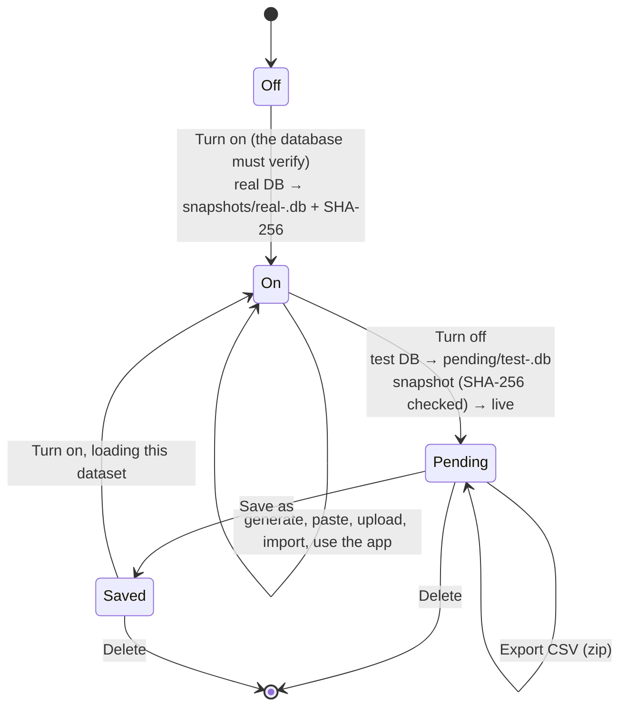
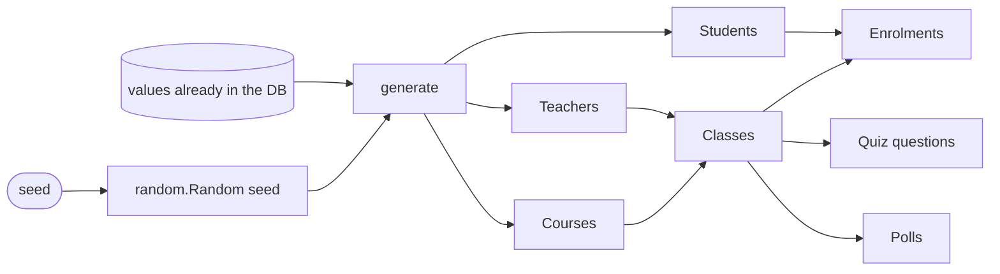

# Debug mode and test data

Debug mode lets a super admin try imPress with realistic data (demos, training, load tests) **without touching the real database**. The real database is copied aside and verified; everything happens on a copy; turning debug mode off puts the real data back exactly as it was.

Page: **Administration → Test data** (super admins only). API: `/api/admin/test-mode` and `/api/admin/test-data` ([REST API](../api/rest-api.md)).

## Lifecycle

1. **Turn on.** imPress verifies the live database first: a Degraded or unverifiable database must be resolved before testing starts. It then copies the database to `test-data/snapshots/` and records the copy's SHA-256. Starting from a saved dataset swaps that dataset in; your own account and session come along, so you stay signed in.
2. **While on**, everyone sees this banner on every page:

   > **Debug mode is on.** This application is under testing: you are working on test data, and you may experience degraded performance.

   Everything works normally (classes, quizzes, devices), but on the test copy.
3. **Turn off.** The snapshot's SHA-256 is checked: if the saved real database is missing or changed, debug mode stays on and administrators are alerted, so you never switch back to a wrong file. The real database goes back live, and the test database is set aside under `test-data/pending/`.
4. **Decide** what happens to the test data: **Save** it under a name (it can be loaded the next time debug mode is turned on), **Export** it as a zip of CSV files (one per table), or **Delete** it.

`test-data/` sits next to the database file. It is git-ignored and readable by the server's user only.

## The sheets

The page has one tab per table, in dependency order:

| Tab | Key columns | Refers to |
|---|---|---|
| Teachers | `username`, `full_name`, `email` | — |
| Courses | `code`, `name` | — |
| Students | `roll_number` (10 letters or digits), `student_name` | — |
| Classes | `code`, `name`, `teacher_username`; optional `course_code`, `co_faculty`, `classroom_code`, `days` + `start` + `end` | Courses, Teachers |
| Enrolments | `roll_number`, `class_code` | Students, Classes |
| Quiz questions | `class_code`, `title`, `question_text`, `option_a` … `option_d`, `correct` (one row per question; rows with the same title form one quiz) | Classes |
| Polls | `class_code`, `title`, `options` (2–4, separated by `\|`) | Classes |

A reference may point at a row in the sheets or at something already in the (test) database. Hover over a column header to see its format; required columns are marked `*`.

**Editing works like a spreadsheet:**

| Do | How |
|---|---|
| Edit a cell | click it and type, or double-click / Enter / F2 to edit its content |
| Move | arrow keys, Tab / Shift+Tab, Enter |
| Select a block | Shift+click or Shift+arrows |
| Copy, cut, paste | Ctrl/⌘+C, X, V. A block copied in Google Sheets or Excel pastes cell by cell from the selected cell |
| Paste a whole table | select the top-left cell (row 1, first column) and paste with a header row: columns are matched by name |
| Clear | Delete or Backspace clears the selection |
| Rows | *10 rows* adds empty rows; *Delete selected rows*; *Clear tab* |
| CSV | *Upload CSV* loads a file into the current tab (header row required, unknown columns are ignored and listed); *Download tab* saves it |

The sheets are kept in the browser (local storage) as a draft until they are imported, so a reload doesn't lose them.

## Check and import

**Check** validates every sheet on the server and lists each problem with its tab, row and column; the offending cells turn red, and clicking a problem jumps to its cell. **Import** validates again and writes **all or nothing**: one bad row and nothing is stored.

It checks: required values and formats (e-mail, whole numbers, `HH:MM`, `YYYY-MM-DD`, terms, day names), uniqueness within the sheets **and** against the database (usernames, e-mails, course, class and room codes, roll numbers), that every reference exists (course, teacher, co-faculty, student, class), duplicate enrolments, quiz options and correct answers, poll options, and the row limit (20 000 per import). It does not check timetable clashes in rows you enter yourself.

With **Simulate a term of activity** ticked, the import also creates past class meetings with attendance, completed quizzes with answers, and closed polls with votes, so the dashboards, student statistics and results pages have something to show.

## The generator

*Generate test data* fills the sheets from a **seed** and the counts you choose (teachers, courses, students, classes, classes per student, quizzes and questions per class, polls per class). Nothing is written until you import.

- **Repeatable:** the same seed and counts always give the same data; another seed gives different data. The button next to the seed picks a random one.
- **Unique:** every username, e-mail, course code, class code, room and roll number is unique across the generated data **and** what the database already holds, so a second generation imports cleanly next to the first.
- **Consistent:** generated in dependency order (teachers → courses → students → classes → enrolments → quizzes → polls), so every enrolment names a student and class that exist. Teachers have a home department; students take their own programme's courses first; a timetable never double-books a room or a teacher (Mon/Wed/Fri or Tue/Thu slots in teaching hours).
- **Natural:** names come from regional and international pools; each department has its own course catalogue and question bank; roll numbers follow the institution's format (intake year + programme + serial); e-mails derive from names.

Generated teachers sign in with the password shown on the page. It is random, new for each debug-mode session (it is not a published default), kept in the state file next to the database (readable by the server's user only), and it exists only in test data.

## Notes

- Only super admins see the page and the endpoints (`users.assign_role`). Generating, checking and importing require debug mode to be on (`409 TEST_MODE_OFF` otherwise).
- The integrity checks (see [data integrity](../design/data-integrity.md)) keep running in debug mode, against the test database and its own backups.
- Turn debug mode off before upgrading or restarting for maintenance. A restart keeps debug mode on (the state is saved next to the database), so nothing is lost, but the banner stays until you turn it off.
