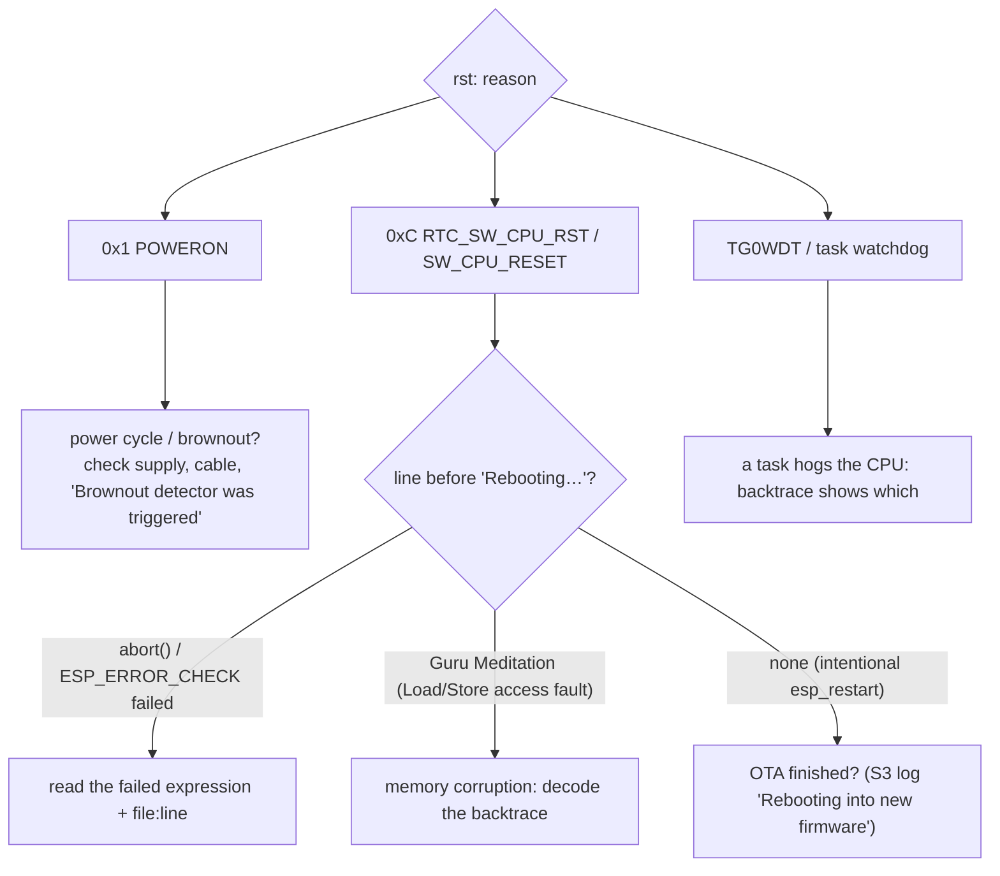

# Troubleshooting

## Contents

- [Setup problems](#setup-problems): the server, the container and the first boot of each board
- [Start with the reset reason](#start-with-the-reset-reason)
- [Connectivity](#connectivity)
- [Mesh and students](#mesh-and-students)
- [Backend data](#backend-data)
- [Collecting evidence for a bug report](#collecting-evidence-for-a-bug-report)

## Setup problems

The release page lists the most common of these. Check them in order: server, then gateway, then hub, then student modules.

### Server

| Symptom | Cause | Fix |
|---|---|---|
| `scripts/install.sh` stops with *imPress needs Python >= 3.12* | the default `python3` is older | install Python 3.12 or later, then `PYTHON=python3.12 scripts/install.sh` |
| `pip` fails to build a package (bcrypt, pydantic-core) | not Linux x86_64, and no prebuilt wheel for this platform | install a C compiler and Python headers, or use the container image |
| The server stops with *Refusing to start with default secrets* | `backend/.env` holds the public example secrets | run `scripts/install.sh` again (it generates new secrets), or set `IMPRESS_JWT_SECRET` and `IMPRESS_DEVICE_API_KEY` |
| The default super admin's password is lost | `impress.default.superAdmin` gets **a new random password at every start**, printed once on the root screen (or in the log) | read the start-up log, or fix it with `IMPRESS_DEFAULT_SUPERADMIN_PASSWORD`; the account is protected (nobody can reset it), so restart to get a new password |
| imPress answers *imPress is locked down* (503) | TrustedInstaller found something the server cannot run without (Python, SQLite, a writable data folder) | the message says what; fix it and restart. `requirements` in the console shows every check |
| *imPress has been disabled by Root as an integrity violation was detected* | a file of the program changed, moved, or was added since the reference was made | restore the original files, or, if you changed them on purpose, start once with `--rehash` (or `iips rehash`); `iips status` lists the differences. `--bypass-iips` starts anyway with a warning on every page |
| A feature (backups, presence, search …) is missing or greyed out | an administrator, root or TrustedInstaller switched it off | *System → Features* shows who and when; if TrustedInstaller did, *System → Requirements* shows the host check that failed |
| `docker exec … python -m app.console` says *the separate root console is switched off* | the server is in a container, so TrustedInstaller closed it | attach to the container's own screen: `docker run -it` or `docker attach`; the screen there is the console |
| Everyone was signed out after a restart | session identifiers are bound to the server run (1PSID) | expected; sign in again |
| *Test mode was enabled by root and cannot be disabled* | the server was started with `--test-mode` | restart without it; it cannot be turned off from the web app by design |
| The web app opens on the server but not from other computers | the host firewall or network blocks TCP 8000, or staff traffic is correctly requiring HTTPS | allow TCP 8000 only on the trusted classroom network; use HTTPS for staff browsers and check the server's LAN address |
| The launcher says port 8000 is already in use | another process owns the fixed server port | review the displayed PID and process name. Answer `y` to request a graceful stop, or `n` to leave it running and abort. A separate prompt is required before any forced stop; otherwise stop the process manually and retry |
| Sign-in says *Too many failed attempts* despite the correct password | password checks are paused during the displayed wait | wait for the live countdown. For recovery, root can use `users unlock USER` or reset the password. An address-wide limit needs explicit `users unlock USER --ip ADDRESS`; inspect the server log first |
| A previous password stops working after restart | the default super admin receives a new password at every start unless root fixed one | choose **Show credentials** or review startup output. Use `password reset` if it is unavailable; update an external fixed-password environment setting before restarting |
| The terminal is cluttered, or command output overwrites input | the terminal needs a complete redraw, or an older root screen is running | update to the current root dashboard. Press Ctrl+L to redraw or use Clear logs. Navigate Actions with arrows and Enter; Tab moves to Logs or the command box |
| *Address already in use* after starting with `scripts/start.sh` | another process owns fixed port 8000 | stop its owner manually; the low-level start script never terminates processes. The launcher can prompt before doing so |
| The upgrade stops and names two classes | two classes share a course and a section | give one of them another section label, then start again ([migrations](../engineering/DATABASE_MIGRATIONS.md)) |

### Container

| Symptom | Cause | Fix |
|---|---|---|
| `docker pull` asks for credentials | the package is private | the repository owner makes it public once (package settings) |
| *exec format error*, or *no matching manifest for linux/arm/v7* | a 32-bit OS (for example 32-bit Raspberry Pi OS); images exist for 64-bit `amd64` and `arm64` only (#136); images before #136 were `amd64` only | use a 64-bit OS, pull a release from #136 on, or install with `scripts/install.sh` |
| `docker exec impress python -m app.manage …` says *No module named 'app'* | the command must run in `/app/backend` | add `-w /app/backend` |
| The browser shows *HTTPS required*, or login says *This connection is not encrypted* | the page was opened with `http://` from another computer (#152) | open the `https://` address (Caddy or your proxy, [container guide](../deployment/container.md)); for an isolated lab only, `IMPRESS_REQUIRE_HTTPS=false` |
| HTTPS through a proxy still says *HTTPS required* | the server does not trust the proxy's `X-Forwarded-Proto` | set `IMPRESS_FORWARDED_ALLOW_IPS` to the proxy's address (`*` in the Compose setup) |
| The data is gone after `docker run` | the container started without the volume | always pass `-v impress-data:/data`; the database and the secrets are in that volume |
| `docker logs` does not show the admin password | the volume already holds a database from an earlier start | use the password from that start, or see "The first admin password is lost" above |
| `docker inspect` shows `unhealthy` | the server did not answer `/health` | `docker logs impress` shows the reason (often the TLS variables) |

### Gateway and hub (first boot)

| Symptom | Cause | Fix |
|---|---|---|
| The native USB port disappears after flashing the gateway | GPIO12/13 are the SPI ready lines | flash and monitor through the UART port ([hardware](../reference/hardware.md)) |
| `WiFi disconnected — retrying` | wrong Wi-Fi name or password, or a 5 GHz-only network | set them in `idf.py menuconfig` (or the settings partition) and erase the flash before flashing |
| The gateway connects to Wi-Fi but never shows `ONLINE` | wrong server address or port, or the host firewall blocks access | `curl http://<server>:8000/health` from the same network; check the configured server address and allow TCP 8000 in the firewall |
| `esp-tls: select() timeout`, then `backend unreachable: …` (`tls_error_code=0`, handshake status 0) | the TCP connection never opened: the host firewall drops the port or the network blocks it. Common on a **Windows Mobile Hotspot**, whose network Windows treats as *Public* | allow TCP 8000 in an administrator PowerShell: `New-NetFirewallRule -DisplayName "imPress 8000" -Direction Inbound -Protocol TCP -LocalPort 8000 -Action Allow`; from a phone or laptop on the hotspot, open `http://<SERVER_IP>:8000/health` (#132) |
| `TLS handshake failed: …`, or the boot line `Backend: https://<host>:8000 (TLS …)` while the server is plain HTTP | the image was built with `BACKEND_TLS=y` but the server does not serve HTTPS on that port, or the certificate does not name `BACKEND_HOST` | either rebuild with `BACKEND_TLS` off for a lab network, or start the server with `IMPRESS_SSL_CERTFILE`/`IMPRESS_SSL_KEYFILE` (usually port 443) and use a certificate whose name (or IP address) is `BACKEND_HOST` ([TLS for devices](deployment.md#tls-for-devices)). The build prints a warning for TLS on port 8000 |
| The server log shows 401 or 403 for device calls | the device API key does not match | set `CONFIG_DEVICE_API_KEY` to the server's `IMPRESS_DEVICE_API_KEY` |
| `WebSocket error: backend refused the device: …` while HTTP calls work | the gateway joins a class it is not linked to (#121), usually a pinned `CONFIG_CLASS_SESSION_ID` / NVS `class_id` | link it in *Admin → Modules*, or set its class back to the linked one (#159) |
| The log shows `First boot — writing … defaults` after you wrote a settings partition | the partition has no `init_done` (gateway) or `init` (hub) flag | rebuild it with the flag ([releases: flash prebuilt images](releases.md#flash-prebuilt-images)) |
| `s3_link_ok` stays false | SPI wiring, or no common ground | check the six signals and GND ([wiring](../reference/hardware.md#s3--c6-wiring)) |
| `Brownout detector was triggered` | weak USB cable or supply | use a short cable and a 5 V supply that gives at least 500 mA |

### Student modules

| Symptom | Cause | Fix |
|---|---|---|
| The display shows `NO ID` | no enrollment number yet | enter the 10-character number with the buttons (A next, B previous, C delete, CONFIRM save) |
| `No mesh found` | the hub is off, or a different Wi-Fi channel | power the hub first; use the same `MESH_WIFI_CHANNEL` on both |
| Answers do not count | the enrollment number is not registered, or the class is not active | add the student on the Students page; activate the class |

## Start with the reset reason

Every ESP32 boot prints `rst:0x… (REASON)`. `idf.py monitor` decodes panic backtraces when it is given the matching `.elf`.

## Known reset causes (all fixed on `v2`)

| Log signature | Board | Cause | Fix |
|---|---|---|---|
| `ESP_ERROR_CHECK failed: … ESP_ERR_WIFI_NOT_STARTED … esp_wifi_set_channel`, repeating `RTC_SW_CPU_RST` | student | channel set before Wi-Fi start (536-reboot loop in the original logs) | fixed before v2; failures are now logged, not fatal (#7) |
| random `Load/Store access fault`, `CORRUPT HEAP`; `spi2http` stalls once the S3 link is busy | C6 | SPI slave ISR used a stack descriptor that was gone | #1 |
| `CORRUPT HEAP` around heartbeats | C6 | two tasks mutated one cJSON batch | #4 |
| crash right after a class reassignment | C6 | WS client destroyed from its own task | #5 |
| hub reboots after any OTA prompt | S3 | no-op OTA used to restart | #13 |

If resets persist on `v2`, log `esp_reset_reason()` at boot and run a soak with `CONFIG_HEAP_POISONING_COMPREHENSIVE=y` on the C6.

## Connectivity

| Symptom | Likely cause | Check / fix |
|---|---|---|
| C6: `WiFi disconnected — retrying` every ~2.4 s | wrong SSID/password; AP weaker than WPA2-PSK; 5 GHz-only AP | NVS `wifi_ssid`/`wifi_pass`; enable 2.4 GHz WPA2 |
| C6 online but `HTTP POST failed: …` | the text after the colon names the cause (#132): *backend unreachable* (address, 127.0.0.1 bind, firewall), *connection refused* (port), *TLS handshake failed* (scheme, port, certificate), *refused the device key* | see [gateway and hub](#gateway-and-hub-first-boot); `curl http://<host>:8000/health` from the same network |
| backend logs 403 for device calls | API key mismatch | NVS `api_key` = `IMPRESS_DEVICE_API_KEY` |
| C6 WS closed with 4401 | key mismatch, or an old firmware sending `?api_key=` with a wrong value | same as above |
| native USB port vanishes at C6 boot | GPIO12/13 are the SPI ready lines | use the UART port ([hardware](../reference/hardware.md)) |
| teacher dashboard never updates | WS rejected (4401) or the proxy doesn't upgrade `/ws/` | browser devtools → WS frames; [proxy config](deployment.md#tls-reverse-proxy-websockets-included) |
| backend won't start: *Refusing to start with default secrets* | production mode with public secrets | set the named variables or `IMPRESS_DEBUG=true` locally |

## Mesh and students

| Symptom | Check |
|---|---|
| student shows "NO ID" | provision an enrollment number (buttons/serial); CONFIRM + C at boot clears it |
| student stuck on "Connecting to mesh…" | S3 powered? Same `MESH_WIFI_CHANNEL`? The S3 log should print `Mesh master initialized, channel=N` and `New student: enroll=…` |
| students far from the hub never get questions | that was a pre-v2 bug (relayed root traffic not delivered); flash v2 student firmware |
| the same answer counted several times | pre-v2 relay storm (#6); v2 stores one answer per (quiz, question, student) |
| answers never reach the dashboard | C6 log `Batch flush N items`; the batch response `skipped` > 0 means unknown enrollment / inactive quiz / out-of-range option / duplicate |

## Backend data

| Symptom | Check |
|---|---|
| a gateway linked to the wrong class / presence shows the wrong root | fixed by #17 for new registrations; repair existing rows by re-registering the C6 with its `classroom_code` or admin re-link |
| sessions expire unexpectedly | 15 min idle (60 min for staff during their class) / 6 h hard by default; live refresh and polling don't count as activity (by design). `IMPRESS_SESSION_IDLE_MINUTES` / `IMPRESS_SESSION_CLASS_IDLE_MINUTES` |
| sign-in refused: *already signed in on another device* (409) | one device per account: sign out on the other device, or an administrator uses **End sessions** on the user (User access page). Behind a proxy that hides client addresses, set `IMPRESS_SINGLE_SESSION=false` |
| red **Degraded** badge next to *System* | the database changed outside imPress and was restored from a backup; read the activity-log entry, then acknowledge it on the System page. See [data integrity](../design/data-integrity.md) |
| `403 DB_WRITE_REFUSED` | the database gateway refused a write the account may not make; the activity log has the table and the reason |
| The launcher did not start because port 8000 is in use | the operator declined to stop the displayed listener, or it did not exit after the graceful stop | leave it running and stop its owner manually, or rerun the launcher and confirm the requested stop. The listener port is fixed at 8000 |
| `database is locked` | multiple workers or external writers; run **one** uvicorn worker |
| nobody can manage users (all super admins disabled or deleted) | run `python -m app.manage restore-super-admin --username <name>` on the server: [deployment → recovering administrator access](deployment.md#recovering-administrator-access) |
| "This is the last active super admin" (409) | promote or reactivate another super admin first; the last one can't be deactivated, demoted or deleted (#116) |
| timestamps look 5:30 off | the DB stores naive IST; legacy UTC rows → `backend/migrate_utc_to_ist.py` |

## Collecting evidence for a bug report

1. The full boot log from power-on through the failure (`idf.py monitor | tee log.txt`).
2. The firmware commit and `ELF file SHA256` from the boot banner.
3. The backend log around the time, plus the related request/response.
4. For data issues: `GET /api/admin/activity` around the time.
