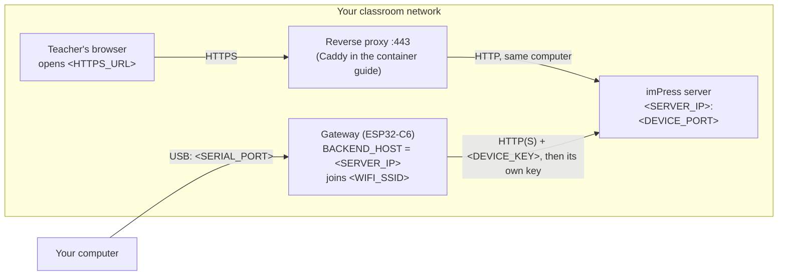

# Placeholders used in this documentation

The guides never show a real address, password, key or port from someone's setup. Wherever a value depends on **your** site, they use a placeholder in angle brackets. Replace the whole placeholder, brackets included, with your own value.

| Placeholder | Meaning | How to find your value | Example of the form |
|---|---|---|---|
| `<SERVER_IP>` | The server computer's address on the classroom network: what gateways connect to, and what teachers type into the browser | Windows: `ipconfig` (the adapter of the classroom network, or *Local Area Connection\* N* for a Mobile Hotspot). macOS: `ipconfig getifaddr en0`. Linux: `hostname -I` | four numbers separated by dots |
| `<SERVER_NAME>` | A host name for the server instead of `<SERVER_IP>`, if your network has DNS | your network administrator | `impress.school.example` |
| `<HTTPS_URL>` | The address teachers open: `https://<SERVER_IP>` or `https://<SERVER_NAME>` (port 443) | the reverse proxy you set up ([container guide](../deployment/container.md)) | `https://impress.school.example` |
| `<DEVICE_PORT>` | The plain-HTTP port the gateways use | the server's port, `8000` unless you changed it | `8000` |
| `<WIFI_SSID>` / `<WIFI_PASSWORD>` | The classroom Wi-Fi the gateways (and hubs during an update) join | your network or hotspot settings | |
| `<DEVICE_KEY>` | The site's shared device key (`IMPRESS_DEVICE_API_KEY`) | printed once by the server at first start, or in `/data/.env` / `backend/.env` | a long random string |
| `<ADMIN_PASSWORD>` | The `admin` account's password | printed once at first start; change it at once | |
| `<SERIAL_PORT>` | The USB serial port of a board | Windows: Device Manager → *Ports (COM & LPT)* (`COM…`). macOS: `ls /dev/cu.usb*`. Linux: `ls /dev/ttyUSB* /dev/ttyACM*` | `COM…`, `/dev/ttyUSB0` |
| `<RELEASE_TAG>` | A release, as on the Releases page | the release page title | `varun/v2.2.3` |
| `<ASSET>` | A release's file prefix | the release's download list | `impress-varun-2.2.3` |
| `<CLASSROOM_CODE>` | A class's room label, also built into a gateway that links itself (`CLASSROOM_CODE`) | Admin → Classes | `RM-201` |
| `<CLASS_ID>` | A class's number | the class page's address bar | `12` |
| `<IDF_PATH>` | Where ESP-IDF v6.1 is installed | the ESP-IDF installer's summary, or `echo $IDF_PATH` | |

Two values are **firmware defaults**, compiled into the release images, not anyone's private address:

- Gateway and hub `BACKEND_HOST` default: the address Windows gives the computer that shares a **Mobile Hotspot** (`192.168.137.1`), so that a server running on the hotspot computer works without configuration. Any other setup sets `BACKEND_HOST` to `<SERVER_IP>` in menuconfig or by [writing a settings partition](../guides/releases.md#write-the-settings-of-a-new-gateway-or-hub).
- Wi-Fi `impress-hotspot` with the public default password: a placeholder network that exists only if you create it.

