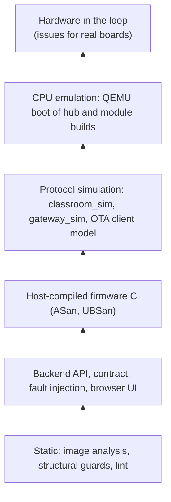

# Test strategy

How imPress is tested, what each layer can and can't catch, and the rules every new test follows. For running the suites, see the [testing guide](../guides/testing.md). For what has and hasn't been run on real boards, see [hardware validation](HARDWARE_VALIDATION.md).

## Layers




| Layer | Where | Runs on | Catches | Can't catch |
|---|---|---|---|---|
| Host C tests | `firmware/*/test_host` | gcc/clang with ASan + UBSan | logic bugs in pure firmware code (SPI slot codec, FIFO, mesh dedup, config overlay, OTA offer parsing, student set), memory errors, undefined behaviour | anything needing ESP-IDF drivers, radios or timing |
| Firmware structural | `firmware/tests` | Python, no compiler | ordering and safety rules in driver code (verify before boot, no flash write before the HTTP status check, mark-valid only when healthy), firmware ↔ backend name agreement (heartbeat fields, reset reasons, partition sizes) | whether the code runs correctly |
| ESP-IDF builds | CI `firmware-build`, `run_tests.py --with-idf` | ESP-IDF v6.1 (pinned image) | compile and link errors, size regressions (`idf.py size` in the log) | runtime behaviour |
| Backend API | `backend/tests` | FastAPI `TestClient`, real SQLite file | every endpoint's contract, validation, access control, state machines, migrations | radio, SPI and real devices |
| Contract | `test_device_ws_contract.py` + `firmware/contract/device_ws_frames.json`, `test_c6_diagnostics.py`, `test_firmware_registry.py` | both sides read the same fixture or source | the backend and firmware drifting apart on a frame, field or constant | |
| End to end (simulated) | `test_e2e_quiz.py`, `test_e2e_ota.py` with `gateway_sim.Gateway` | backend API + WebSockets | whole flows: a quiz from CSV import to results; a staged OTA rollout to several rooms | real firmware: the simulator follows the firmware's documented behaviour, it isn't the firmware |
| Classroom simulation | `firmware/sim/classroom_sim.py`; `firmware/tests/test_classroom_sim.py`, `backend/tests/test_classroom_sim.py` | the firmware's protocol C code compiled for the host and called from Python (ctypes), seeded radio and SPI faults, then the real backend | frame and CRC handling, relay de-duplication, the 238-byte mesh budget, SPI record packing, hub queue limits, no double counting end to end; found #181 and #182 | the boards' timing, RF and power; board glue (buttons, radio driver, `msg_to_json`) is a Python model of the firmware, not the firmware |
| Fault injection | `test_fault_injection.py`, faults in `test_e2e_ota.py` | backend API | failed commits, lost responses, duplicate and racing deliveries, offline gateways, corrupt downloads, power loss mid-update, unhealthy images | physical faults (brown-out, flash wear, RF interference) |
| Browser UI | `ui_tests/` | Playwright + Chromium against a real server | pages render, forms validate, actions reach the API, live refresh; screenshots for review | visual design judgement |
| Install smoke | CI `install-smoke` | fresh runner | the documented install path works end to end (#42) | other operating systems |
| Repository and CI | `tests/` | Python | CI wiring, pinned actions, lockfiles, docs links, script hygiene | |

## Coverage

- **Backend line coverage:** 88.0 %, measured locally on 2026-10-08 (`run_tests.py -s backend --coverage`, 379 tests). CI measures it on every run and uploads `coverage-backend.xml`.
- **Firmware:** line coverage isn't measured. The host tests cover the pure modules; the rest is covered by structural rules and pending hardware runs.

## Rules for new tests

1. **Test behaviour through the API.** Touch the database only to create states the API can't produce (time passing, a crashed process) or to check stored rows.
2. **Never block forever.** WebSocket tests broadcast a marker after the action and read until it arrives. Never `sleep` waiting for something to happen.
3. **Prove the test can fail.** For a non-trivial test, break the code it guards once (a mutation) and watch it fail before trusting it.
4. **One source of truth across the boundary.** When firmware and backend must agree, the test reads both (the frame fixture, `schemas.py`, `partitions.csv`, `health.py`) instead of copying a value.
5. **Fix flakiness, don't retry it.** A test that fails intermittently is a bug in the test or the code. Find the race.
6. **Simulation is not hardware.** A passing simulated test never counts as hardware verification. Hardware results go in [hardware validation](HARDWARE_VALIDATION.md) with the board, firmware version and date.

## Faults covered

| Fault | Expected behaviour | Test |
|---|---|---|
| Database commit fails (locked, I/O) during a batch | 503, nothing stored, the gateway keeps the batch and its retry stores it once | `test_fault_injection.py` |
| The gateway resends a batch whose 200 was lost | duplicates skipped, nothing double-counted | `test_fault_injection.py` |
| Two copies of a batch race | one answer stored; the loser gets 200 or 503, and its retry is skipped | `test_fault_injection.py` |
| The gateway goes offline with answers buffered | health `OFFLINE`; the answers count if the quiz is still open, and are skipped if it closed | `test_fault_injection.py` |
| A malformed batch | 4xx, so the gateway drops it instead of retrying forever | `test_fault_injection.py` |
| The same press arrives over two mesh paths | stored and broadcast once | `test_e2e_quiz.py`, `test_device_batch_dedup.py` |
| A corrupt firmware download | the device refuses it (SHA-256 mismatch), the engine retries | `test_e2e_ota.py` |
| Power loss mid-install | the target times out, is retried, and the old image keeps running | `test_e2e_ota.py` |
| The new image fails its health check | `rolled_back`, the version is unchanged, health `ERROR`, the rollout pauses | `test_e2e_ota.py` |
| A backend restart during a rollout | running deployments resume | `test_deployments.py` |
| An invalid or corrupt firmware upload | refused with the reason, nothing stored | `test_firmware_registry.py` |
| A migration step fails | its DDL rolls back and startup stops with instructions | `test_migrations.py` |
| A CSV import fails mid-commit | nothing imported | `test_question_import.py`, `test_class_import.py` |

## Simulation levels

The words matter: each level proves something different, and only the last one proves hardware behaviour.

| Level | What actually runs | In imPress |
|---|---|---|
| Static binary inspection | nothing runs; the image's bytes are parsed | TrustedInstaller analysis (`services/qualification.py`): header, chip, segments, digest, signature, slot size |
| Host-compiled firmware logic | the firmware's pure C files, compiled for the build machine | `firmware/*/test_host` (ASan/UBSan) and the classroom simulator |
| Protocol-level simulation | models of each board exchanging real frames | `firmware/sim/classroom_sim.py`, `backend/tests/gateway_sim.py`, the TrustedInstaller's OTA-client stage |
| CPU-level emulation | a compiled firmware image executing on an emulated CPU | CI "Emulator boot test": Espressif QEMU boots the hub (ESP32-S3) and module (ESP32) emulator builds of every source revision. QEMU has no ESP32-C6 target; the production images are not booted (see #176) |
| Hardware in the loop | the release image on real boards | the hardware issues in [hardware validation](HARDWARE_VALIDATION.md); nothing else counts as hardware verification |

Run the classroom simulator yourself:

```bash
python firmware/sim/classroom_sim.py --students 300 --seed 7 --loss 0.05 --duplicate 0.3 --corrupt 0.02 --reorder 0.2 --spi-corrupt 0.01
```

It prints a JSON report with the seed, what the radio lost, duplicated and corrupted, what the hub accepted and dropped, what reached the gateway's batch, and the SHA-256 of the protocol sources it ran. The same seed always gives the same report.

## What is not covered

Everything that needs a board: radio delivery and range, the SPI link at speed, real flash writes and reboots, reset reasons, power, heat and timing. These are listed with procedures in [hardware validation](HARDWARE_VALIDATION.md). Each check has a test issue, tracked in [#94](https://github.com/Kush-Kelaiya22/imPress/issues/94).
